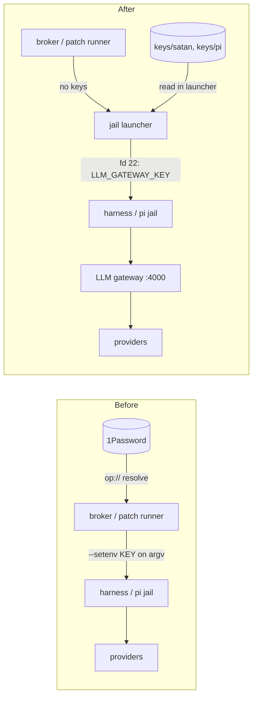
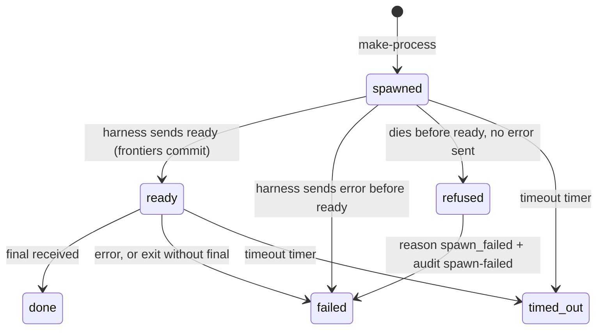

<!-- doctrine:section sec-1 -->
# What changes, and why

SATAN still handles plaintext LLM provider keys. The broker resolves `op://`
references through 1Password (`satan-credential.el`, with a backend in the
Emacs config), puts the key into the child's environment, and the jail
forwards it with `--setenv NAME "$NAME"`. The key then appears on bwrap's
argv, readable in `/proc/<pid>/cmdline`. The patch path does the same for
`jailed-pi`, and the `satan-patcher` daemon resolves its own two keys. ISS-029
records the argv leak, and records a second gap: the per-run token ceiling
`SATAN_MAX_BUDGET_TOKENS` never reaches the harness jail, so the harness's
hard stop reads 0 and never fires.

The host now runs an **LLM gateway** (flakes:SL-011): a LiteLLM proxy on
`127.0.0.1:4000` that holds the provider keys itself. Each client gets its own
gateway key, a 0600 file at `~/.config/llm-gateway/keys/<client>`, with a
model list and a USD budget. flakes:SL-013 taught the shared jail builder
(`agents.lib.mkJailedAgents`) a **gateway mode**. A jail built with
`gateway = jailLib.gatewayClient "<client>"` reads its key file in the
launcher and hands it to the jail on file descriptor 22 as `LLM_GATEWAY_KEY`,
never on argv. It also sets `LLM_GATEWAY_URL`, and selects no provider keys.

This slice moves every SATAN jail onto that mode and deletes the key-handling
code it makes redundant. Afterwards **no SATAN process holds, resolves or
forwards a provider key.** The boundary is the jail launcher: SATAN asks for a
jail, and the launcher (owned by `~/flakes/agents`) joins it to the gateway.



The picture shows where the key lives. Before, it passes through SATAN.
After, only the launcher and the gateway touch it.

The slice implements flakes:IMP-030 and closes ISS-029's criteria 3 and 4 for
`~/dev/satan` (REQ-016; for the harness specifically, SPEC-003 REQ-025). It
does not touch Emacs's in-process LLM clients (gptel, minuet, unjailed eca),
which belong to emacs:SL-015. The two slices meet only at the gateway, and at
the `env.zsh` key exports, which SL-015 retires once this slice lands.

<!-- doctrine:section sec-2 -->
# Jails, keys and the flake check

## Two gateway clients

| client (key file) | jails | why |
|---|---|---|
| `satan` | `satan-jailed-gptel-harness` | the broker-driven harness; its own budget and spend line |
| `pi` | `jailed-pi`, `jailed-pi-research`, `jailed-shell`, `jailed-claude` | every pi jail shares one pi home, so one key; SL-022 OQ-1, "one key for satan, one for pi" |

`SATAN-jailed-fake-harness` stays `offline`: it needs no model.
`jailed-claude` signs in by OAuth, but it must be able to run pi agents
(for example, research agents) as subagents. So it matches the emacs flake:
`subagents = ["pi" "claude"]` and the `pi` gateway. A nested pi is
`exec`'d inside claude's jail rather than re-jailed. It inherits the parent's
gateway env and gets the generated `models.json` bind, because pi is among
the jail's subagents. `maxSubagentDepth = 2`, as on `jailed-pi`, so a pi
started by claude can start its own subagent. Two costs come with this (user
direction, 2026-10-18):

- claude's own process can read the pi key;
- `jailed-claude` will not start while the gateway is down or `keys/pi` is
  missing.

Deleted, per SL-022 OQ-5 ("delete the unused opencode and dirge jails"):
`jailed-opencode`, `jailed-dirge`, and `"dirge"` in every `subagents` list.

Gateway budgets are **deployment-side insurance** against runaway spend
(DEC-043). They are tuned with generous headroom and are not SATAN policy.
SATAN's daily token budget (`satan-budget-daily-tokens`) and per-run maximum
(`SATAN_MAX_BUDGET_TOKENS`) remain the authoritative ceilings, and the
ADR-017 ledger does not list the gateway caps. The `satan` key is issued for
`deepseek-flash` only, with a $20 lifetime budget (DEC-048). Typical use is
about 0.5M tokens a day.

## `flake.nix` shape

This copies the emacs flake (commit 069e9b6) and the flakes template:

```nix
piGateway = jailLib.gatewayClient "pi";
satanGateway = jailLib.gatewayClient "satan";

# satanGptelJailOptions: SATAN_* only — no provider key forwards
satanGptelJailOptions = satanJailOptions ++ (with jailLib.combinators; [
  (try-fwd-env "SATAN_MODEL")
  (try-fwd-env "SATAN_BUDGET_TOKENS")
  (try-fwd-env "SATAN_MAX_BUDGET_TOKENS")
]);

jailed-pi = jailLib.makeJailedPi {
  profile = "specDev";
  allowSelfAsSubagent = true;
  maxSubagentDepth = 2;
  subagents = ["pi" "claude"];
  extraPkgs = projectPkgs;
  extraOptions = jailEnvOptions;
  gateway = piGateway;
  inherit workspaceDeps;
};

satan-jailed-gptel-harness = jailLib.makeJailedAgent {
  name = "satan-gptel-harness";
  agent = satanGptelHarness;
  profile = "specDev";
  extraOptions = satanGptelJailOptions;
  gateway = satanGateway;
  workspaceDeps = [];
};
```

```nix
jailed-claude = jailLib.makeJailedClaude {
  profile = "specDev";
  subagents = ["pi" "claude"];   # pi agents run nested on the pi gateway
  maxSubagentDepth = 2;
  extraPkgs = projectPkgs;
  extraOptions = jailEnvOptions;
  gateway = piGateway;
  inherit workspaceDeps;
};
```

Every `useOpEnv = false; passApiKeysFromEnv = true;` pair goes, along with its
comment about pre-resolved keys.

`apiKeyJailOptions` is deleted. It forwarded `OPENROUTER_API_KEY` and re-bound
`/usr/bin/env`, which the base profile already binds. `jailEnvOptions` and
`jailed-pi-research` drop it from their lists.

`SATAN_PROVIDER` is no longer forwarded (see "Harness"). The `try-fwd-env`
form is still on argv, which is acceptable for these values: they are not
secrets.

`agents` must be locked at a rev that has `gatewayClient`. That is ≥ a24a0f03
(the current lock, cfda05a5, predates it). `jailLib.gatewayClient` is an
attribute of the `mkJailedAgents {}` result, not of `agents.lib`.

## The flake check (DEC-046)

REQ-025 requires the harness env-forward list to be asserted against the
**built** wrapper. Today `flake.nix` has no `checks` output, and `just check`
runs no Nix. This slice adds `checks.<system>.harness-jail-profile` (Linux
only): a `runCommand` that reads the built outer and inner launchers of
`satan-jailed-gptel-harness`, using the idiom in
`~/flakes/agents/jailed-agents-test.nix` (`gateway_probes`).

- The outer launcher contains no `op run`.
- The inner launcher:
  - contains no `API_KEY`;
  - contains `--args 22 22< <(printf`;
  - contains `--setenv LLM_GATEWAY_KEY "$(<`;
  - contains `--setenv LLM_GATEWAY_URL`.
- With the `<(printf …)` substitutions stripped, `LLM_GATEWAY_KEY` does not
  appear (it is not on argv).
- `SATAN_MODEL`, `SATAN_BUDGET_TOKENS` and `SATAN_MAX_BUDGET_TOKENS` are
  forwarded. `SATAN_PROVIDER` is absent.

The probe strings (`op run`, `API_KEY`) are kept in one `let`-bound list in
`flake.nix`, so the closure sweep (invariant I1, under "Invariants") can
exclude that one binding by name.

A `just check-jails` recipe builds it (`nix build .#checks.x86_64-linux.harness-jail-profile`).
`just check` stays Nix-free. The check is the place ISS-028 later extends with
bind-list assertions (REQ-025 criteria 1–3).

<!-- doctrine:section sec-3 -->
# Harness: one endpoint, model by alias

**Current.**
- `satan/harness/providers/__init__.py` holds a registry that maps
  `SATAN_PROVIDER` (`openrouter` by default, or `deepseek`) to a subclass of
  `OpenAICompatibleProvider` plus the name of a key variable.
- The subclasses (`deepseek.py`, `openrouter.py`) carry nothing but a
  `base_url`.
- `build_provider` reads the key, refuses an unresolved `op://` value, and
  returns `cls(key)`.

**Target (DEC-044).** The gateway is OpenAI-compatible and routes by model
alias: `deepseek-flash` today, `<provider>/<upstream id>` aliases once
flakes:IMP-029 lands. Selecting a provider therefore collapses into selecting
the model, and the harness has a single endpoint:

```python
def build_provider() -> tuple[Provider, str]:
    model = _required("SATAN_MODEL")
    url = _required("LLM_GATEWAY_URL")
    key = _required("LLM_GATEWAY_KEY")
    return OpenAICompatibleProvider(key, base_url=url), model

def _required(var: str) -> str:
    value = os.environ.get(var) or ""
    if not value:
        raise RuntimeError(f"{var} not set")
    return value
```

Deleted:
- `deepseek.py` and `openrouter.py`;
- the registry and `SATAN_PROVIDER`;
- the `op://` check. The gateway key comes from a file, so there is no
  reference left to leak.

`OpenAICompatibleProvider` keeps its class-level `base_url` default of `""`
and its constructor check. The `__main__.py` env docstring lists
`LLM_GATEWAY_URL` and `LLM_GATEWAY_KEY` in place of the provider variables.

In elisp, `satan-profiles` becomes `((deepseek-flash . (:model "deepseek-flash")))`,
and the broker stops emitting `SATAN_PROVIDER`. `:model` is the one policy
field, and it stays in the mode table (ADR-018 D2).

`reasoning_content` handling is unchanged. A live probe on 2026-10-18
confirmed that the gateway returns it, and accepts it echoed back on an
assistant turn. The harness sends no reasoning-effort parameter. If it ever
does, it uses the flat OpenAI `reasoning_effort` field, the client convention
shared with emacs:SL-015, which the gateway translates per provider.

## Error classes at the gateway (DEC-045)

`classify_error` (`runloop.py`) maps a failed call to the closed set of
error classes (SPEC-003 REQ-024). Behind the gateway it must cover these
responses:

| gateway response | today | target |
|---|---|---|
| bad or revoked key: 401 | `auth` | `auth` (unchanged) |
| key budget exhausted: 429, error type `budget_exceeded` ("Budget has been exceeded!", LiteLLM 1.102) | `rate_limit` | `credits` |
| model not on the key's list: 403, "not allowed to access model" | `unknown` | `auth` |
| request timed out (openai `APITimeoutError`) | `timeout` | `timeout` (unchanged) |
| gateway unreachable mid-run (openai `APIConnectionError`) | `unknown` | `server` |

Rules, in order, before the existing status-code branches:

1. `getattr(e, "type", None) == "budget_exceeded"` → `credits`. The openai
   SDK unwraps the error body and sets `.type`, so nothing reaches into
   `e.body`.
2. A 403 whose message says `not allowed to access model` → `auth`. It is a
   key-configuration fault that needs a human. `auth` always notifies, which
   is right for that. A plain 403 keeps today's path: an OpenRouter
   moderation 403 still falls through to the message match.
3. An exception whose class or any base class is named `APITimeoutError` →
   `timeout`. It must come before rule 4, because the SDK defines
   `APITimeoutError` as a subclass of `APIConnectionError`.
4. An exception whose class or any base class is named `APIConnectionError`
   → `server`. It is transient, like a 5xx.

Rules 3 and 4 match on class names along the exception's MRO
(`{c.__name__ for c in type(e).__mro__}`), not with `isinstance`. That keeps
`runloop.py` free of an `openai` import. The harness tests run under the
devshell's plain `python3`, which has no openai package, and inject a fake
SDK only around `build_provider`.

A tripped insurance cap is an out-of-money incident, not throttling.
`credits` is already the class for that.

The SDK retries a 429 twice by default (`max_retries = 2`). So an exhausted
budget costs two extra round trips to the gateway before the harness
classifies it. Those calls are refused by the gateway and cost nothing. The
retry default is left alone.

<!-- doctrine:section sec-4 -->
# Broker: no key resolution, typed launcher refusal, frontiers commit on ready

## What goes (DEC-042)

The broker's credential machinery came from slice SL-018. In
`satan-broker.el`:

- `satan-broker-provider-key-vars` and `--key-var`.
- `--acquire`, and with it the `cred` value threaded into `--spawn`. The new
  signature is `satan-broker--spawn (mode prepare dir)`. The child env is
  `(default-value 'process-environment)` plus the `SATAN_*` values.
- `--credential-policy`, `--credential-streak-age` and the defcustom
  `satan-credential-escalate-after`.
- The pre-allocation gate arms for `:deferred` and `:unavailable`, and
  `--write-credential-deferred-run`.
- The "busy" arm stays, and now tests only `satan-run--spawn-running`.
- `--evict-on-auth`, together with its call in `--finalize` and the
  `credential-refs` slot of `satan-run`.
- `satan-credential-scrub` around the child env. Jails start from `env -i`
  and receive only explicit forwards. So no `op://` reference in the Emacs env
  can reach a **jailed** child. The launcher process outside the jail still
  inherits that env until emacs:SL-015 retires the `env.zsh` exports.
- `"credential_deferred"` in `satan-broker--streak-transparent-reasons`. A
  transparent reason is stepped over by the failure-streak walk. Once it is
  removed, a historic `credential_deferred` run counts as a different cause
  and ends any streak that spans it. Streaks only pace failure
  notifications, and such runs stop appearing on the day this lands, so that
  is accepted.

Elsewhere:

- `satan-mode.el` loses `--check-credential-keys` and the
  `:credential-policy 'prompt` lines on `morning` and `motd`.
- `satan-credential.el`, its test and its fixture are deleted. So are
  `dev/satan-test.el`'s `require` of it, its backend binding and its scrub.
  No test depends on `op://` refs being absent from the env: nothing reads
  `*_API_KEY` any more.

## A refused launch (DEC-041)

Under gateway mode the jail launcher can refuse before the harness starts:

- the key file is missing, empty or unreadable;
- the gateway is down.

Either way it prints a few lines to stderr and exits 1. Today such a child
finalises as an untyped `failed`, and the reason lives only in
`<run>/stderr.log`.

The general rule is: **a child that dies before sending `ready`, without
having sent an `error` message, is `spawn_failed`.** That covers a launcher
refusal, and also these:

- a bwrap or jail prelude failure;
- a Python import-time crash (the harness's own `try` covers only `run()`);
- an external kill.

None of these ran the model, so `spawn_failed` is the honest class for all of
them. A harness that fails while initialising after it has started sends
`error` first. `--on-error` then sets the status to `failed` with its own
class, so this rule does not apply to it.



The diagram shows every way a spawned child can end. `refused` and the
frontier commit on `ready` are new. The other edges exist today.

Mechanism:

- A new `satan-run` slot, `ready`, replaces `credential-refs`. The `"ready"`
  arm of `satan-broker--dispatch` sets it the first time, and commits the
  frontiers then. See "Frontiers commit on `ready`".
- The sentinel wrapper in `--spawn` owns `stderr-buf`. Before it calls the
  inner sentinel, it checks three things:
  - the process has ended;
  - the run is not `ready`;
  - the status is still `running`.

  If all three hold, it calls
  `satan-broker--record-launch-refusal (run-ctx process-status code stderr)`.
- That function:
  - appends the audit event `broker spawn-failed` with
    `(:process-status exit|signal :code N :stderr TAIL)`;
  - sets `failure-reason` to `"spawn_failed"` (first write wins, as today).
- The ordinary `--finalize` then closes the run as `failed` and announces it
  on the normal failure path.
- `TAIL` is the last 2 KiB of stderr, cut by the pure helper
  `satan-broker--stderr-tail (text max-bytes)`. Launcher output names the key
  file's path, never its content.

The broker never reads a key file or a gateway path. It reads only what the
launcher printed (SPEC-002 REQ-018). Two consequences:

- A key failure now **allocates** a run: a child that died, where SL-018
  recorded a run that never had a child. That supersedes DEC-020. The run is
  still denied, typed and audited, which is the run-audit requirement
  (SPEC-001 REQ-003) and SPEC-003's "Failure at spawn" concern.
- The tick trace still records the tick as `spawned`. The outcome is stamped
  synchronously, before the sentinel learns of the refusal. The run's status
  and audit are the record of the refusal. Re-stamping a closed tick is not
  worth the machinery.

## Frontiers commit on `ready`

Today `--spawn` commits the perception frontiers before `make-process`:

- the curiosity, content and WPM probe watermarks;
- `satan-ingest-cursor-advance`.

That relies on the invariant "no denied tick advances any frontier", which
held because every denial returned before `--spawn` (`satan-broker.el:905-911`).
A launcher refusal is a denial that happens after `--spawn`, so it would
consume signals for a model that never ran.

The commits therefore move into a new `satan-broker--commit-frontiers
(run-ctx)`, called from the `"ready"` arm of `--dispatch`. Every commit
writes what was **perceived**, not what is current:

- The probe commits already work this way: each commits the snapshot it took
  at perceive (`:probe_snapshots` on `prepare`).
- The ingest cursor does not. `satan-ingest-cursor-advance` reads each
  source's live head when it is called. Called at `ready`, that is after
  bundle assembly and process start-up, so rows that arrive during the
  launch would be skipped unseen.

  So perceive also snapshots the heads, with a new pure read
  `satan-ingest-cursor-heads` that returns `(:focus H :browser H :content H)`.
  It stores them under `:probe_snapshots :ingest`. The advance takes them:
  `satan-ingest-cursor-advance (&optional heads)` writes
  `max(current, snapshot)` per source. Without an argument it keeps today's
  read-head behaviour for its other callers.

Each commit keeps its `condition-case` soft-fail.

**Once only.** The `"ready"` arm sets the `ready` slot and calls
`--commit-frontiers` only when the slot was nil. A second `ready` from a
misbehaving harness records its audit event and nothing else. Without the
guard it would advance watermarks twice and enqueue attribute payloads
twice.

The pre-spawn steps that **feed the bundle** stay before `make-process`:

- the observer pass;
- `satan-run-enrich`;
- the sensor-alert check.

A child that dies after `ready` has consumed its frontiers. The model ran, as
it does today.

<!-- doctrine:section sec-5 -->
# Patch path and the satan-patcher daemon

The patch path gets the minimum. That follows SL-022 OQ-1 (the patcher
barely works, and its replacement is being built under IDE-007).

## Elisp patch runner and adapter

- `satan-patch-adapter-pi-api-key-vars` is deleted, along with its
  docstring about `useOpEnv`.
- The adapter's `:env` input is deleted too. Only the runner's credential
  resolve ever set it, and it was never in the adapter's INPUT contract
  (`satan-patch-adapter.el`). The child env becomes `process-environment`,
  with no scrub.
- In the runner:
  - `--queue-ready-p` keeps its peek, but loses the credential probe and the
    `credential_deferred patch` journal line;
  - the post-claim `satan-credential-resolve` call goes;
  - `--credential-warnings` and `--with-warnings` go too. Their only job was
    to attach credential warnings to a finished job.
- `satan-patch-runner-enabled` stays as the disable switch (POL-001).
- The pi model comes from the shared jail home's `settings.json`, which is
  already `llm-gateway/deepseek-flash`. The runner passes no `--provider`.

## The daemon (`~/flakes/features/satan/patcher.nix`, other repo)

- `apiKeyRefs`, `opBin` and `opAccount` are dropped. The module's defaults
  are lazy, so leaving them unset is safe.
- The daemon runs whatever `jailed-pi` is on its unit PATH. It builds satan's
  flake only when a repo carries `.satan-patch.toml`, and none does. Whether
  that `jailed-pi` resolves at all is the subject of ISS-038 and ISS-039; it
  is not fixed here.
- Its untracked `~/.config/satan-patcher/policy.toml` changes in two places:
  - `[defaults]` goes from `provider = "openrouter"` and
    `model = "deepseek/deepseek-v4-flash"` to `provider = "llm-gateway"` and
    `model = "deepseek-flash"`;
  - the `[tag."cheap+code"]` override (`qwen/qwen-2.5-coder-32b-instruct`) is
    removed. The gateway does not serve that model, and pi has no gateway
    entry for it, so tagged jobs fall back to the defaults.
- The Go daemon's hardcoded `apiKeyVars` list becomes dead code in another
  repo (sloptower). It is not touched.

<!-- doctrine:section sec-6 -->
# Across repos: order and ownership

Three repos and two host files move. Each component's provenance decides the
order (DEC-048):

| component | built from |
|---|---|
| broker, patch runner (elisp) | `~/dev/satan` directly. Emacs loads the checkout (`dl-path.el`), so it picks up a change on its next load of satan. |
| deployed harness and `jailed-*` on PATH | flakes' **locked** `satan` input, plus flakes' in-tree `agents`. `home-switch` overrides `agents` with the local tree, but not `satan`. |
| dev jails in `~/dev/satan` | the satan flake under direnv, with live `~/flakes/agents` |

Two facts follow:
- **The new harness works with the old broker.** The old broker sends
  `SATAN_PROVIDER` and a resolved key in its env. The new launcher forwards
  neither and supplies the gateway pair, and the new harness ignores
  `SATAN_PROVIDER`.
- **The old harness fails with the new broker.** It defaults to OpenRouter
  and finds no key, or finds an unresolved `op://` ref.

So the deployed harness must change **before** Emacs loads the new satan.

```mermaid
sequenceDiagram
  participant H as host keys + policy
  participant S as ~/dev/satan
  participant F as ~/flakes
  participant X as running Emacs
  participant E as ~/.config/emacs
  H->>H: issue the satan gateway key
  S->>S: land code, tests, flake check; re-lock agents; push
  Note over X: keeps the old broker loaded: do not reload satan yet
  F->>F: update the satan and agents locks; patcher module; SATAN.md; home-switch
  Note over X: old broker + new harness works
  H->>H: patcher policy defaults to the gateway model
  X->>X: restart Emacs (loads new satan)
  E->>E: drop the satan credential backend
```

The diagram's point is that the running Emacs stays on the old broker until
`home-switch` has installed the new harness. Old and new satan code cannot
load side by side, because `satan.el` and `satan-patch.el` require every
module eagerly. So the window is a matter of discipline: if Emacs crashes or
restarts between the satan push and `home-switch`, ticks fail until the
switch. Keep that gap short.

- **Order of the last two steps.** The emacs edit comes after the restart.
  Removing `satan-credential-function` while the old broker is still loaded
  would fail its key reads. Setting it once the new satan no longer defines
  it is harmless.
- **The flakes `agents` lock.** `home-switch` builds `agents` from the local
  tree whatever the lock says. Updating the lock is hygiene, needed only for
  evaluations without the override. What actually reaches PATH is
  flakes' working-tree `agents`. The flake check in `~/dev/satan` asserts the
  satan-locked build. A manual probe of the deployed launcher therefore
  closes that gap (see "What the tests cannot cover").
- **Dev jails.** Jails built under direnv in `~/dev/satan` move on the next
  reload after the satan change. This is independent of the sequence above.

| concern | owner |
|---|---|
| satan jails, harness, broker, patch path, `satan-credential.el` | SL-022 |
| satan credential backend in emacs (`dl-satan.el`, `dl-secret.el`) | SL-022 (DEC-042) |
| flakes `patcher.nix`, `flake.lock`, `SATAN.md` | SL-022 |
| gptel, minuet, unjailed eca, `dl-llm-gateway.el`, `my/op-key` (emacs) | emacs:SL-015 |
| the `env.zsh` `*_API_KEY` exports | emacs:SL-015, after SL-022 lands |
| reasoning-effort wire convention (flat `reasoning_effort`) | the gateway (flakes); both slices follow it |
| launcher hint names the jail, not the gateway client | flakes backlog (cosmetic) |

<!-- doctrine:section sec-7 -->
# Invariants and key test cases

## Invariants

- **I1. No SATAN process holds a provider key.** No elisp or Python in
  `~/dev/satan` names an `*_API_KEY` variable, an `op://` reference, `op run`
  or `satan-credential`. This is the cutover under ADR-017 §3, with no
  fallback path left. Closure sweep:
  `rg '_API_KEY|op://|op run|satan-credential' satan/ dev/ flake.nix`. Its only
  hits are the flake check's named probe-string binding.
- **I2. The gateway key never appears on argv** (REQ-016 criterion 3,
  REQ-025 criterion 4). The flake check asserts it.
- **I3. Broker ceilings reach the jail** (REQ-016 criterion 4, REQ-025
  criterion 5). `SATAN_MAX_BUDGET_TOKENS` is forwarded, the flake check
  asserts it, and `runloop.py` reads it.
- **I4. A child that dies before `ready` without an error message is a typed
  `spawn_failed` run** with a `broker spawn-failed` audit event (SPEC-001
  REQ-003; SPEC-003 "Failure at spawn"). It is never an untyped `failed`.
- **I5. Frontiers advance only for a child that reached `ready`.** That
  restores "no denied tick advances any frontier" for denials that happen
  after `--spawn`.
- **I6. The broker knows no host fact** (SPEC-002 REQ-018). No key path,
  gateway URL or socket path appears in satan elisp or Python.

## Key test cases

**Harness** (`test_gptel_harness.py`)
- `ProviderFactoryTests`:
  - a gateway URL and key give a provider whose `FakeOpenAI` saw that
    `base_url` and `api_key`;
  - a missing `SATAN_MODEL`, `LLM_GATEWAY_URL` or `LLM_GATEWAY_KEY` each
    raise "<VAR> not set";
  - a stray `SATAN_PROVIDER` is ignored.
- `classify_error`:
  - an error whose `.type` is `budget_exceeded` (status 429) is `credits`;
  - a 403 "not allowed to access model" is `auth`;
  - a fake `APIConnectionError` subclass is `server`, and a fake
    `APITimeoutError(APIConnectionError)` is `timeout`, both without
    importing openai;
  - a plain 429 is still `rate_limit`, and a 401 is still `auth`.
- The run tests drop their `SATAN_PROVIDER` / `OPENROUTER_API_KEY` fixtures
  and set `SATAN_MODEL` with a stub provider.

**Broker** (ert)
- A stub `:cmd` that prints to stderr and exits 1 before `ready` ends
  `failed`. Its `failure_reason` is `spawn_failed`. The audit holds a
  `spawn-failed` event with `:process-status exit`, `:code 1` and the stderr
  text. The probe watermarks and the ingest cursor are unchanged.
- A stub that sends `error` before `ready` keeps the harness's error class,
  not `spawn_failed`.
- A stub that sends `ready` then exits without `final` is a plain `failed`,
  and its frontiers have advanced.
- A second `ready` message commits nothing: the watermarks and the attribute
  enqueue count are unchanged.
- `satan-ingest-cursor-advance` given a heads snapshot writes
  `max(current, snapshot)` and ignores newer live heads.
- `satan-broker--stderr-tail` returns the last N bytes, or the whole string
  when it is shorter.
- The child env carries `SATAN_MODEL` and the budget values, and no
  `SATAN_PROVIDER`. This replaces SL-018's verification VT-20 ("child env is
  the base env plus the resolved key").
- `satan-broker-test.el`'s error-class fixture "OPENROUTER_API_KEY not set"
  becomes "LLM_GATEWAY_KEY not set".
- Deleted with the code they cover:
  - the credential gate tests (defer mode, prompt mode, key ref from the
    global env, policy failure);
  - the key-rotation and eviction tests;
  - the `satan-mode` credential-key tests;
  - the `satan-broker-test--no-cred` helper.

**Patch runner** (ert)
- A ready queue claims and runs a job with no credential backend bound.
- The adapter's child env is `process-environment`.
- Deleted: the credential tests (no session, resolved keys, a failing key
  warns, adapter failure keeps credential warnings, scrubbed child env).

**Nix:** `checks.<system>.harness-jail-profile`, run by `just check-jails` at
audit.

## What the tests cannot cover

These are manual checks (VH, verified by a human):
- **Deployed launcher.** Run the flake check's probes against
  `readlink -f ~/.nix-profile/bin/jailed-satan-gptel-harness`, the
  `home-switch` build rather than the satan-locked one.
- **A broker tick.** A morning or motd tick succeeds, and `llm-gateway list`
  shows spend on `satan`.
- **Argv.** `ps -o args` on a live harness shows no key.
- **Refusal.** With `keys/satan` moved aside, a tick ends `spawn_failed` with
  the launcher's message in the audit.
- **Patcher.** Best effort, given ISS-038 and ISS-039.
- **Emacs.** After the emacs edit and a restart, Emacs starts clean, with no
  void-variable or unknown-defcustom warnings for `satan-credential-function`.

<!-- doctrine:section sec-8 -->
# Code impact

| path | change |
|---|---|
| `flake.nix` | `piGateway` on pi, pi-research, shell, claude (claude gains `subagents = ["pi" "claude"]`); `satanGateway` on the harness; delete `apiKeyJailOptions`, opencode, dirge; `satanGptelJailOptions` per "Jails"; `checks.<system>.harness-jail-profile` with a named probe-string binding |
| `flake.lock` | `agents` ≥ a24a0f03 |
| `justfile` | `check-jails` recipe |
| `satan/harness/providers/__init__.py` | `build_provider` over the gateway env; registry gone |
| `satan/harness/providers/deepseek.py`, `openrouter.py` | deleted |
| `satan/harness/providers/base.py` | docstring only (names no providers) |
| `satan/harness/runloop.py` | `classify_error`: budget, model-access and connection rules |
| `satan/harness/__main__.py` | env docstring |
| `satan/harness/test_gptel_harness.py` | provider factory and classify tests; fixtures |
| `satan/satan-broker.el` | remove key vars, acquisition and `cred` (`--spawn (mode prepare dir)`), credential policy, deferred/unavailable arms, eviction, scrub, `SATAN_PROVIDER`, `credential_deferred` transparency; add `ready` handling, `--record-launch-refusal`, `--stderr-tail`, `--commit-frontiers` (probe commits and cursor advance move to `ready`) |
| `satan/satan-run.el` | slot `credential-refs` → `ready` |
| `satan/satan-context.el` | perceive snapshots ingest heads into `:probe_snapshots :ingest` |
| `satan/satan-ingest-cursor.el` (+ tests) | `satan-ingest-cursor-heads`; `advance` takes an optional heads snapshot |
| `satan/satan-mode.el` | profile without `:provider`; drop credential-key check and the morning/motd policy lines |
| `satan/satan-patch-adapter-pi.el` | drop key vars, `:env` input and scrub |
| `satan/satan-patch-runner.el` | drop credential gate, resolve, `--credential-warnings`, `--with-warnings` |
| `satan/satan-credential.el`, `satan/test/satan-credential-test.el`, `satan/test/satan-credential-fixture.el` | deleted |
| `dev/satan-test.el` | drop credential require, binding, scrub |
| `satan/test/satan-broker-test.el`, `satan-patch-runner-test.el`, `satan-mode-test.el` | per "Key test cases" |
| `docs/governance.md` (§ key resolution, providers, jails), `docs/patch/handover.md`, `docs/patch/plan.md`, `docs/architecture.md` | gateway story |
| `~/.config/emacs/apps/dl-satan.el`, `lisp/dl-secret.el`, `lisp/test/dl-secret-test.el` | drop `satan-credential-function`, `my/satan-credential` and its tests (emacs verification VT-26) |
| `~/flakes/features/satan/patcher.nix`, `~/flakes/flake.lock`, `~/flakes/SATAN.md` | drop key refs; re-lock `satan agents`; secrets and known-gaps text |
| `~/.config/satan-patcher/policy.toml` (untracked) | defaults → `llm-gateway` / `deepseek-flash`; remove the `cheap+code` tag |

<!-- doctrine:section sec-9 -->
# Governance follow-through

The design makes the following governing text stale. Each change is made at
reconcile through its owning surface, not in this design:

- **SPEC-003 (REV).**
  - The spawn contract's "key" row becomes "none: the jail launcher supplies
    `LLM_GATEWAY_KEY` by fd".
  - The model+budget row drops `SATAN_PROVIDER`.
  - REQ-020's premise (one base env shared with credential lookup) no longer
    holds. Retitle it, or withdraw it in favour of a jail-enforced env rule:
    the jail starts from `env -i`, but the launcher process outside it still
    inherits the Emacs env until emacs:SL-015 lands.
  - REQ-022: the harness reads its model, budgets and gateway pair from its
    env; there is no provider key.
  - REQ-025: the jail forwards "only the declared `SATAN_*` variables". The
    launcher sets `LLM_GATEWAY_URL` and passes `LLM_GATEWAY_KEY` by fd.
  - "Failure at spawn" concern: a child that dies before `ready` without an
    error message is `spawn_failed`, and frontiers commit on `ready`.
- **SPEC-002.**
  - The overview no longer says the editor supplies a credential backend.
  - The Transports table gains harness/pi → gateway.
  - The REQ-016 rationale gap list.
- **ADR-017 authority ledger.** Note that provider-credential custody left
  SATAN's inventory for the host gateway (DEC-049). There is no new row.
  Annotate RFC-018 D3 and D5 step 1.
- **Knowledge records.**
  - DEC-020, DEC-021 and DEC-022 are superseded by DEC-041 and DEC-042.
  - ASM-002 ("a read inside a live 1Password session never prompts") is
    retired.
  - ISS-023 (prompt-mode runs lost to the 1Password dialog) is closed as
    moot.
  - QUE-001's list of pre-spawn gates loses its `credential_*` gates.
- **ISS-029** closes for `~/dev/satan`. Its emacs flake citation was handled
  by flakes:SL-013. The `satan-attrd/flake.nix:66` forward has no owner and
  is split into a new backlog item.
- **REQ-016 and REQ-025** stay `pending`: criteria 1–3 belong to ISS-028.

