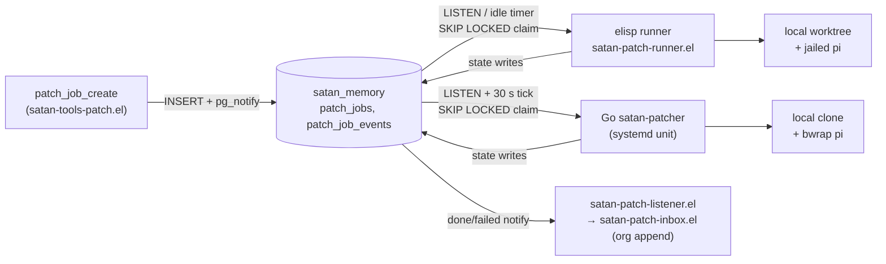
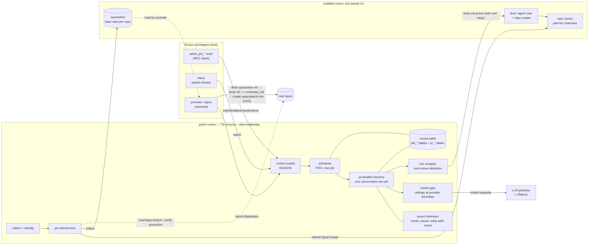
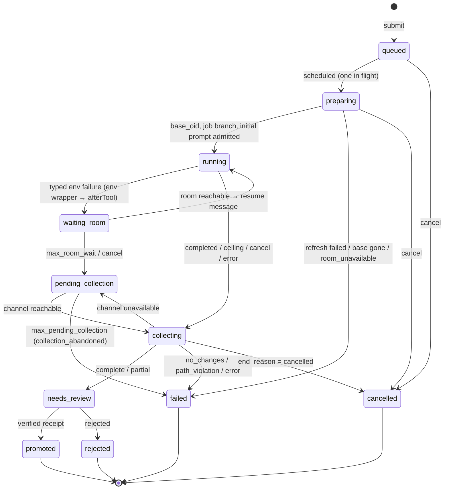
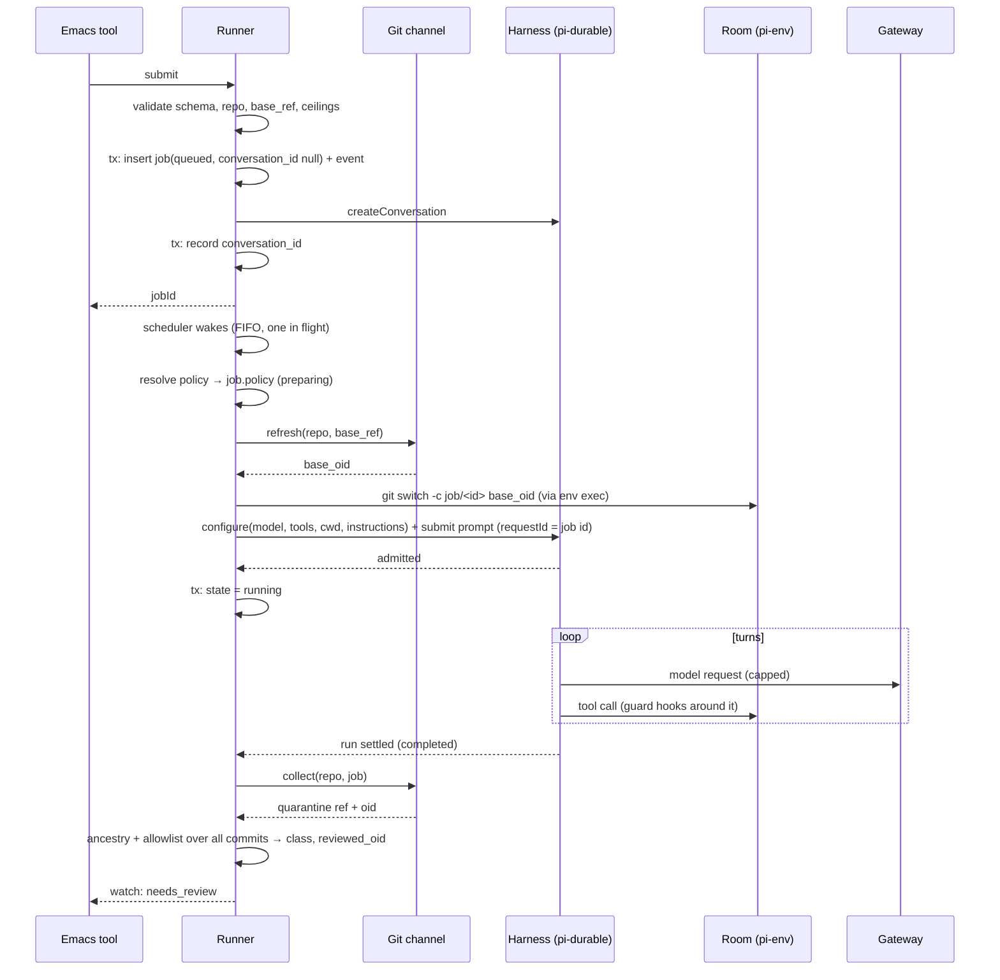
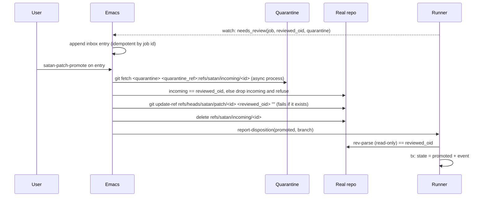
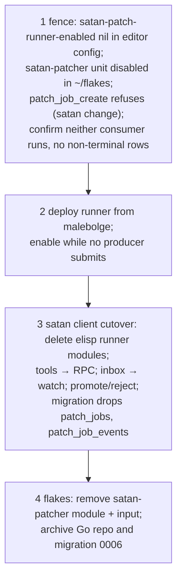

<!-- doctrine:section sec-1 -->
# 1. Design Problem

SATAN can ask for a code change: its `patch_job_create` tool queues a *patch
job* — a directive, a repo, a base branch and the paths the change may touch.
Something must then run a coding agent on that job, bring the resulting commits
back, and put them in front of the user, who decides whether they land.

Today nothing completes that loop. Two consumers read the same queue (the elisp
runner in `satan/satan-patch-*.el` and the Go `satan-patcher`), and neither has
ever finished a live job (ISS-030, ISS-038, ISS-039, ISS-041). Both were built
for a model this slice replaces: a local worktree or clone, with the agent
jailed on the host.

The new model is oubliette's *room*: a persistent microVM holding clones of the
user's repos, with no network egress and no git credentials. Work leaves it only
as git commits the host fetches into a per-repo *quarantine* (a host-side bare
repo). Oubliette stops the room routinely (its DEC-031), so a run must survive
the room going away under it.

This design introduces one new process, the **patch runner**: a TypeScript
daemon on the host, in `~/dev/malebolge`, that

- is the only consumer of patch jobs and the only owner of their state;
- runs each job as a durable agent conversation (pi-durable) on the host, whose
  coding tools execute inside the room through pi-env;
- enforces the job's path allowlist, spend ceilings and kill switch, and audits
  what it does, whether or not Emacs is running;
- collects the job's commits into quarantine, classifies them, and offers them
  for review.

Emacs keeps three things: the producer tool (a thin client that submits to the
runner), the inbox notice, and the human approval act that promotes reviewed
commits into the real repo as a branch. Both old runners are deleted, and the
`patch_jobs` tables leave Postgres.

**Boundary.** Inside this design: the runner, its control socket and store, the
Emacs client changes, the cutover, and the authority-ledger changes. Outside it:
the room, its door (ssh ingress) and git channel (oubliette, its SL-005); the
LLM gateway, its keys and budgets (`~/flakes` SL-011). Where the runner touches
the door — the room adapter, door configuration, the room's land verb — this
design defines a port and builds against an oubliette capsule *slot* standing in
for the room, on ASM-005 (`doctrine show ASM-005`: the door will be pinned as
oubliette's Plan F §5 sketches it). It does not design oubliette's side.

<!-- doctrine:section sec-10 -->
# 2. Current State



Purpose: show why the queue has two writers and two schema owners today.

**Producer.** `satan-tool/patch-job-create` (`satan/satan-tools-patch.el:83`)
validates arguments, defaults `base_ref` to `"HEAD"` (:97), inserts a row and
notifies. Sibling tools read status/result, cancel, and clean up worktrees.

**Elisp runner** (`satan-patch-{runner,worktree,adapter,adapter-pi,prompt,classify,store,listener}.el`,
~1.9k lines, 85 ert tests). Claims a row, prepares a local worktree, composes
the prompt, spawns jailed pi with an 1800 s timeout, checks changed files
against the allowlist, classifies, appends to the org inbox. Every psql and git
call is a synchronous `call-process` on Emacs's main thread. The in-flight job
lives only in memory, so an Emacs restart orphans it. `satan-patch-runner-enabled`
defaults off, but the editor config turns it on (ISS-039).

**Go `satan-patcher`** (`~/dev/satan-patcher`, ~5k lines, 92 tests). Same claim
query, a policy ladder (defaults → mode → tag → repo pin → row), prompt
composition, a pi JSONL classifier, crash reconcile of `running` rows. It owns
migration 0006 on `satan_memory`, making `patch_jobs` a two-owner table
(SPEC-002 REQ-013, RSK-015). All 17 recorded jobs failed. Known defects in the
Go code itself: adapter axis never dispatched, checks never run, a silently
skipped missing prompt file (CHR-003), the repo pin read from the host working
copy rather than the base ref.

**Contract skew.** `HEAD` works for `git worktree add` but not for Go's
`clone --branch` (ISS-041).

**Missing everywhere.** No SATAN-owned ceiling beyond the timeout (SPEC-001
REQ-004), no audit of patch-job actions (REQ-003), no promote command (the
`accepted_external` and `stale` states have no writer), and no owner for a run
outliving a VM stop.

**What exists to build on.** `~/dev/malebolge` (~750 lines TypeScript) hosts
interactive SATAN on pi-durable: SQLite store, NDJSON framing
(`src/ndjson.ts`), a unix-socket server (`src/unix-socket.ts`, `src/daemon.ts`),
model catalog wiring (`src/models.ts`), config from the environment
(`src/config.ts`), Biome + tsc + vitest behind `just check`. The option-D spike
(EVD-005) drove a capsule slot from a host pi-durable harness through pi-env
over the slot's relay: a killed tool connection failed one call, and the model
recovered and committed.

<!-- doctrine:section sec-11 -->
# 3. Forces & Constraints

**Binding governance** (confirmed for this run):

| Source | How it binds this design |
|---|---|
| POL-001 (extraction policy) | Queue, dispatch and quarantine fetch do not use the editor as an editor, so they leave elisp; the promotion surface stays. Cutover, never addition. Every extraction has a disable switch and holds its ceilings with Emacs absent. Ported test corpora become acceptance fixtures. Rust is the daemon target, with recorded workload-fit exceptions. |
| ADR-017 §1, §3, §4 | Emacs owns the human approval surfaces. Each authority item has exactly one owner, recorded in the ledger with a transition line (INV-1..3). A daemon fails closed when the client is absent. |
| ADR-018 D1, D3 (as amended 2026-10-18 by REV-006) | A component whose enforcement points are hooks inside a library that exists only in another language may live outside the daemon repo by workload fit, with one ledger owner per item. Postgres is the *shared* state store; process-private state may live in its own store. The control plane is UDS RPC; no new `pg_notify` control traffic. |
| ADR-018 D5 | No new stateful layer lands in elisp. |
| ADR-018 OQ-2 / OQ-3 | Open: the global RPC shape. The runner's socket is its own surface and does not front-run them. |
| SPEC-001 REQ-001, -003, -004, -005, -007, -009, -010 | Schema-validated actions; audit; ceilings; kill switch fails closed; request/response lifecycle; no dual enforcement; fail closed. |
| SPEC-002 REQ-013, REQ-016 | One schema owner per store. Every jail holding model output has a test-asserted profile with no protocol bypass (here: the runner socket path is never bound into a jail). |
| SPEC-003 OQ-3 | This slice decides the surviving runner and its spec (DEC-064). |
| DEC-043, DEC-049 | Gateway budgets are not SATAN ceilings. Provider-credential custody is not a ledger item. |
| oubliette DEC-031 | Room stops are routine and must be cheap; persistent state survives them. |

Checked and ruled out: ADR-001 (perception/cognition), ADR-002 (proposed, not
binding), RFC-017/RFC-018 (open — evidence), REQ-019..025 (harness-only).

**Technical forces.**

- pi-durable and pi-env exist only as Node libraries, are experimental, and
  change without notice. Versions are pinned (1.3.0 today).
- pi-durable allows one owning process per storage, with no cross-process
  locking. A tool interrupted by a process crash reruns only if declared
  `replay: "safe"`.
- pi-durable's hooks: `beforeTool` (block or rewrite arguments), `afterTool`
  (replace the result), `beforeRequest` (replace one request's messages — not
  its options), `afterResponse`, `onYield`, `afterTools`. Spend is tracked in
  `pi.usage`, including failed and aborted attempts; there is no built-in
  ceiling.
- `bash` in the room can write any path, so a per-tool-call check cannot be the
  authoritative path allowlist.
- The room has no egress and no credentials; the model call must happen on the
  host.
- Oubliette's door and room git channel are not designed yet (SL-005). A slot
  offers the same shape: ssh as an agent user through a relay, host-side collect
  into a bare quarantine.

<!-- doctrine:section sec-12 -->
# 4. Guiding Principles

1. **One owner, one enforcement site.** Every authority the runner exercises —
   job lifecycle, RPC validation, path allowlist, ceilings, audit, its own kill
   switch — is the runner's alone, recorded in the ledger. Emacs validates tool
   arguments for the model's sake only; it never restates a runner check.
2. **The runner never writes a real repo.** It reads real repos (to resolve a
   base branch, to verify a promotion) and writes only the room and quarantine,
   through the git-channel port. Promotion is a human act enacted in Emacs.
3. **Authoritative checks run on what actually travels.** The path allowlist and
   ancestry are checked on the collected commits, not on tool calls. Per-call
   checks are early feedback.
4. **Durable by construction, not by repair.** Job rows and transcripts share one
   SQLite file and commit together. Restart is "reopen and follow the recovery
   table", not reconcile-and-guess.
5. **Spend nothing while blocked.** A room outage pauses a job; it does not burn
   model turns on failing tool calls.
6. **Fail closed.** An unreachable runner fails the Emacs tools; an unreadable
   usage figure denies the next request; a disabled runner schedules nothing.
7. **Ports where the door is unknown.** Everything that depends on oubliette's
   unpinned room verbs sits behind a port with a slot-backed adapter, so SL-005
   swaps an adapter, not a design.
8. **Port logic, not code.** The policy ladder, prompt composition, allowlist
   semantics and classification move from the old runners as behaviour, pinned
   by their old tests turned acceptance fixtures.

<!-- doctrine:section sec-13 -->
# 5. Proposed Design

## 5.1 System Model



Purpose: who owns what, and which edges cross a trust boundary.

Non-obvious edges:

- **Model requests go host → gateway.** The room needs no model door and holds
  no key. The runner is a gateway client like the harness and malebolge's
  interactive daemon; per-job model choice comes from the policy ladder.
- **Tools reach the room only through pi-env.** pi-env runs a small daemon in
  the guest over ssh as the agent user, through the door's relay socket
  (`ProxyCommand` in a runner-owned ssh config, as EVD-005 proved on a slot).
  The guest sees tool arguments only; prompt, transcript and model output stay
  on the host.
- **The runner reads the real repos and never writes them.** Reads: resolve and
  validate `base_ref`, and verify a promotion. The only real-repo write is
  Emacs's promotion fetch.
- **Promotion does not touch the socket.** Emacs fetches from quarantine itself,
  then reports a disposition the runner verifies (DEC-061, DEC-058).

**Ownership by party.**

| Party | Owns |
|---|---|
| Emacs | producer tool (argument schema for the model), inbox notice, promote/reject command and its git fetch |
| Patch runner | queue, scheduling, job state and its schema, RPC validation, policy ladder, prompt composition, harness hosting, ceilings, pause/resume, collection, classification, job audit, its kill switch |
| Oubliette | room, door, refresh push and quarantine fetch verbs, graceful stop; later a land verb |
| Gateway | model routing, provider keys, deployment budgets |

**Module layout in `~/dev/malebolge`.** A second binary beside the interactive
daemon, sharing framing, socket and model wiring; separate process, store and
disable switch (POL-001: one binary per extraction).

| Module | Responsibility | Pure? |
|---|---|---|
| `src/ndjson.ts`, `src/unix-socket.ts` | shared framing and listen/connect (existing) | — |
| `src/models.ts` | shared model catalog; gains the gateway-routed provider both binaries use | — |
| `src/runner-main.ts` | entry: load config, open store, open harness, start scheduler and socket | no |
| `src/runner/config.ts` | parse runner config: maxima, repos, mode/tag policy, prompt path, door settings | yes |
| `src/runner/protocol.ts` | full schema parse of every control operation | yes |
| `src/runner/store.ts` | SQLite file, shared adapter, job schema and migrations, job queries | no |
| `src/runner/jobs.ts` | state machine: allowed transitions and the recovery table | yes |
| `src/runner/policy.ts` | policy ladder resolution | yes |
| `src/runner/prompt.ts` | prompt composition | yes |
| `src/runner/ceilings.ts` | budget arithmetic: remaining allowance, warning threshold, cap | yes |
| `src/runner/model-gate.ts` | `Models` view wrapping `streamSimple` and `completeSimple`: attempt counter, ceiling denial, output cap | no (thin over `ceilings.ts`) |
| `src/runner/env.ts` | per-job wrapper over pi-env's `ExecutionEnv`: builds it from door config, catches typed connection failures, records `pause_requested` durably | no |
| `src/runner/guard.ts` | pi-durable extension: `afterTool` pause trigger (reads `pause_requested`), `beforeTool` early path check | no (thin over pure parts) |
| `src/runner/room.ts` | git-channel port, reachability probe; slot adapter | no |
| `src/runner/classify.ts` | path allowlist match, ancestry result, class from end reason | yes |
| `src/runner/scheduler.ts` | FIFO, one in flight, wake on submit, deadline timer | no |
| `src/runner/control.ts` | serve operations and the watch stream | no |
| `src/runner/audit.ts` | append `job_events` | no |

<!-- doctrine:section sec-14 -->
## 5.2 Interfaces & Contracts

### Control socket (DEC-058)

`$XDG_RUNTIME_DIR/satan-runner/control.sock`; directory `0700`, socket `0600`.
Authentication is same-uid plus one invariant: the path (and its directory) is
never bound into any jail. It sits in its own directory, not malebolge's
`$XDG_RUNTIME_DIR/satan/`, so a jail binding that directory cannot reach it.

One JSON object per line, malebolge's framing. Every operation except `watch`
is a short request/response the runner answers without waiting on any job;
`watch` is the one long-lived stream. Every request carries `op` and a
client `requestId`; every response echoes `requestId` and is `{ok: true, ...}`
or `{ok: false, error: {code, message}}`. The runner parses the **full schema**
of every operation before acting (SPEC-001 REQ-001 on its own surface) and
answers `invalid_request` otherwise; unknown keys are refused.

| op | request | response | effect |
|---|---|---|---|
| `submit` | `submissionId`, `mode`, `directive`, `repo`, `allowedPaths`, optional `baseRef`, `tags`, `context`, `source`, `ceilings` (each may only lower the configured maximum) | `jobId`, `state` | validate; insert job (`conversation_id` null) + event; create the conversation and record its id; wake scheduler. Same `submissionId` returns the existing job (idempotent). |
| `cancel` | `jobId`, `reason` | `state` | queued → cancelled; running/waiting → abort, then collect (§5.4) |
| `status` | `jobId` | job summary | read |
| `list` | optional `states[]`, `limit` | summaries | read |
| `result` | `jobId` | class, `baseOid`, `reviewedOid`, quarantine path + ref, commits, diffstat, end reason, usage | read |
| `report-disposition` | `jobId`, `disposition: promoted \| rejected`, for promoted `branch` | `state` | rejected: record. promoted: verify (read-only) that `refs/heads/satan/patch/<id>` in the real repo resolves to `reviewedOid`, else refuse `receipt_mismatch` |
| `ack` | `jobIds[]` | — | marks failed/cancelled notices as announced (sets `announced_at`) |
| `watch` | — | stream | on connect, one frame per `needs_review` job and per unacked `failed`/`cancelled` job; then `job_changed` frames on every transition; ends on disconnect |

Error codes: `invalid_request`, `unknown_job`, `invalid_transition`,
`base_ref_invalid`, `ceiling_above_maximum`, `runner_disabled`,
`receipt_mismatch`.

Example:

```json
→ {"op":"submit","requestId":"r1","submissionId":"sat-7f3c","mode":"fix","directive":"…","repo":"satan","allowedPaths":["satan/satan-db.el","satan/test/"],"tags":["lint"]}
← {"requestId":"r1","ok":true,"jobId":"pj-01JABC…","state":"queued"}
→ {"op":"report-disposition","requestId":"r2","jobId":"pj-01JABC…","disposition":"promoted","branch":"satan/patch/pj-01JABC…"}
← {"requestId":"r2","ok":false,"error":{"code":"receipt_mismatch","message":"satan/patch/pj-01JABC… is 3e1f…, reviewed 9a0c…"}}
```

There is no promote operation. Nothing reachable over this socket writes a real
repo.

### Job contract (DEC-059)

- `repo` names an entry in runner config (real repo path, guest clone path,
  default branch) — a name, not a path. Unknown repo → `invalid_request`.
- `baseRef` must be a branch of the real repo: `git check-ref-format --branch`
  and `refs/heads/<baseRef>` exists. Omitted → the repo entry's default branch.
  `HEAD`, tags and oids are refused (`base_ref_invalid`). The producer no longer
  defaults it (ISS-041).
- `allowedPaths`: non-empty, repo-relative. An entry ending `/` is a prefix;
  otherwise an exact file. No globs (ported from
  `satan-patch-worktree-path-allowed-p`). Leading `./` is stripped; `..`
  segments and absolute paths are refused.
- The Emacs tool's argument schema stays the model-facing gate (ledger row 1);
  the runner is the authoritative validator.
- Dropped from the contract: `branch`, `worktree_path`, `adapter`, `checks`,
  and the `patch_job_cleanup` tool. The runner runs no checks; a directive may
  ask the agent to run them in the room. Host-side checks are a later slice.

### Policy ladder and prompt (DEC-056)

Resolved at `preparing`, low → high precedence: built-in defaults → config
`[defaults]` → `[mode.<m>]` → `[tag.<sorted tags joined>]` (longest match) →
the repo's entry in runner config → submit fields. The repo pin is that
config entry; the runner reads nothing policy-bearing from the repo itself
(the Go runner's `.satan-patch.toml` is not ported), so a repo cannot author
its own policy. Resolves `model`,
`thinkingLevel`, and ceilings. Every resolved ceiling is clamped to the config
`[maxima]`; a submit value above the maximum is refused
(`ceiling_above_maximum`), not clamped. The resolved policy is written to
the job row and audited. The policy is runner config: ADR-018 D2's policy
artifact does not exist yet, and the runner restates nothing from it (DEC-059).

The prompt is composed from the corpus prompt file at the explicit path in
runner config (no fallback; unreadable → the runner refuses to start, closing
CHR-003), the mode/repo prompt fragments in config, and the job fields
(directive, allowed paths, base branch, job branch, the commit-your-work and
notes conventions). Composition is a pure function of (prompt text, resolved
policy, job).

### Git-channel port (DEC-060)

```ts
interface GitChannel {
  /** Make base_ref's tip present in the room's clone; return its oid. */
  refresh(repo: RepoConfig, baseRef: string): Promise<Oid>;
  /** Fetch job/<id> from the room into quarantine; return the ref and its oid. */
  collect(repo: RepoConfig, jobId: JobId): Promise<{ ref: string; oid: Oid }>;
  /** Cheap reachability probe for pause/resume and pending_collection. */
  reachable(): Promise<boolean>;
}
```

Errors are typed: `ChannelUnavailable` (room down — retry later) vs
`ChannelFailed` (anything else). The slot adapter maps these onto oubliette's
slot provision/collect verbs; the room adapter replaces it when SL-005 pins the
room verbs. The job branch `job/<id>` is created at `base_oid` in the guest
clone through the execution environment during `preparing`. Only `job/<id>` is
collected; uncommitted work never travels.

### Execution environment

pi-env's remote `ExecutionEnv`, one per job, wrapped by `src/runner/env.ts`
(room-down detection, §5.4), built from door settings in runner config: ssh config file with the relay `ProxyCommand`, the runner's keypair,
its own `known_hosts`, and the repo's guest clone as `cwd`. Door values are the
slot recipe until SL-005 pins them (inq-14, deferred on ASM-005;
`mem.pattern.satan.pi-env-oubliette-gateway`).

### Tools offered to the model

pi-durable's built-in `read`, `write`, `edit`, `bash`, run through the job's
environment. `read` is wrapped with `wrapTool` as `replay: "safe"`; the rest
stay unsafe (DEC-054).

### Emacs side

- `patch_job_create`, `_status`, `_result`, `_cancel`: rewritten as RPC clients
  of the socket. Tool handlers are synchronous (`satan-tool-dispatch` expects
  an immediate result, from both broker and MCP), so each call is a bounded
  synchronous request on a fresh local connection with a short deadline; no
  change to the dispatch path. Runner unreachable or deadline passed → the tool
  returns an error; nothing is queued locally.
- `patch_job_create` keeps creating the observer's intervention: after the
  runner's `submit` response, Emacs creates one `patch_job` intervention
  targeting the runner's job id and returns `intervention_id`. Each tool call
  mints one `submissionId` and sends it once — Emacs never retries a submit —
  so one tool call yields at most one job and one intervention. A failed
  intervention create returns ok with `job_id` and an `intervention_error`
  instead of `intervention_id`. This departs from today, where the tool returns
  an error although the job is already queued, which invites the model to
  submit a duplicate. A lost submit response returns an error; that job has no
  intervention.
- Inbox: a watch connection, reconnecting with backoff. A `needs_review` frame
  appends a review entry; a `failed` or `cancelled` frame appends a notice and
  is then acked. Appends are idempotent by job id, so a resend after a lost ack
  is harmless.
- `satan-patch-promote` / `satan-patch-reject` commands on an inbox entry
  (§5.4, promotion sequence).

<!-- doctrine:section sec-2 -->
## 5.3 Data, State & Ownership

### One SQLite file (DEC-052, DEC-054)

`$XDG_STATE_HOME/satan/runner/runner.sqlite` (beside, not inside, malebolge's
`durable/session.sqlite`). One `NodeSqliteDatabase` adapter is opened and used
for both pi-durable (`SqliteStorage.open(database, { prefix: "pi_" })`) and all
host queries, so host writes queue behind pi transactions instead of bypassing
them. The runner is the only process that opens the file, the only schema
owner and the only migrator. Tests use in-memory databases.

```sql
CREATE TABLE job_schema (version INTEGER NOT NULL);

CREATE TABLE jobs (
  id              TEXT PRIMARY KEY,          -- pj-<ULID>
  submission_id   TEXT NOT NULL UNIQUE,      -- idempotent submit
  conversation_id TEXT UNIQUE,               -- pi-durable conversation; null until created
  state           TEXT NOT NULL CHECK (state IN ('queued','preparing','running',
                    'waiting_room','collecting','pending_collection','needs_review',
                    'promoted','rejected','cancelled','failed')),
  mode            TEXT NOT NULL,
  directive       TEXT NOT NULL,
  repo            TEXT NOT NULL,
  base_ref        TEXT NOT NULL,             -- resolved branch name
  allowed_paths   TEXT NOT NULL,             -- JSON array
  tags            TEXT NOT NULL DEFAULT '[]',
  context         TEXT NOT NULL DEFAULT '{}',
  source          TEXT NOT NULL DEFAULT '{}',
  policy          TEXT,                      -- resolved ladder output, JSON
  base_oid        TEXT,                      -- set at refresh
  end_reason      TEXT,                      -- completed|ceiling_exceeded|usage_unavailable|cancelled|room_unavailable|error
  pause_requested INTEGER NOT NULL DEFAULT 0, -- written by the env wrapper
  pause_count     INTEGER NOT NULL DEFAULT 0, -- waiting episodes; names resume messages
  state_entered_at TEXT NOT NULL,           -- set on every transition; bounds waits
  running_since   TEXT,                      -- start of the current running segment
  active_ms       INTEGER NOT NULL DEFAULT 0, -- closed running segments
  model_requests  INTEGER NOT NULL DEFAULT 0, -- provider attempts, counted by the model gate
  reviewed_oid    TEXT,                      -- immutable once set
  quarantine_ref  TEXT,
  class           TEXT,                      -- complete|partial|no_changes|path_violation|error
  failure         TEXT,                      -- reason for failed/cancelled, JSON
  created_at      TEXT NOT NULL,
  updated_at      TEXT NOT NULL,
  started_at      TEXT,
  finished_at     TEXT,
  announced_at    TEXT                       -- failed/cancelled notice acked by Emacs
);
CREATE INDEX jobs_state_created ON jobs(state, created_at);

CREATE TABLE job_events (                    -- append-only audit (DEC-057)
  seq     INTEGER PRIMARY KEY AUTOINCREMENT,
  job_id  TEXT NOT NULL REFERENCES jobs(id),
  at      TEXT NOT NULL,
  kind    TEXT NOT NULL,                     -- submitted|transition|policy|blocked_tool|warning|ceiling|pause|resume|collected|classified|disposition|...
  payload TEXT NOT NULL DEFAULT '{}'
);
-- triggers refuse UPDATE and DELETE on job_events
```

A state change and its `job_events` row are one host transaction. Host
transactions and pi-durable commits are separate but ordered through the one
adapter's queue. Where the two must agree, the runner writes in a fixed order
and the recovery table (§5.4) covers each gap:

- **Creation** (DEC-052): job row first, `conversation_id` null; then the
  conversation is created and its id recorded; the job's first submission uses
  `requestId` = job id, so resubmitting after a crash is a no-op. pi-durable's
  `createConversation` takes no `requestId`; a conversation created but not
  recorded before a crash is never submitted to and is left inert.
- **Initial submission**: the job stays `preparing` until the initial prompt is
  admitted; only then is `running` recorded.
- **Warning**: the `job_events` warning row is the receipt of an admitted
  `warn-<job id>` steer; placement is read from its submission record.
- **Pause**: the env wrapper records `pause_requested` before the hook runs
  and before the abort; `pause_count` is incremented with `waiting_room`.

### What is audited

`job_events` records what the runner *enacts*: submission (with the validated
request), resolved policy, each state transition, blocked tool calls,
warnings, ceiling hits, pause and resume, collection result, classification,
and dispositions (with verification outcome). The pi-durable transcript records
what the model and tools did. Together they answer "what happened to this job"
without Emacs; read with `sqlite3` or the `status`/`result` operations.

### Runner config

One file (TOML), path from the unit's environment. Read once at start; a parse
error refuses start.

```toml
enabled = true
prompt_file = "~/satan-corpus/prompts/patch-agent.md"   # explicit, no fallback

[maxima]                       # absolute; a job may only lower these
model_requests = 200
cost_usd = 2.00
tokens = 2_000_000
active_wall_clock_s = 3600
soft_threshold = 0.8
max_room_wait_s = 21600
max_pending_collection_s = 86400

[defaults]
model = "gateway/deepseek-flash"

[mode.fix]
[tag."lint"]

[repo.satan]
path = "~/dev/satan"
guest_path = "/work/repos/satan"
default_branch = "main"

[door]                         # slot recipe until SL-005 (ASM-005)
ssh_config = "…"
identity = "…"
known_hosts = "…"
```

Values are illustrative; the shape is the contract.

### Leaving Postgres

At cutover a new elisp migration drops `patch_jobs` and `patch_job_events` from
`satan_memory`; the 17 failed historical rows are discarded. Go migration 0006
is retired with `satan-patcher`. Nothing else references these tables (the
observer and audit name `patch_job` only as an intervention kind).

### Authority ledger (DEC-062), applied at audit

| Item | Owner | Note |
|---|---|---|
| Patch-job lifecycle / queue consumer (new) | `patch-runner` | SPEC-001 REQ-001 (RPC schema validation on the runner's socket) and ADR-018 D3 (lifecycle, no REQ covers it; QUE-001) |
| Per-job path allowlist (new) | `patch-runner` | REQ-002; authoritative at collection |
| Row 4 audit → run actions | `emacs-client` | unchanged |
| Row 4 audit → patch-job actions | `patch-runner` | `job_events` + transcript |
| Row 5 ceiling → run budget | `emacs-client` | unchanged |
| Row 5 ceiling → per-job ceiling | `patch-runner` | |
| Row 6 kill switch → per switch | each owner | the runner's `enabled` owned by `patch-runner`; `satan-patch-runner-enabled` deleted |
| Legend token | `satan-patcher` → `patch-runner` | the malebolge runner binary |

Each row gets its transition line in the same change (INV-3). Promotion is an
approval surface (ADR-017 §1), not a ledger row. Credential custody stays out
(DEC-049).

<!-- doctrine:section sec-3 -->
## 5.4 Lifecycle, Operations & Dynamics

### Job state machine (DEC-059, DEC-055, DEC-060)



Purpose: the full set of states and who moves a job between them.

- Once anything has run in the room (from `running` on), a job reaches a
  terminal state only through `collecting`: the job is terminal only on a known
  collection outcome. `queued` and `preparing` can end directly — nothing
  travelled.
- A cancelled job that had run is still collected (its commits sit in
  quarantine for inspection and audit) but ends `cancelled`, not `needs_review`:
  it is never promotable. *(Reading of DEC-059 + DEC-060; see §6.)*
- `preparing` never enters `waiting_room`. With the room unreachable it retries
  refresh and branch creation with backoff, bounded by `max_room_wait`, then
  ends `failed(room_unavailable)` — nothing ran, so nothing is collected.
  `waiting_room` is entered only from `running`, so the resume message always
  follows an admitted run.
- Dropped from 0005: `claimed`, `preparing_worktree`, `accepted_external`,
  `stale`.

### Submit to review



### Ceilings (DEC-057)

Per job: model requests, cost (USD), tokens, and *active* wall-clock (time in
`running`; `waiting_room` does not count).

**The model gate.** Hooks cannot deny a request: `beforeRequest` returns only
messages, and a throwing hook is reported and skipped. Denial therefore sits at
the provider boundary. The runner gives the harness a `Models` view whose job
models wrap both provider entry points pi-durable uses (`src/runner/model-gate.ts`):
`streamSimple` (generation and its retries) and `completeSimple` (compaction
summaries). Every provider call the job makes passes the gate; the view
delegates neither entry point unwrapped.
Before each send the gate, purely from (attempt count, `pi.usage`, ceilings):

1. refuses if any ceiling is exhausted or usage cannot be read — the stream
   fails without a provider call, and the runner aborts the job with
   `end_reason = ceiling_exceeded` (or `usage_unavailable`), proceeding to
   collection;
2. otherwise increments the job's durable attempt counter (`model_requests`),
   so failed attempts count and the count survives restart;
3. sets the request's `maxTokens` to the lesser of the model's limit and what
   the remaining token and cost budget allows.

`pi.usage` (per model and per tool; includes input, failed, aborted and
compaction spend) is the token and cost measure; it has no request count, hence
the gate's counter. **Guarantee:** spend exceeds a ceiling by at most one
request, whose output is capped by the gate and whose input cost is that of its
prompt. That the gate can sit in the request path at the pinned pi-durable is
demonstrated before ceilings are built on it (§6 OQ-1); if it cannot, DEC-057
is amended to the weaker guarantee.

**Deadline timer.** Independent of the gate: a timer armed for the remaining
active wall-clock aborts the conversation's current work (a long model call or
`bash` included) when it fires. Active time is `active_ms` (closed running
segments) plus now minus `running_since`; a crash interval is charged to the
job (fail closed), so a restart re-arms with what is truly left.

**One warning.** At the soft threshold (default 80%) or when the remaining
budget falls under one request's allowance, whichever comes first, the runner
submits one steer (`whenBusy: "steer"`, placed after the current tool round,
before the next model request): commit work in progress and write notes now.
Its `requestId` is `warn-<job id>`, so a resubmit is a no-op. The `job_events`
warning row records *admission* and carries the admitted `submissionId` in
its payload; *delivery* is the steer's placement in the transcript.
Transcript entries carry no `requestId` and compaction can drop a placed entry
from the active view, so placement is read from the submission record instead:
`Harness.submission(id)` then `Submission.status()`, neither of which enables
scheduling (`wait` would). The warning is placed when that record carries an
`entry` (`placed`, `done`, or `unanswered` with an entry); `queued`, or
`unanswered` with no entry (withdrawn), is not placed. A pause aborts the
conversation and so withdraws a queued, unplaced steer; resubmitting the same
`requestId` would only return the withdrawn submission. So when a job resumes
past the warning threshold with no placed warning on record — no receipt (a
crash between admission and receipt), or a receipt whose record has no
`entry` — the resume message carries the warning text. A warning placed
before that crash is then repeated once; a duplicate advisory is tolerated.
Placement of a steer mid-run is confirmed in the pause spike.

**Maxima.** Runner config holds hard maxima; a job may only lower them.

### Room down: pause and resume (DEC-055)

```mermaid
sequenceDiagram
  participant Env as Env wrapper (pi-env)
  participant H as Harness
  participant Gd as Guard (afterTool)
  participant R as Runner
  participant G as Git channel
  Env->>R: catch typed pi-env failure (lost / spawn) → tx: pause_requested = 1 + event
  Env-->>H: rethrow
  H->>Gd: tool result (error)
  Gd->>R: read pause_requested (never the result text)
  Gd-->>H: replace result ("environment unavailable; paused")
  R->>H: conversation.abort()  (before another model request)
  R->>R: tx: state = waiting_room, pause_requested = 0, pause_count += 1, stop deadline timer
  loop backoff
    R->>G: reachable()?
  end
  G-->>R: true
  R->>H: submit(requestId = resume-<job>-<pause_count>): "The environment restarted. Your last call may not have completed. Check state and continue."
  R->>R: tx: state = running, re-arm timer
```

- Recognition is by **type**, never by text, and happens at the environment
  boundary: pi-durable catches tool and environment exceptions and hands
  `afterTool` an ordinary error result, so a typed pi-env failure would arrive
  there as text only. The runner wraps pi-env's `ExecutionEnv` per job
  (`src/runner/env.ts`); the wrapper catches the typed failure before
  pi-durable converts it, records `pause_requested = 1` durably (with its
  event) and rethrows. The mark is durable before the hook runs, so a crash
  anywhere after it leaves a recorded pause for recovery. Which typed
  failure pi-env raises on a real room stop is proven first, by a spike
  stopping a slot mid-call (`capsule f stop`); EVD-005 covered a killed daemon,
  not a VM stop.
- The same spike confirms that the env wrapper's host write runs outside any
  pi transaction on the shared adapter: a host call on the adapter from inside
  a pi transaction never settles (pi-durable README, SQLite adapters). The
  `afterTool` hook only reads. There is no in-memory fallback.
- Each waiting episode's resume message has a restart-stable id,
  `resume-<job id>-<pause_count>`: `pause_count` is incremented in the same
  transaction that records `waiting_room`, so a crash after admitting the
  resume message resubmits the same id.
- `max_room_wait` bounds the wait; then `end_reason = room_unavailable` and the
  job moves to `pending_collection`, collected when the room returns. A cancel
  while waiting takes the same path with `end_reason = cancelled`.
- A planned-stop signal from oubliette is a later, door-touching option.

### Collection and classification (DEC-060)

1. `collect` fetches `job/<id>` into quarantine. `ChannelUnavailable` →
   `pending_collection`, retried when `reachable()`; bounded by
   `max_pending_collection`, then `failed(collection_abandoned)`, audited.
2. Record `reviewed_oid` = collected oid (immutable from here).
3. Check ancestry: `reviewed_oid` descends from `base_oid`.
4. Check every path changed across `base_oid..reviewed_oid` (all commits, not
   only the tip diff) against `allowed_paths`.
5. Classify (pure):

| Condition | Class | State |
|---|---|---|
| ancestry fails, or any path outside the allowlist | `path_violation` | `failed` — never promotable |
| no commits beyond `base_oid` | `no_changes` | `failed` |
| collection or check error | `error` | `failed` |
| `end_reason = error` (collection succeeded) | `error` | `failed` — commits stay in quarantine, not promotable |
| `end_reason = cancelled` | (class recorded) | `cancelled` |
| `end_reason = completed` | `complete` | `needs_review` |
| `end_reason ∈ {ceiling_exceeded, usage_unavailable, room_unavailable}` | `partial` | `needs_review`, flagged |

The commit check is the authoritative allowlist site. A `beforeTool` block on
`write`/`edit` outside the allowlist is early feedback to the model only.

### Promotion (DEC-061)



Emacs fetches the quarantine *ref* into an isolated temporary ref and requires
it to equal `reviewed_oid`, rather than fetching by oid, which a repo may refuse
(`uploadpack.allowReachableSHA1InWant`); the plan verifies the exact form
against the quarantine. The branch is then created by compare-and-swap against
an absent ref, so Emacs never moves or deletes a branch it did not create. Merging the branch is the user's own git act. Rejection skips the fetch and
reports `rejected`. When SL-005 provides a room land verb, Emacs calls it in
place of the plain fetch; the receipt check is unchanged. Re-sending
`needs_review` on every watch connect means a missed notice is never lost.

### Restart recovery (DEC-054)

Every harness call that asks for progress — `submit`, `abort`, `compact`, a
wait — starts pi-durable's task scheduler, and `Harness.open` alone runs
nothing. Startup therefore has two phases.

**Phase A — host only.** After `Harness.open`, settle every job row from the
table below using the job tables, git reads, the reachability probe, and the
harness's read-only views (`inspect`, a conversation's view, a submission
record's `status()` by its stored id), which never
enable scheduling (pi-durable `Harness` type docs). No call that asks for
progress is made.

**Phase B — harness acts, only when `enabled`.** One job is in flight
globally, so at most one conversation has pending work. Phase B performs that
job's one harness act, if any (column 3), then calls `resume()`.

With `enabled = false` the runner runs phase A only and makes no call that asks
for progress: in-flight jobs stay parked where they were, and a recorded pause stays
recorded. `status`, `list` and `result` read the job tables only.

Each row is exercised by fault injection at its write boundary.

| State at restart | Phase A (host) | Phase B (harness, enabled only) |
|---|---|---|
| `queued`, `conversation_id` null | — | create the conversation, record it |
| `queued` | left for the scheduler | — |
| `preparing`, no `base_oid` | redo refresh (room down → retry within `max_room_wait`), record `base_oid` | — |
| `preparing`, `base_oid` set | ensure `job/<id>` exists at `base_oid` (create if absent; at another oid → `failed(error)`) | submit the initial prompt with `requestId` = job id (returns the existing submission if admitted); then `running` |
| `running`, `pause_requested = 1` | — | abort; then `waiting_room` |
| `running`, conversation settled (read-only view), no transition recorded | apply the transition the settled outcome implies (→ `collecting`) | — |
| `running` | re-arm the deadline from `active_ms` + (now − `running_since`) | `resume()` continues it; an interrupted unsafe tool reaches the model as `interrupted` |
| `running`, warning threshold passed, no warning receipt | — | resubmit the warning (`warn-<job id>`; returns the existing submission if admitted), then write the receipt with its `submissionId` |
| `waiting_room`, warning threshold passed and no placed warning on record (no receipt, or its submission record has no `entry`) | — | the resume message carries the warning text |
| `waiting_room` | resume probing; bound from `state_entered_at` | on reachable: submit the resume message (`requestId` = `resume-<job id>-<pause_count>`) |
| `collecting` | redo collect (idempotent fetch) and classification (pure) | — |
| `pending_collection` | resume retrying; bound from `state_entered_at` | — |
| `needs_review`, terminal | — | — |

Replay concerns runner crashes only. `read` reruns after a crash; `write`,
`edit` and `bash` do not — the model sees `interrupted` and decides.

### Scheduling (DEC-056)

One job in flight across all repos, FIFO by `created_at`. `submit` wakes the
scheduler; there is no tick and no `pg_notify`. A job in `waiting_room` holds
the slot (one room). The runner's `enabled = false` (or unit stopped) is the
kill switch: the runner refuses `submit` with `runner_disabled`, schedules
nothing, and makes no harness call that asks for progress (above); status and result stay readable.

### Cutover (DEC-063)

Deployment steps, each verified against the deployed service state, not only
green checks:



Purpose: the one-consumer invariant holds at every step. Today two consumers
are enabled, so fencing comes before anything else. The fence covers the
producer too: from step 1 until the client cutover, `patch_job_create`
refuses with "patch runner migration in progress", so no row can be queued
without a consumer. The drop migration refuses to run while any non-terminal
`patch_jobs` row exists, so a row from a transition window is never dropped
silently.

<!-- doctrine:section sec-4 -->
## 5.5 Invariants, Assumptions & Edge Cases

### Invariants

- **I1 One consumer.** At every deployment step at most one patch-job consumer
  is enabled; after cutover it is the runner.
- **I2 One schema owner.** Only the runner creates, migrates or writes the job
  tables; no other process opens `runner.sqlite`.
- **I3 No real-repo writes from the runner.** The runner's only real-repo
  operations are reads (`rev-parse`, `show-ref`, `check-ref-format`, ref
  existence). No socket operation causes a real-repo write.
- **I4 Socket never jailed.** `$XDG_RUNTIME_DIR/satan-runner/` is absent from
  every jail profile, asserted by the profiles' tests (REQ-016).
- **I5 Every operation validated.** No socket operation acts before its full
  schema parse succeeds.
- **I6 Authoritative allowlist at collection.** Nothing reaches `needs_review`
  unless every path changed in `base_oid..reviewed_oid` is allowed and
  `reviewed_oid` descends from `base_oid`.
- **I7 `reviewed_oid` is immutable** once recorded; promotion lands exactly it.
- **I8 Promoted means verified.** `promoted` is recorded only after the runner
  reads `satan/patch/<id>` in the real repo and finds `reviewed_oid`.
- **I9 Ceilings hold without Emacs.** Ceiling checks, the deadline timer and
  the kill switch run in the runner and depend on no client.
- **I10 Unreadable usage denies.**
- **I11 Audit is append-only** and written in the same transaction as the state
  change it records.
- **I12 Terminal only on a known collection outcome** for any job that reached
  `running`.
- **I13 No fallback paths.** Missing prompt file or config refuses start.
- **I14 Disabled means parked.** With `enabled = false` the runner never calls
  `harness.resume()`, submit or wait; no job advances.
- **I15 Host state before harness acts.** Startup settles every job's host
  state (phase A) before any harness call that asks for progress (read-only
  views are allowed); only the one in-flight job gets a
  harness act, then `resume()`.
- **I16 Running means admitted.** A job is `running` only after its initial
  prompt is admitted.
- **I17 Gate on every provider call.** Every provider call a job makes passes
  the model gate, which counts it before sending.

### Assumptions

- **ASM-005** — oubliette SL-005 pins the door as Plan F §5 sketches (agent
  user, runner key in the room declaration, unix-socket relay, writable
  executable home). Room adapter, door config and the land verb wait on it; the
  slot stands in.
- pi-env raises a *typed* failure on a room stop, catchable in the runner's env
  wrapper, whose host write runs outside a pi transaction; a steer is placed
  before the next model request; a `Models` view wrapping `streamSimple` and
  `completeSimple` gates every provider call (all proven by the first-phase spike; DEC-055,
  DEC-057).
- pi-durable 1.3.0's API (hooks, prefixed SQLite storage sharing one adapter,
  `pi.usage`, `abort`, `wrapTool`) holds at the pinned version.

### Edge cases

| Case | Behaviour |
|---|---|
| Duplicate `submit` (same `submissionId`) | returns the existing job; no second row |
| Crash between creating and recording the conversation | recovery creates another; the unrecorded one is never submitted to |
| Cancel while `preparing` | `cancelled`; nothing ran |
| Room down during `preparing` | retry with backoff; after `max_room_wait`, `failed(room_unavailable)` |
| Crash after `base_oid`, before the initial prompt is admitted | phase B resubmits with `requestId` = job id, then records `running` |
| Provider error ends the run after valid commits | collected; class `error`, `failed`; commits kept in quarantine, not promotable |
| Another process creates `satan/patch/<id>` mid-promotion | the compare-and-swap fails; Emacs refuses and touches nothing it did not create |
| Producer called during cutover | refused from the fence until the client cutover |
| Emacs absent when a job fails | notice resent on next watch connect until acked |
| `baseRef` deleted between submit and refresh | `preparing → failed(base_ref_invalid)` |
| `job/<id>` already exists in the guest at another oid | `failed(error)`; never force-moved |
| Agent commits on another branch | not collected; may yield `no_changes` |
| Agent leaves uncommitted work | not collected (the warning tells it to commit) |
| Agent rewrites history below `base_oid` | ancestry fails → `path_violation`, not promotable |
| `bash` writes outside the allowlist and commits it | `path_violation` at collection |
| Room stops during collection | `pending_collection`, retried |
| Cancel while `waiting_room` | `pending_collection`, collected when the room returns, then `cancelled` |
| Emacs absent when a job finishes | job waits in `needs_review`; sent on next watch connect |
| `satan/patch/<id>` already exists in real repo | Emacs refuses promotion; nothing written |
| User moves `satan/patch/<id>` before reporting | runner refuses `receipt_mismatch` |
| Runner disabled with jobs queued | they stay queued; nothing schedules |
| Gateway refuses (budget) | a failed attempt, counted by the gate; the run's error path ends it → collection with `end_reason = error` |

<!-- doctrine:section sec-5 -->
# 6. Open Questions & Unknowns

Deferred by the inquiry:

- **Door configuration** (inq-14, deferred on ASM-005): runner keypair, relay
  socket path, `known_hosts`, per-repo guest `cwd`. Runner config values pinned
  by oubliette SL-005; the slot recipe stands in. The runner's dedicated
  keypair and its public half's hand-off to the room declaration are
  deployment facts for `~/flakes/SATAN.md`.
- **Room git-channel adapter and land verb** — wait on SL-005 (DEC-060,
  DEC-061).

Open, gated by the first-phase spike:

- **OQ-1 The model gate.** Ceiling denial, the attempt counter and the
  per-request output cap all sit in a `Models` view wrapping the provider
  stream (§5.4), because no pi-durable hook can deny a request or set its
  options (`beforeRequest` returns only messages; a throwing hook is skipped).
  That the view sits in the path of every provider call — generation, retry,
  compaction — at the pinned version is demonstrated in the first-phase spike.
  If it cannot, DEC-057 is amended to the weaker guarantee: strict up to one
  *uncapped* request, enforced by aborting at the first turn boundary after
  exhaustion, with the deadline timer unchanged.
- **Spike confirmations** (same phase): pi-env's typed failure on a real room
  stop, caught by the env wrapper; the wrapper's host write running outside a
  pi transaction; a steer placed before the next model request; compaction
  (`completeSimple`) passing the gate; `Harness.submission(id).status()` on a
  paused harness leaving scheduling paused.

Not a design question here:

- **Runner gateway credential.** The runner is a new gateway client; how its
  key reaches it is `~/flakes` SL-011's (DEC-049: not a ledger item). A
  deployment dependency only.

<!-- doctrine:section sec-6 -->
# 7. Decisions, Rationale & Alternatives

The decisions are the normative records; read each with `doctrine show DEC-0NN`.
This table is an index.

| Record | Choice | Main alternative rejected, and why |
|---|---|---|
| DEC-050 | Option D: host daemon runs a pi-durable harness; tools in the room via pi-env. Emacs keeps producer, inbox, approval. | A (elisp runner, pi in room) fails ADR-018 D5 and loses the run on every room stop; B (daemon, pi in room) also loses the run. |
| DEC-051 | One TypeScript process, second binary in `~/dev/malebolge`. | Rust core over RPC driving a TS harness would split one authority across two processes or call back per tool call. |
| DEC-052 | Job state and pi-durable share one runner-local SQLite file and adapter; ordered creation (job row, then conversation) with a recovery row; `patch_jobs` leaves `satan_memory`. | Postgres with the runner as sole owner: two stores, no shared commit boundary. |
| DEC-053 | Strict tsc + Biome now; typescript-eslint `strictTypeChecked` via IMP-041 before runner code; vitest; 85% line coverage, ratcheted. | Biome alone lacks type-aware rules. |
| DEC-054 | One store, one conversation per job; only `read` replay-safe; written recovery table with fault injection. | Replay-safe `write` can clobber guest state after an unrecorded first write. |
| DEC-055 | Pause on a typed room failure caught at the env boundary, resume with one message; bounded wait; spike first. | Letting the model retry burns turns while the room is down. |
| DEC-056 | One job in flight, FIFO, woken by submit; ladder and composition ported; prompt path explicit. | Per-repo concurrency; periodic tick. |
| DEC-057 | Per-job ceilings on requests, cost, tokens, active wall-clock; a model gate at the provider boundary (deny, count, cap) + deadline timer; one idempotent warning submission; own append-only audit. | Gateway budgets only; audit relayed through Emacs (fails client-absent). |
| DEC-058 | Same-uid UDS never bound into a jail; NDJSON; full schema validation; watch resends review and unacked failure notices; no promotion op. | Token file adds nothing a reachable socket lacks. |
| DEC-059 | `base_ref` is a real-repo branch validated by the runner; slimmed room-model states. | Producer resolves `base_ref` (dual enforcement). |
| DEC-060 | Git-channel port; collect every ended job; classify from quarantine; commit check authoritative. | Per-call allowlist only (`bash` bypasses it). |
| DEC-061 | Approval and enactment in Emacs; land `satan/patch/<id>`; runner verifies a receipt. | Runner enacts promotion on an RPC (socket would reach real repos). |
| DEC-062 | Ledger: new lifecycle and allowlist rows; rows 4, 5, 6 split; token `patch-runner`. | Keep token `satan-patcher` (names a retired repo). |
| DEC-063 | Cutover: fence, deploy, client cutover with table drop, remove Go; one consumer throughout. | Keep a fallback runner (half-extraction). |
| DEC-064 | Runner tech spec under SPEC-002, written at reconcile. | Spec before implementation (ahead of evidence). |

Governance amended for this design: REV-006 (ADR-018 D1/D3 scope for workload
fit and process-private state; POL-001's IMP-006 destination).

<!-- doctrine:section sec-7 -->
# 8. Risks & Mitigations

| Risk | Mitigation |
|---|---|
| pi-durable / pi-env are experimental and change without notice. | Exact version pins in one place (malebolge's `package.json`), shared by both binaries; upgrades are deliberate and gated by the harness tests and the env conformance suite. |
| Door-touching parts designed against a sketch (ASM-005). | Port + slot adapter; door values are config; nothing outside `room.ts` and config knows the door. Validate ASM-005 against SL-005's locked design before building the room adapter. |
| A real room stop surfaces differently from a killed daemon, or pi-durable erases the error type. | The pause spike is the plan's first phase; recognition is by type at the env wrapper, before pi-durable converts it; never by text. |
| The model gate cannot sit in every provider call's path (OQ-1). | Demonstrated in the first spike; on failure amend DEC-057 to the weaker guarantee; the deadline timer remains regardless. |
| The env wrapper's host write runs inside a pi transaction and deadlocks. | Confirmed by the pause spike before pause is built on it; the hook only reads. |
| Half-extraction during cutover (two consumers enabled today, ISS-039). | Fence consumers and producer first; verify deployed state at each step; the drop migration refuses non-terminal rows (DEC-063). |
| Restart between a pi commit and a host write leaves them disagreeing. | Recovery table rows for each gap, each exercised by fault injection. |
| The runner socket becomes reachable from a jail (RSK-018, ISS-028). | Own runtime directory; jail-profile tests assert its absence (REQ-016). |
| The agent escapes the allowlist via `bash`. | Authoritative check on the collected commit set; violations never promotable. |
| Malicious content in collected git objects. | Quarantine fetch with `transfer.fsckObjects` (oubliette's channel); Emacs fetches one quarantine ref and lands it only if it equals `reviewed_oid`. |
| Losing job history on table drop. | Accepted: 17 rows, all failed (DEC-063). |

<!-- doctrine:section sec-8 -->
# 9. Quality Engineering & Validation

### Gates (DEC-053)

`just check` in malebolge (lint + typecheck + test), zero warnings, covering
both binaries. tsc `strict` plus `noUncheckedIndexedAccess`,
`exactOptionalPropertyTypes`, `noImplicitOverride`,
`noPropertyAccessFromIndexSignature`, `noFallthroughCasesInSwitch`. Lint:
typescript-eslint `strictTypeChecked` once IMP-041 lands, which precedes runner
code; until then Biome recommended at error plus its nursery promise and
exhaustiveness rules. vitest; V8 line coverage threshold 85%, ratcheted, entry
points excluded. 2-space format. malebolge's existing code is raised to the
same bar. In this repo, `just check` (ert) covers the elisp client.

### Test layers

| Layer | Subject | Substrate |
|---|---|---|
| Pure units | `policy`, `prompt`, `ceilings`, `classify`, `jobs` (transitions + recovery table), `protocol` | plain vitest |
| Store | migrations, idempotent submit, append-only `job_events`, state + event atomicity | in-memory SQLite |
| Harness | guard hooks, pause/resume, ceilings, deadline, warning, restart recovery | pi-durable faux provider + memory storage; fault injection at each write boundary |
| Tool seam | the runner's use of an `ExecutionEnv` | a local env held to `registerEnvConformance` |
| Git channel | collect, ancestry, allowlist over commit sets | temp bare repos as room and quarantine |
| Socket | every op, schema refusal, watch replay | real UDS in a temp dir |
| Acceptance fixtures | behaviour ported from the deleted ert tests and the Go policy/classify/reconcile tests (POL-001) | per the layer they exercise |
| Elisp client | RPC tools, watch-driven inbox, promote/reject | ert against a fake socket server |
| Live smoke | one job end to end against a slot through the gateway | env-gated; not in `just check` |

### Key test cases

- *submit with `baseRef: "HEAD"` is refused `base_ref_invalid`* (ISS-041).
- *submit omitting `baseRef` uses the repo's default branch.*
- *a second submit with the same `submissionId` returns the first job.*
- *a ceiling above the configured maximum is refused.*
- *an unknown key in any operation is refused before any effect.*
- *a commit touching a path outside the allowlist yields `path_violation` even
  when the tip diff is clean* (all commits checked).
- *a history rewrite below `base_oid` fails ancestry.*
- *`write` outside the allowlist is blocked early; the same change via `bash`
  is caught at collection.*
- *a typed env failure, caught by the env wrapper, pauses the job before another
  model request; a tool error with the same text does not.*
- *waiting time does not count toward the wall-clock ceiling.*
- *the deadline aborts an in-flight long `bash`.*
- *unreadable usage denies the next request.*
- *with the budget exhausted, the next generation request, a retry and a
  compaction summary each reach no provider* (model gate; faux provider).
- *the attempt counter counts failed attempts and survives restart.*
- *a restart during a long call charges the crash interval to active
  wall-clock; a restart during `waiting_room` or `pending_collection` does not
  reset its bound.*
- *a crash between warning admission and its receipt resubmits without a
  second warning reaching the model.*
- *room down during `preparing` retries, then fails `room_unavailable` without
  a conversation turn.*
- *a crash after `base_oid` and before admission resubmits the initial prompt
  once; the job does not hold the slot forever.*
- *a disabled runner restarting with a recorded pause makes no call that asks
  for progress.*
- *a compaction summary with the budget exhausted reaches no provider.*
- *a crash after the resume message is admitted resubmits the same id; one
  resume message reaches the transcript.*
- *a crash after the env wrapper records the pause, before the hook runs,
  recovers to `waiting_room`.*
- *a pause withdrawing an unplaced warning: the resume message carries it.*
- *a placed warning compacted out of the active view still reads as placed
  (its submission record carries an `entry`); no resume message repeats it.*
- *a crash after warning admission and a recorded pause, before the receipt,
  resumes with the warning text in the resume message.*
- *an intervention create failure returns ok with `job_id` and
  `intervention_error`.*
- *a run ending in a provider error after valid commits is `failed` with class
  `error`.*
- *promotion refuses, touching nothing, when `satan/patch/<id>` appears
  between fetch and branch creation.*
- *`patch_job_create` returns `intervention_id` and creates a `patch_job`
  intervention for the runner's job id.*
- *the drop migration refuses while a non-terminal row exists.*
- *the warning is delivered once, at the threshold or under one request's
  allowance, whichever is first.*
- *a ceiling hit collects partial work and offers it flagged.*
- *restart in each recovery-table state reaches the expected next state, with
  no task scheduled before the table completes; the resume message is not sent
  twice.*
- *restart with a job whose `conversation_id` is null creates and records one;
  the first submission uses `requestId` = job id.*
- *with `enabled = false` and a job `running`, restart never starts the
  conversation; status reads it as `running`.*
- *watch connect resends unacked `failed`/`cancelled` jobs; after `ack` they
  are not resent.*
- *cancel while `preparing` ends `cancelled` without collection.*
- *promotion fetches the quarantine ref and refuses when it differs from
  `reviewed_oid`.*
- *`report-disposition promoted` with a mismatched branch oid is refused.*
- *watch connect re-sends every `needs_review` job; the inbox appends once.*
- *the runner refuses to start with a missing prompt file.*
- *with `enabled = false`, submit is refused and nothing schedules.*
- *Emacs tools fail with an error when the socket is absent.*
- *jail profiles do not bind `$XDG_RUNTIME_DIR/satan-runner`* (in `~/flakes`).

### Closure evidence

A job from `patch_job_create` runs end to end against the slot, lands in
quarantine, is classified, and is promoted and rejected from Emacs; exactly one
consumer is enabled (deployed state checked); the ledger shows every changed
owner with transition lines; ISS-030, ISS-038, ISS-039, ISS-041 and CHR-003
are closed by supersession; IDE-007 is resolved into this slice.

<!-- doctrine:section sec-9 -->
# 10. Code Impact & Governance Follow-through

### This repo (`~/dev/satan`)

| Path | Change |
|---|---|
| `satan/satan-patch-{runner,worktree,adapter,adapter-pi,prompt,classify,store,listener}.el` | deleted |
| `satan/test/satan-patch-{runner,worktree,adapter,classify,store,listener}-test.el` | deleted; behaviour ported to runner acceptance fixtures first |
| `satan/satan-tools-patch.el` | fence commit first (`patch_job_create` refuses during migration); then rewritten: `patch_job_create/_status/_result/_cancel` as bounded synchronous socket RPC clients; intervention creation retained; no `HEAD` default; `patch_job_cleanup` and `satan-patch-prepare` removed; fail closed when the runner is unreachable |
| `satan/satan-patch-inbox.el` | watch-driven: socket watch with reconnect; idempotent org append by job id; renders `reviewed_oid`, class and partial flag |
| `satan/satan-patch.el` | entry shrinks to tools + inbox + the new promote/reject commands (`satan-patch-promote`, `satan-patch-reject`), in a new `satan/satan-patch-promote.el` |
| `satan/test/satan-tools-patch-test.el`, `satan/test/satan-patch-inbox-test.el`, new `satan/test/satan-patch-promote-test.el` | ert against a fake socket server and temp git repos |
| `satan/memory/migrations/0009_drop_patch_jobs.sql` | new: refuses while any non-terminal row exists; drops `patch_job_events`, `patch_jobs`, their trigger function |
| `satan/test/satan-custom-test.el` | drop the deleted modules' defcustoms from its path-root inventories |
| `satan/satan-db.el` | comment no longer names `satan-patcher` |
| `.doctrine/adr/017/authority-ledger.md` | rows per DEC-062, with transition lines (at audit) |

### Other repos

| Repo / path | Change |
|---|---|
| `~/dev/malebolge` | IMP-041 lint move first; then the runner binary (`src/runner-main.ts`, `src/runner/*`, `test/runner/*`); `src/models.ts` gains the gateway-routed provider; `pi-env` pinned beside `pi-durable`; `package.json` `bin` gains the runner; `just check` covers both binaries |
| `~/flakes` | runner unit (with its `enabled` switch, config file, state and runtime dirs); `satan-patcher` module and flake input removed; jail-profile tests assert `$XDG_RUNTIME_DIR/satan-runner` absent; runner keypair + gateway credential wiring; `SATAN.md` updated |
| `~/.config/emacs/apps/dl-satan.el` | `satan-patch-runner-enabled` set nil (fence), then removed |
| `~/dev/satan-patcher` | archived, with migration 0006 |
| `~/satan-corpus/tools/patch_job_{create,status,result,cancel}.md` | rewritten for the new contract: `repo` is a config name, not a path; `base_ref` a branch, default the repo's; no `checks`, `adapter`, `branch` or `worktree_path`; create returns `job_id`, `state` and `intervention_id` (or `intervention_error` when the intervention create failed; the job still exists); result carries class, `reviewed_oid` and a partial flag; review is promote/reject in Emacs, not cherry-pick. Committed with `just commit` in the corpus repo. |
| `~/satan-corpus/tools/patch_job_cleanup.md` | deleted with the tool |

### Governance follow-through

- Ledger rows (DEC-062) at audit.
- Runner tech spec under SPEC-002 at reconcile; SPEC-002's container list and
  SPEC-003 OQ-3 updated with it (DEC-064).
- Close ISS-030, ISS-038, ISS-039, ISS-041, CHR-003 by supersession; resolve
  IDE-007 into this slice.
- REV-006 already applied (ADR-018 amendment, POL-001 IMP-006 destination).

