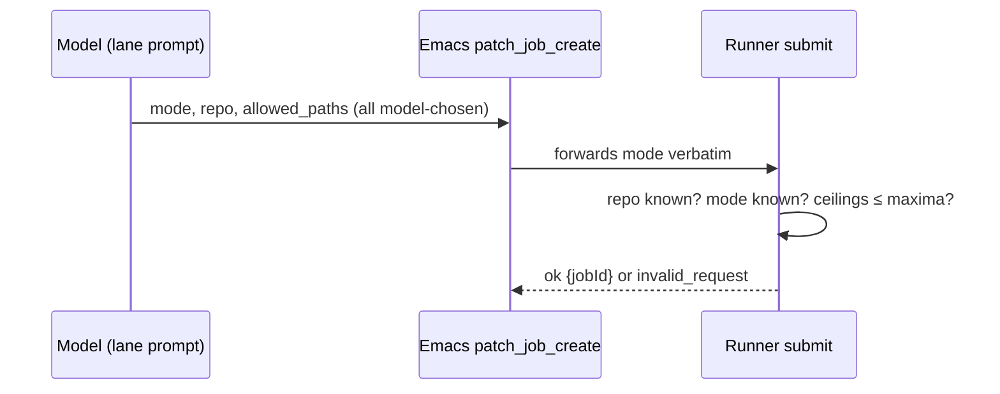
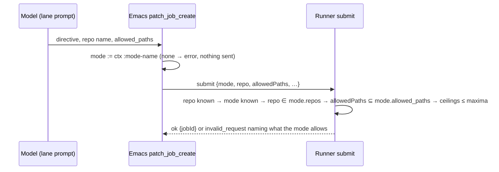
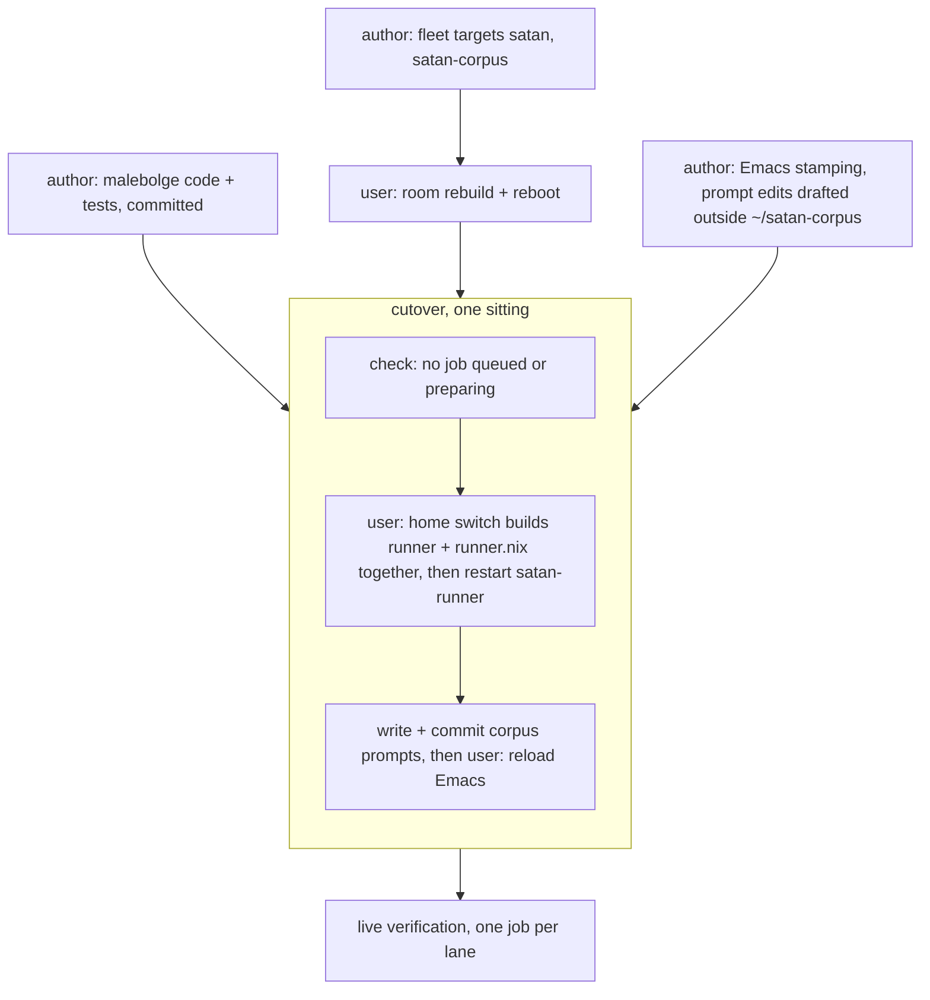

<!-- doctrine:section sec-1 -->
# 1. Design Problem

SATAN hands edit-shaped work to the **patch runner** (`satan-runner`, the
malebolge daemon that SL-023 built). The runner runs a coding agent on a clone
of a repo inside the oubliette room `assistant` (a sandboxed VM with no
network uplink) and leaves the result waiting for the user to review. Today
only one lane works: mode `fix` on repo `goad-walk`. SATAN's own lanes —
`self-edit-mech` (its elisp), `self-edit-mind` (its corpus) and `tick-agent`
(directives found during a tick) — are refused (ISS-046).

Two things are wrong, and this design fixes both:

1. **The lanes are not wired.** The room does not hold `satan` or
   `satan-corpus`; the runner's config names one repo and one mode; the
   producers (Emacs and three corpus prompts) send old modes, a repo as a path,
   and a `checks` field the runner never had.
2. **A lane is a label, not a scope.** The model chooses `mode`, and the runner
   treats mode and repo as independent policy layers. Nothing ties a lane to
   the repos or paths it may touch, so any lane holding `patch_job_create` can
   claim any mode and edit any configured repo.

The target: Emacs stamps each job with the run's real mode; the runner checks,
at submit, that the job's repo and paths lie inside that mode's configured
scope; every lane has its repo in the room and its mode in the config.

**System boundary.** The runner is the only place scope is enforced (REQ-009,
one enforcement point). Emacs supplies identity — which mode is acting — and
nothing else. The room, the fleet and `runner.nix` are configuration; their
changes are deployed by the user.

<!-- doctrine:section sec-2 -->
# 2. Current State

A job crosses three layers before it runs. Each must agree with the others.

```
 layer                          where                                   state
 ─────────────────────────────  ──────────────────────────────────────  ───────────────────────────────
 1 room holds the clone         /srv/fleet flake.nix targetNames,        13 targets; no satan,
                                targets/<name>.nix, inputs.<name>        no satan-corpus
 2 runner knows repo + mode     ~/flakes features/satan/runner.nix       repo.goad-walk, mode.fix only
 3 producer sends what the      Emacs satan-tools-patch.el;              mode chosen by the model;
   runner accepts               corpus prompts                           repo as a path; `checks`
```

How a submit flows today:



The facts this design builds on (research.md, verified ✓):

- **Emacs forwards the model's `mode`.** `satan-tools-patch--submit-fields`
  copies `:mode` from the arguments (`satan/satan-tools-patch.el:47-52`); the
  schema enumerates `satan-tools-patch-modes`, default `("fix")`
  (`:24`, `:133`). The run's true mode is in the tool context as `:mode-name`
  (`satan/satan-run.el:345`). MCP sessions resolve mode `interactive`
  (`satan/satan-mcp.el:162`, `:200`); ticks register `tick-<name>`
  (`satan/satan-tick.el:74`), so the agent tick is `tick-agent`.
- **The runner's submit checks are a list.** `checkSubmit` resolves the repo,
  then runs `SUBMIT_CHECKS = [knownMode, ceilingsWithinMaxima]`
  (`src/runner/protocol.ts:264-291`). A `RunnerError("invalid_request", …)`
  from any check refuses the submit (`configEntry`, `src/runner/policy.ts:39-45`).
- **The matcher already exists.** `pathAllowed` / `disallowedPaths`
  (`src/runner/classify.ts:33-56`): an entry ending `/` is a prefix, any other
  an exact file, no globs. The tool guard (`guard.ts:102`) and collection use
  the same matcher.
- **Config tables are closed.** `readLayer` refuses keys it was not told about
  and reads only `prompt` from its extras (`src/runner/config.ts:229-241`).
  Modes are read as bare layers (`:394`); repos through `readRepo` (`:250-282`),
  the precedent for a typed subtype.
- **Replays skip admission.** `submit()` returns the existing job for a known
  `submissionId` before any check (`control.ts:117-120`).
- **Adding room targets keeps existing clones.** `room-seed` initialises only
  an absent `.git`; the work volume persists; quarantines are created on first
  collect (oubliette `vm/room.nix:86-91, 138-174`, `host/room-git.nix:242-246`).
  A push to a repo the room does not yet hold exits 2 (`host/cli.nix:380`).

<!-- doctrine:section sec-3 -->
# 3. Forces & Constraints

**Binding governance** (confirmed for this run):

- **ADR-017 §2, §4 / REQ-010.** The trust boundary is a protocol; a daemon
  enforces its invariants with Emacs absent and never fails open. Scope lives
  in the runner, not in prompts or the Emacs schema.
- **Authority ledger row 9** (per-job path allowlist, owner `patch-runner`,
  REQ-002). Mode scope is a row-9 duty: same owner, same requirement, same
  matcher. No new row; its *Enforced at* gains the submit check.
- **Ledger rows 1–2** (`emacs-client`): the run and its mode are Emacs's facts.
  Stamping `mode` supplies identity, not a second validation.
- **REQ-009.** One enforcement point per invariant: no per-mode check in Emacs.
- **DEC-059** (job contract, SL-023 design §5.2): extended by mode-scope
  admission.
- **DEC-056** (policy ladder): scope sits outside it.
- **DEC-060 / I6:** the commit check at collection stays the only authoritative
  path site; admission bounds the job's own `allowedPaths` earlier.
- **DEC-065 / I13:** configured, never derived; closed tables; missing config
  fails closed.
- **DEC-058 / REQ-027:** full-schema parse; refusals are `invalid_request`. No
  wire change and no new error code.
- **DEC-053:** malebolge quality gates bind the runner change.
- **REQ-014/015 (SPEC-002):** acyclic flake graph, one revision per repo. The
  fleet gains a `satan` input beside `~/flakes`'s — a second pin (§7).

**Decisions:**

- **DEC-068** — a job's mode is the acting run mode, stamped by Emacs.
- **DEC-069** — every `[mode.<m>]` requires `repos` and `allowed_paths`, each a
  list or `"*"` (unbounded); checked at submit only.

**Accepted risk:** **RSK-019** — mode `interactive` is unbounded, so any MCP
client can submit on any configured repo.

**Forces:** lane names must match end to end (SATAN mode registry → runner
`[mode.*]`); repo literals are hand-copied from the fleet until IMP-044; every
deploy step after the code is a user act.

<!-- doctrine:section sec-4 -->
# 4. Design

The target submit path: Emacs supplies the mode, the runner checks scope.



## 4.1 Mode identity — Emacs stamps the acting mode (DEC-068)

`mode` leaves the model's argument schema. The handler reads the run's mode
from the tool context and refuses when there is none:

```elisp
(defun satan-tool/patch-job-create (args ctx)
  (let ((mode (plist-get ctx :mode-name)))
    (cond
     ((null mode) (cons 'error "patch_job_create needs an acting run mode"))
     ((seq-empty-p (plist-get args :allowed_paths))
      (cons 'error "allowed_paths must be non-empty"))
     (t (pcase (satan-patch-rpc-call
                "submit" (satan-tools-patch--submit-fields args mode))
          …)))))   ; ok branch unchanged
```

`satan-tools-patch--submit-fields` takes `mode` as a parameter instead of
reading `:mode` from `args`. `satan-tools-patch-modes` is deleted, and so is
the `mode` entry in the `patch_job_create` registration.

| caller | ctx `:mode-name` | job's mode |
|---|---|---|
| `self-edit-mech` / `self-edit-mind` run | the mode | same name |
| tick `agent` | `tick-agent` | `tick-agent` |
| MCP session (pi under `jpi`, malebolge interactive) | `interactive` | `interactive` |
| direct `emacsclient` call to the handler, no ctx | — | refused, nothing submitted |

Stamping isolates lanes for models that reach the runner through Emacs. It
does not authenticate control-socket clients: a same-uid process is trusted by
construction (socket `0600`, never bound into a jail — DEC-058).

## 4.2 Mode scope in the runner (DEC-069)

**Config shape.** Each `[mode.<m>]` table takes two required keys:

```toml
[mode.self-edit-mind]
repos = ["satan-corpus"]
allowed_paths = ["prompts/", "system/", "tools/"]

[mode.interactive]
repos = "*"
allowed_paths = "*"
```

A value is either a non-empty list of strings or the string `"*"`, meaning
unbounded. Config refuses (startup fails, I13):

- a missing `repos` or `allowed_paths` key;
- an empty list, a non-string member, or a string other than `"*"`;
- a `repos` member that is not a `[repo.*]` key;
- an `allowed_paths` member that `normaliseAllowedEntry` refuses (empty,
  absolute, `..`, surrounding whitespace), or a member equal to `"*"` — a list
  holding `"*"` is almost certainly a mistaken unbounded marker, and as a path
  it would name a file called `*`.

**Types** (`src/runner/config.ts`):

```ts
/** A mode's bound on one axis: a closed list, or "*" for unbounded (DEC-069). */
export type Scope = readonly string[] | "*";

export interface ModeConfig extends PolicyLayer {
  repos: Scope;
  allowedPaths: Scope;
}

export interface RunnerConfig {
  …
  modes: ReadonlyMap<string, ModeConfig>;
}
```

`readMode(fields, name, repoNames)` follows the `readRepo` precedent: it calls
`readLayer(fields, where, ["prompt", "repos", "allowed_paths"])` for the shared
keys, then reads the two scopes with one helper,
`readScope(fields, key, normalise)`. `parseRunnerConfig` reads the repos before
the modes, so `readMode` can check `repos` members against the repo names.
`policy.ts` keeps using a mode as a `PolicyLayer`; the scope fields never enter
the ladder, so no tag, repo or submit tier can set or widen them.

**Admission** (`src/runner/protocol.ts`). `knownMode` becomes
`withinModeScope`, which resolves the mode (an unknown mode is still
`unknown mode "…"`) and then checks both axes. It runs **before** the repo is
resolved, so a scoped mode answers a wrong or unknown repo name with the list
of repos it allows (config guarantees every listed repo exists):

```ts
import { disallowedPaths, normaliseAllowedEntry } from "./classify.ts";

/** The submit's repo and paths lie inside its mode's scope (DEC-069). */
function withinModeScope(request: SubmitRequest, config: RunnerConfig): void {
  const mode = configEntry(config.modes, "mode", request.mode);
  const name = JSON.stringify(request.mode);
  if (mode.repos !== "*" && !mode.repos.includes(request.repo)) {
    throw new RunnerError(
      "invalid_request",
      `mode ${name} does not allow repo ${JSON.stringify(request.repo)}; ` +
        `it allows: ${mode.repos.join(", ")}`,
    );
  }
  if (mode.allowedPaths === "*") {
    return;
  }
  const outside = disallowedPaths(request.allowedPaths, mode.allowedPaths);
  if (outside.length > 0) {
    throw new RunnerError(
      "invalid_request",
      `mode ${name} does not allow paths ${outside.join(", ")}; ` +
        `it allows: ${mode.allowedPaths.join(", ")}`,
    );
  }
}

const SUBMIT_CHECKS: readonly SubmitCheck[] = [withinModeScope, ceilingsWithinMaxima];

export function checkSubmit(request: SubmitRequest, config: RunnerConfig) {
  for (const check of SUBMIT_CHECKS) {
    check(request, config);
  }
  const repo = configEntry(config.repos, "repo", request.repo); // after scope
  return { ...request, baseRef: request.baseRef ?? repo.defaultBranch };
}
```

Under an unbounded mode (`interactive`) an unknown repo still gets the generic
`unknown repo "…"`; repo discovery for that lane is IDE-011.

**Containment** is the existing matcher applied to each submitted entry:
`disallowedPaths(submitted, mode.allowedPaths)`. No new matcher.

| mode `allowed_paths` | submitted entry | admitted? |
|---|---|---|
| `satan/` | `satan/` | yes |
| `satan/` | `satan/satan-broker.el` | yes |
| `satan/` | `satan` (an exact file) | no |
| `satan/` | `satanic/` | no |
| `a.el` | `a.el` | yes |
| `a.el` | `a.el/` (a prefix) | no — an exact entry never covers a prefix |
| `"*"` | anything `normaliseAllowedEntry` accepts | yes |

The refusal message names what the mode allows. The tick prompt relies on it:
a `tick-agent` model that picks a repo outside the mode, or a name the runner
does not know, learns the allowed set from the error.

**Lifetime.** Admission is the scope snapshot. Scope is not re-checked at
`preparing` or when the runner rejoins jobs after a restart; narrowing config
affects new submissions only. A replayed `submissionId` returns its existing
job without re-admission (it creates nothing). Collection stays the
authoritative path check (DEC-060), now against `allowedPaths` that admission
has already bounded.

## 4.3 Runner config — `~/flakes/features/satan/runner.nix`

**Repos.** One `repo.<name>` per room target, 15 in all, keyed by the oubliette
target name. The literals are hand-copied from the fleet (one source is
IMP-044). Every entry has the same room shape, so one local function writes it:

```nix
roomRepo = path: defaultBranch: name: {
  inherit path;                              # targets/<name>.nix `path`
  guest_path = "/work/${name}";
  default_branch = defaultBranch;
  quarantine = "/var/lib/capsule/collect/${room}/${name}.git";
  transfer_timeout_s = 600;                  # covers a first full push
};
repo = lib.mapAttrs (name: f: f name) {
  doctrine     = roomRepo "${home}/dev/doctrine" "edge";
  goad-walk    = roomRepo "${home}/dev/goad-walk" "main";
  …
  nix-config   = roomRepo home "main";
};
```

| repo | host path | default branch |
|---|---|---|
| doctrine | `~/dev/doctrine` | **`edge`** |
| goad-walk, goad, satan-attrd, panopticon, malebolge, retrograde, oubliette, www, resume, satan | `~/dev/<name>` | `main` |
| notes | `~/notes` | `main` |
| emacs-config | `~/.config/emacs` | `main` |
| nix-config | **`~`** (the home directory) | `main` |
| satan-corpus | `~/satan-corpus` | `main` |

**Modes.** `mode.fix` is dropped. Mode names are SATAN's lane names. No mode
sets a model, thinking level or ceiling: each falls through to `[defaults]` and
`[maxima]` (user ruling 2026-10-19).

| mode | `repos` | `allowed_paths` |
|---|---|---|
| `self-edit-mech` | `["satan"]` | `["satan/"]` |
| `self-edit-mind` | `["satan-corpus"]` | `["prompts/", "system/", "tools/"]` |
| `tick-agent` | every repo except `satan` and `satan-corpus` | `"*"` |
| `interactive` | `"*"` | `"*"` (RSK-019) |

`tick-agent`'s list is computed at Nix eval from the repo set, so adding a room
repo extends it; the runner still receives a literal list (I13 forbids the
runner deriving, not the config generator).

## 4.4 Room targets — `/srv/fleet`

Two new targets, each a `targets/<name>.nix` file, an entry in `targetNames`,
and a flake input of the same name (the fleet pairs them by name):

| target | input | `toolsPackage` |
|---|---|---|
| `satan` | `github:davidlee/satan`; `nixpkgs` and `doctrine` follow the fleet's | `"dev-tools"` (satan's `packages.dev-tools`) |
| `satan-corpus` | `git+ssh://git@github.com/davidlee/satan-corpus` (private); `nixpkgs` follows | `null` — the room base already has git, bash and coreutils (oubliette `vm/room.nix:7-9`) |

Both target files copy `targets/malebolge.nix`'s shape (placeholder `sizes`,
every absent field spelled as a value), with their own `path`.

## 4.5 Producers — prompts and tool description (`~/satan-corpus`)

| file | change |
|---|---|
| `prompts/self-edit-mech.txt` | drop `mode` and `checks`; `repo: "satan"` (a name) |
| `prompts/self-edit-mind.txt` | drop `mode` and `checks`; `repo: "satan-corpus"` |
| `prompts/tick/agent.txt` | drop `mode: tick-agent`; `repo` is a runner repo name; an `invalid_request` names the repos the mode allows |
| `tools/patch_job_create.md` | drop the `mode` parameter; say the job runs under the caller's run mode and the runner refuses repos or paths outside it |

The prompts keep their advice to narrow `allowed_paths` below the mode's
bound.

## 4.6 Order of work and deployment

Two facts shape the order. The runner is a store build
(`inputs.malebolge.packages.<system>.runner`), so a malebolge change reaches it
only at the next `just home-switch`, which builds from the `~/dev/malebolge`
checkout's tracked files when present (`~/flakes/SATAN.md` § satan-runner,
`bin/dev-checkouts`). And the runner reads the mode at `preparing` from the
current config (`run.ts:131-150`; `rejoin.ts:185-209` for a held `preparing`
job with no recorded policy), so a job still `queued` or `preparing` when
`fix` disappears fails.



- **Runner code and config deploy in one home switch.** Separately, the old
  parser would refuse the new keys, or the new parser the old `[mode.fix]`
  without scope keys. The switch must build malebolge from the committed
  checkout; the restart confirms it with no `refusing to start` in the journal.
- **The room rebuild comes before that switch**: a push to a repo the room
  does not hold exits 2.
- **Drain before the switch.** `select count(*) from jobs where state in
  ('queued', 'preparing')` in the runner store must be 0. Jobs further on carry
  their recorded policy and are unaffected.
- **Land the prompts and reload Emacs straight after the restart.** Until the
  reload the loaded tool still offers and forwards `fix`, which the runner now
  refuses; the corpus is read live from its working tree, so prompts written
  there before the reload would omit
  the `mode` the loaded schema requires. Ticks fire once at boot (`SATAN.md` §
  units), so the gap is open only to sessions started during the sitting;
  start none.

<!-- doctrine:section sec-5 -->
# 5. Code Impact

satan (this repo; the only one selectors can fence):

| Path | Change |
|---|---|
| `satan/satan-tools-patch.el` | delete `satan-tools-patch-modes`; `mode` leaves the `patch_job_create` schema; handler stamps `:mode-name`, refuses without it; `--submit-fields` takes `mode` |
| `satan/test/satan-tools-patch-test.el` | replace the vacuous schema test (it compared the enum with itself) with stamping and no-ctx tests; schema keys lose `mode` |

malebolge (`~/dev/malebolge`, own repo):

| Path | Change |
|---|---|
| `src/runner/config.ts` | `Scope`, `ModeConfig`, `readScope`, `readMode`; repos read before modes; `RunnerConfig.modes: ModeConfig` |
| `src/runner/protocol.ts` | `knownMode` → `withinModeScope`, run before the repo lookup; import `disallowedPaths` |
| `test/runner/config-fixture.ts` | `[mode.fix]` gains `repos = "*"`, `allowed_paths = "*"`, so existing tests keep admitting (`fix` stays a test-only name) |
| `test/runner/policy.test.ts` | the appended `[mode.deep]` tables (`:45`, `:52`) gain both scope keys |
| `test/runner/config.test.ts` | scope parse and refusal cases |
| `test/runner/protocol.test.ts` | admission cases |
| `test/runner/control.test.ts` | a replayed `submissionId` returns its job without re-admission |
| `test/runner/run.test.ts`, `test/runner/recovery.test.ts` | an admitted job runs, and a held job rejoins, after its mode's scope narrows |
| `test/runner/live-fixture.ts`, `live-fixture.test.ts` | smoke submits as `interactive` (`fix` is no longer deployed); the test's expectation follows |

`~/flakes`: `features/satan/runner.nix` — `roomRepo`, 15 repos, 4 modes;
`mode.fix` removed; header comment updated. `SATAN.md` § satan-runner: the
smoke is an `interactive` job; the modes and their scope.

`/srv/fleet`: `flake.nix` (inputs `satan`, `satan-corpus`; `targetNames`),
`targets/satan.nix`, `targets/satan-corpus.nix` (new).

`~/satan-corpus`: `prompts/self-edit-mech.txt`, `prompts/self-edit-mind.txt`,
`prompts/tick/agent.txt`, `tools/patch_job_create.md`. Committed by path: the
corpus's `just commit` sweeps all dirty state.

**Decisions carried into code, verbatim:**

- **Mode keys are required, and `"*"` means unbounded** (DEC-069). There is no
  default: a mode without `repos` or `allowed_paths` refuses config.
- **The `interactive` mode is unbounded**: `repos = "*"`, `allowed_paths =
  "*"`. This is an accepted risk (RSK-019), not an oversight.

<!-- doctrine:section sec-6 -->
# 6. Verification

| Criterion | Mode | How |
|---|---|---|
| Config parses list and `"*"` scopes; refuses a missing key, an empty list, a non-string member, a non-`"*"` string, a `"*"` list member, an unknown repo, an `allowed_paths` member `normaliseAllowedEntry` refuses | VT | `test/runner/config.test.ts` |
| Scope keys never reach the policy ladder: a tag or repo layer cannot carry them (closed tables refuse) | VT | `test/runner/config.test.ts` |
| Submit admits a repo in `repos` and paths covered by `allowed_paths` (table in §4.2); refuses `invalid_request` otherwise, the message naming what the mode allows; `"*"` admits any repo / path | VT | `test/runner/protocol.test.ts` |
| Unknown mode is still refused `invalid_request` | VT | existing `protocol.test.ts:239` |
| A replayed `submissionId` returns its existing job, even after the mode's scope narrows | VT | `test/runner/control.test.ts` |
| A job admitted, then run under a config whose mode no longer allows its repo or paths, reaches `preparing` with its policy recorded | VT | `test/runner/run.test.ts` |
| A held job rejoins after a restart whose config narrowed its mode's scope | VT | `test/runner/recovery.test.ts` |
| A scoped mode refuses an unknown repo name with the list of repos it allows | VT | `test/runner/protocol.test.ts` |
| malebolge gate: tests, lint, typecheck, format | VT | `just check` |
| Emacs submits the ctx `:mode-name`, never a model argument; the schema has no `mode` | VT | `satan-tools-patch-test.el`, fixture runner records the request |
| No ctx or no `:mode-name`: error, nothing sent to the runner | VT | `satan-tools-patch-test.el` (`satan-patch-fixture-requests` empty) |
| satan gate | VT | `just check` |
| Before the cutover, no job is `queued` or `preparing` | VH | user: the §4.6 store query returns 0 |
| Runner starts on the deployed config (15 repos, 4 modes) | VH | user: `systemctl --user status satan-runner`, no `refusing to start` |
| One job per lane reaches `needs_review` through `patch_job_create`: `self-edit-mech` on `satan`, `self-edit-mind` on `satan-corpus`, `tick-agent` on another room repo | VH | live, run with the user |
| One live refusal: a submit outside its mode's repos or paths returns `invalid_request` | VH | live, run with the user |
| Smoke still passes as `interactive` on `goad-walk` | VH | `SATAN_RUNNER_LIVE=1 just smoke-runner` |

<!-- doctrine:section sec-7 -->
# 7. Risks & Open Edges

- **RSK-019 — `interactive` is unbounded.** Reaching the MCP socket is enough
  to submit on any configured repo, including `satan` and `satan-corpus`.
  Accepted by the user for the interactive session's freedom; mitigated by the
  room's lack of egress, human review before promotion, and promotion only
  creating a branch.
- **ISS-028 — the harness jail binds `~/dev/satan` read-write.**
  `self-edit-mech` can edit directly and bypass the patch lane, so mode scope
  is not a complete boundary for that lane until ISS-028 closes.
- **Second `satan` pin.** The fleet's `satan` input (the room's tool set) and
  `~/flakes`'s (the runtime) can be at different revisions. Only the room's
  tools drift, not behaviour; `doctrine` follows the fleet, so it keeps one pin.
- **Live Emacs keeps the old schema** until reloaded (§4.6).
- **Room rebuild.** Adding targets is expected to keep existing clones and
  quarantines (§2); confirm after the reboot that `goad-walk`'s clone is
  intact.

**Follow-through** (not this design's code):

- SPEC-004's job contract (mode scope) and ADR-017 ledger rows 1 and 9
  (*Enforced at*) change through a REV at SL-025 reconcile, after SL-023's
  REV-007 applies. DEC-068 and DEC-069 are the authority until then.
- Memory `mem.fact.satan.patch-job-contract` is stale (it says `repo` is an
  absolute path) and is corrected within this slice.
- IMP-044 (one source for room repos), IDE-011 (a runner `list-repos` op) and
  ISS-047 (rejoin wedges the seat when a repo leaves config) stay open.

