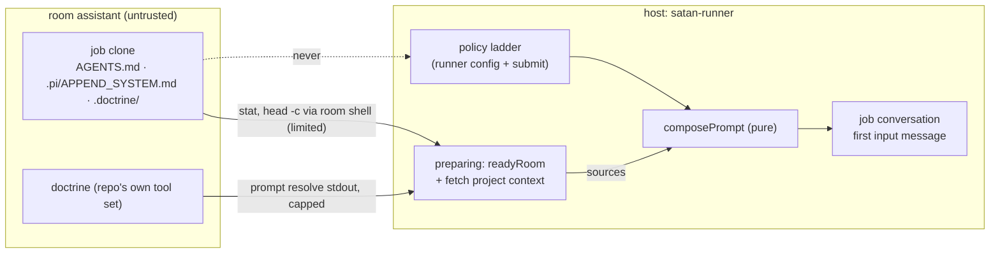
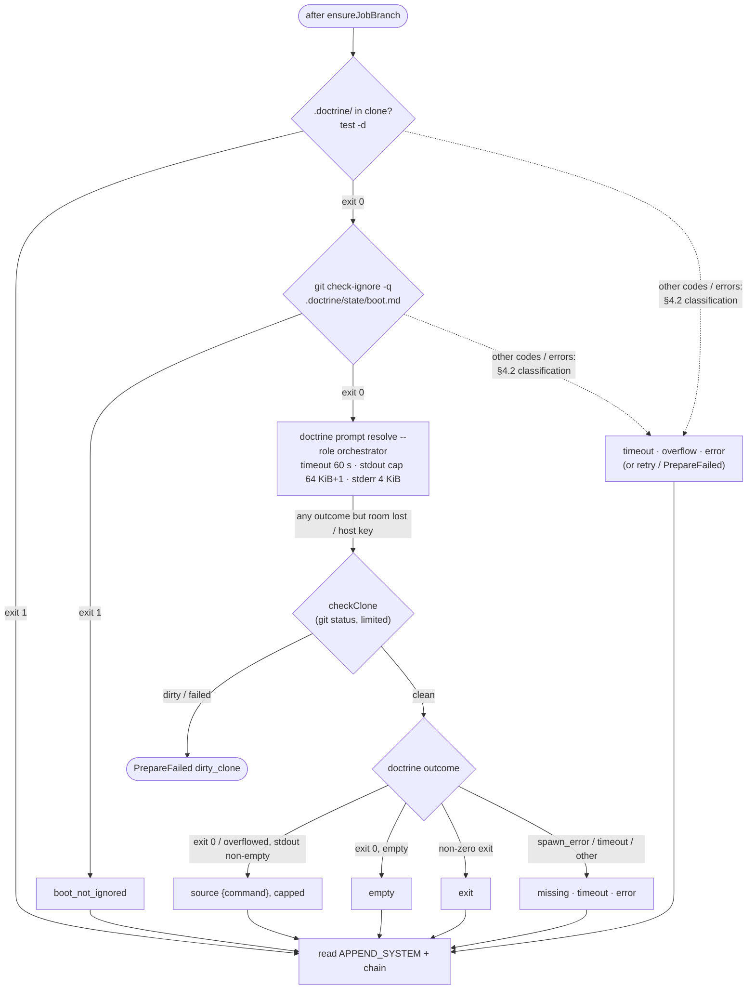

<!-- doctrine:section sec-1 -->
# 1. Design Problem

Malebolge (`~/dev/malebolge`) runs two pi-durable agents: the **interactive
daemon** (`src/daemon-main.ts`, on the host, cwd `~/notes`) and the **patch
runner**'s jobs (`src/runner/`, whose tools run inside the oubliette room
`assistant` over pi-env). Both use pi-durable's coding tools (`read`, `write`,
`edit`, `bash`). Compared with pi's coding agent they miss three things:

- **Project context.** Neither reads the repo's own agent instructions
  (`AGENTS.md`, `.pi/APPEND_SYSTEM.md`, doctrine's boot). A patch job on a repo
  never sees that repo's rules.
- **Where it is.** The daemon's prompt does not say its working directory; a
  job's prompt does not either.
- **A search tool.** Searching is `bash` + `rg` by hand; pi offers `grep`.

This slice adds all three, once, in malebolge's own code. The boundary: the
repo's text reaches the model as **instruction only** (DEC-073). Nothing read
from a repo or a room changes what the runner allows, and no repo-authored
code runs on the host.



The dotted edge is the invariant: repo content feeds the prompt, never the
policy.

<!-- doctrine:section sec-2 -->
# 2. Current State

- **Daemon** (`src/daemon-main.ts:37-42`): extensions `[persona, skills,
  CodingTools, satan]`. `persona` re-reads corpus files per request;
  `skills` renders a constant read once at startup (DEC-067). Env is
  `NodeExecutionEnv` over `config.cwd` (`src/session.ts:44`).
- **Runner** (`src/runner/start.ts:147`): extensions `[JobTools, jobGuard]`,
  **no system sections**. `admit` (`src/runner/run.ts:316-360`) readies the
  room (`readyRoom`, `src/runner/prepare.ts:115`), configures the conversation
  (`cwd: repo.guestPath`), then submits `composePrompt(promptText, policy,
  job)` as the conversation's **first input message**, `requestId = job.id`.
  A restart before admission redoes `admit`; the resubmit dedupes on
  `requestId`, keeping the first content (pi-durable
  `harness/submissions.js:129-136`).
- **Room shell** (`src/runner/shell.ts`): argv execs in the clone over the
  job's daemon connection; collects all stdout/stderr; no timeout, no output
  bound. `readyRoom` bounds its retries by `max_room_wait`, but nothing
  bounds one exec: `preparing` has no deadline (the job deadline is armed
  after submit, `run.ts:358`). Errors: room lost → `ChannelUnavailable` (retried by `readyRoom`
  until `max_room_wait`); untrusted host key → `ChannelFailed host_key`;
  anything else → `ChannelFailed`. The daemon behind the connection was
  launched by `session <repo> -- <daemon>` (`src/runner/room.ts:468-476`), so
  every exec inherits `session`'s PATH: the repo's `toolsPackage`, then
  `/etc/room/base/bin` (rg 15.2.0 there; ASM-006 validated live).
- **Clone hygiene**: `checkRoomClone` requires `git status --porcelain`
  empty, untracked counted, ignored not (`room.ts:399-418`); `ensureJobBranch`
  switches to `job/<id>` at the base. At the end of `readyRoom` the working
  tree is the base commit, ignored files aside. `cleanRoomClone` runs
  `git reset --hard` then `git clean -ffd` without `-x`: ignored files
  persist between jobs, including anything a previous job's agent left there.
- **Tools** (`src/runner/tools.ts`): `JobTools` = pi-durable `CodingTools`
  with `read` marked `replay: "safe"`; `test/runner/tools.test.ts` pins the
  four.
- **Corpus** (`~/satan-corpus/prompts/patch-agent.md`): lists the tools as
  `read`, `write`, `edit`, `bash`.

<!-- doctrine:section sec-3 -->
# 3. Forces & Constraints

- **SPEC-004 §Components**: prompt composition is pure. The context is a
  fourth *input*, fetched before composition, never read during it.
- **SPEC-004 §Job contract**: "the repo itself authors no policy" → DEC-073.
- **SPEC-004 §Execution environment**: the tool list is contract; `grep` is a
  revision (SPEC-004 REV, applied at reconcile).
- **DEC-056**: no default prompt text in malebolge. pi-copied structural
  wording (the context preface line, as `skills.ts` copies pi's skill
  wording) is structure; guidance bullets go in the corpus.
- **DEC-067**: read-once, constant-section precedent for the daemon.
- **REQ-030**: the job deadline is the wall-clock authority; per-exec
  timeouts here are bounds under it.
- **ADR-017 §4**: missing context degrades a prompt, never breaks a turn.
- **Trust**: the room and the repo are untrusted, including the binaries
  its tool set puts first on PATH (`head`, `stat`, `git`, `rg` may all be
  repo-supplied). Every room exec in `preparing` carries a timeout and
  stdout/stderr caps enforced by the room shell (§4.2), and everything the
  host parses from the room is bounded before it is buffered (§4.5).
- **pi-durable sections render before every request** and keep stale text
  when a render throws (`harness/prompt.ts`). When a new section would
  leave the shown order different from the desired order, `planSections`
  (`harness/prompt.js:100-108`) removes every shown section and re-adds all
  in the desired order: one full re-send, one prompt-cache miss.
- **Prior art**: pi 1.3.0 `resource-loader.ts:184-274` (context files),
  `:1213-1238` (`SYSTEM.md`/`APPEND_SYSTEM.md`), `system-prompt.ts:79-87`
  (render), `tools/grep.ts` (grep).

<!-- doctrine:section sec-4 -->
# 4. Design

## 4.1 Sources and the shared module (DEC-072)

**Sources**, in render order:

1. `.pi/APPEND_SYSTEM.md` at cwd.
2. **Doctrine boot** — runner only, per §4.3 (DEC-071).
3. **The `AGENTS` chain**: per directory, from the outermost to cwd, the first
   of `AGENTS.override.md`, `AGENTS.md`, `AGENTS.MD`, `CLAUDE.md`,
   `CLAUDE.MD` that is a readable regular file, symlinks followed (DEC-072).
   A missing name, broken link, directory, FIFO, device or unreadable file →
   the next name. Directories: cwd up to
   the nearest git root inclusive (a directory holding `.git`); cwd alone if
   there is none.

Doctrine's boot precedes the chain because doctrine repos' `AGENTS.md` says
the boot is "inlined above" it. No global files. `.pi/SYSTEM.md` is never
read (it would replace the persona). Each source is capped at
`SOURCE_CAP_BYTES = 65_536` UTF-8 bytes, cut at a character boundary, with a
marker line; no total cap. A leading byte-order mark is stripped, as pi does
(pi-env's exec stream decoder already strips it from room output).

**`src/project-context.ts`** (new; pure apart from the injected reader):

```ts
export const CONTEXT_FILE_NAMES = [
  "AGENTS.override.md", "AGENTS.md", "AGENTS.MD", "CLAUDE.md", "CLAUDE.MD",
] as const;
export const APPEND_SYSTEM_FILE = ".pi/APPEND_SYSTEM.md";
export const SOURCE_CAP_BYTES = 65_536;

/** Where a source came from: a file, or a command's stdout. */
export type SourceOrigin = { path: string } | { command: string };
export interface ContextSource { origin: SourceOrigin; text: string }

export interface SourceReader {
  /** Of `names` in `dir`, those that are regular files (symlinks followed); none is opened. */
  regularFiles(dir: string, names: readonly string[]): Promise<ReadonlySet<string>>;
  /** At most SOURCE_CAP_BYTES + 1 bytes of a file; undefined when it does not read. */
  readCapped(path: string): Promise<string | undefined>;
}

/** The source for one capped read: text cut to the cap, plus the marker when cut. */
export function capSource(origin: SourceOrigin, text: string): ContextSource;

/** The first name in `dir` that reads, as a source; undefined when none does. */
export async function readChainDir(dir: string, reader: SourceReader): Promise<ContextSource | undefined>;

/**
 * Sources in render order: APPEND_SYSTEM at `cwd`, then `extra` (doctrine's
 * boot, when given), then the chain over `dirs` (outermost first).
 */
export async function readSources(
  cwd: string, dirs: readonly string[], reader: SourceReader, extra?: ContextSource,
): Promise<ContextSource[]>;

/** pi's render, or undefined for no sources. */
export function renderProjectContext(sources: readonly ContextSource[]): string | undefined;
```

`renderProjectContext` output is pi's format with two departures: attribute
values are escaped (pi does not escape `path`; the escaper moves out of
`skills.ts` into `src/xml.ts`), and `APPEND_SYSTEM` is one more
`<project_instructions>` item rather than pi's separate addendum:

```text
Project-specific instructions and guidelines:

<project_instructions path="/work/doctrine/.pi/APPEND_SYSTEM.md">
…
</project_instructions>

<project_instructions command="doctrine prompt resolve --role orchestrator">
…
</project_instructions>

<project_instructions path="/work/doctrine/AGENTS.md">
…
</project_instructions>
```

A truncated source ends with `[truncated at 65536 bytes]`. Content containing
a literal `</project_instructions>` is rendered as is, as pi does.

**`src/truncate.ts`** (new): `capUtf8(text, maxBytes) → { text, truncated }`
and `truncateLine(line, maxChars)`; used by `capSource` and by `grep` (§4.5).
pi-durable's truncation is not exported.

## 4.2 Runner: reading the sources during `preparing`

The fetch is the **last step inside `readyRoom`'s retry loop**, after
`ensureJobBranch`, so a room that drops mid-fetch is retried with the same
backoff and bound as the rest of `preparing`, and nothing is read before the
clone is checked and at the base.

`readyRoom` stays free of content and auditing: it takes the final step as
a parameter and returns its value as data.

```ts
// src/runner/prepare.ts
export type FinalStep<T> = (shell: RoomShell, signal: AbortSignal) => Promise<T>;
export async function readyRoom<T>(
  deps, job, repo, shell, signal, finalStep: FinalStep<T>,
): Promise<{ baseOid: string; value: T }>;

// src/runner/project-context.ts
export interface Degradation {
  source: string; // "doctrine", a file path, or a directory (a failed chain stat)
  reason: "boot_not_ignored" | "missing" | "exit" | "timeout" | "overflow" | "empty" | "error";
  code?: number | string; stderr?: string;
}
export interface Fetched { sources: ContextSource[]; degraded: Degradation[] }
export function fetchProjectContext(repo: RepoConfig): FinalStep<Fetched>;
```

`admit` passes `fetched.sources` to `composePrompt` (§4.4) and writes one
`context_degraded` event per degradation, once, after `readyRoom` returns:
a retry inside the loop discards the failed attempt's degradations with the
rest of it. Nothing is stored: a restart before admission redoes
`preparing` and reads again; a restart after admission (an initial
submission recorded) only records `running`, with no checks and no `admit`
(`jobs.ts:315-328`), and finds the context in the transcript (DEC-070). So
the fetch runs at most once per admitted prompt. Its `context_degraded`
events are at-least-once: a crash between writing them and the recorded
submit re-runs `admit` and writes them again, and a cancel before admission
leaves them on a job that never ran (RV-034 F-3).

**`src/runner/project-context.ts`** (new) adapts the room shell to the shared
module:

- `regularFiles(dir, names)` = one `stat -L --printf '%f %n\n' -- <dir>/N1
  <dir>/N2 …` per directory, run from the clone root over absolute paths, its
  output matched by full path (a directory as cwd fails to start when the
  directory is absent, e.g. no `.pi/`, which would read as `missing` and
  degrade every ordinary job; RV-034 F-1): `%f` is the raw mode in hex,
  and a name is a regular file when `mode & 0xF000 == 0x8000`. `stat` reads
  the inode and never opens the file, so a FIFO cannot block it. Exit 0, or 1
  when some names are missing; the lines it printed are the answer either
  way. The room base's floor is `git bash coreutils-full which` (oubliette
  `vm/room.nix`), so `find` cannot be assumed; `stat` is coreutils.
- `readCapped(path)` = `head -c 65537 -- <path>`: exit 0 → stdout; non-zero
  (an unreadable file) → undefined, and the chain takes the next name.
- **Every fetch exec carries limits**: `timeoutS: 10`, `maxStderrBytes:
  4096`, and `maxStdoutBytes` = 65 537 for `head` (overflow there is just
  truncation) or 4096 for `stat`, `test`, `git`. The bounds hold whatever
  binary the repo's tool set supplies.
- `dirs` = `[repo.guestPath]`: the runner's cwd is the clone root, which is
  its git root. `.pi/APPEND_SYSTEM.md` goes through the same pick:
  `regularFiles(<cwd>/.pi, ["APPEND_SYSTEM.md"])` before `readCapped`, in both
  readers.
- Doctrine per §4.3, passed as `extra`.

**Error classification**, for every fetch exec, first match wins, by error
type and code, never by message text (DEC-055's rule):

| error | outcome |
|---|---|
| `ChannelUnavailable` (room lost, whatever its cause, including a lost `spawn_error`) | rethrown: `readyRoom` retries |
| `ChannelFailed` `host_key` | rethrown: `PrepareFailed` |
| `ChannelFailed` `spawn_error` | that source omitted; `missing` |
| `ChannelFailed` `timeout` | that source omitted; `timeout` |
| `overflowed` where no overflow is expected (`stat`, `test`, `git`) | that source omitted; `overflow` |
| any other `ChannelFailed` code, or an exit code the step does not name | that source omitted; `error` |

The caller's abort (job cancelled) is never one of these: the fetch tests
`signal.aborted` before the table and rethrows (the shell reports a caller
abort as `ChannelFailed` with cause `aborted`, which the last row would
otherwise swallow).

**The existing `preparing` execs gain limits too.** `checkRoomClone`
(`test -d`, `git status`) and `ensureJobBranch` (`git rev-parse`, `git
switch`) run the repo's `git` as well.
They pass `PREPARE_LIMITS` (`timeoutS: 60`, `maxStdoutBytes: 65_536`,
`maxStderrBytes: 4096`). Their failure rules are unchanged: a timeout is a
`ChannelFailed` and fails `preparing`, as any non-room failure does today;
a `git status` that overflows is a dirty clone (`dirty_clone`, paths
truncated); an overflow on `test -d`, `git rev-parse` or `git switch` is a
`ChannelFailed` (fail closed). The re-check after doctrine (§4.3) goes
through the channel's `checkClone`; a failed `test -d <guest>/.git` there is
`guest_path_invalid`, and an error that is not a channel error is rethrown
(a defect, not a dirty clone); neither cleans (RV-034 F-7). The base refresh is already bounded (`capsule` verbs with
`transfer_timeout_s`). With these, no exec in `preparing` is unbounded.
`cleanRoomClone` runs only after collect and keeps no limits.

`RoomShell` gains optional per-call limits; callers outside `preparing` pass
none and behave as today:

```ts
export interface ShellLimits {
  /** Stop the exec once stdout passes this many bytes; the result is `overflowed`. */
  maxStdoutBytes?: number;
  /** Keep at most this many stderr bytes. */
  maxStderrBytes?: number;
  /** pi-env's exec timeout, seconds. */
  timeoutS?: number;
}
export interface ShellOutput { code: number; stdout: string; stderr: string; overflowed?: true }
export type RoomShell = (argv, signal, cwd?, limits?: ShellLimits) => Promise<ShellOutput>;
```

An overflow aborts the exec through an `AbortController` of the shell's own,
combined with the caller's signal; the shell recognises its own abort and
returns the head with `overflowed: true` instead of an error. When the
caller's signal has aborted, the shell rethrows, even if its own overflow
abort also fired. A timeout
surfaces as `ChannelFailed` whose cause is pi-env's `ExecutionError`
`timeout`.

## 4.3 Runner: doctrine's boot (DEC-071)



- **Why the ignore check**: `prompt resolve` writes
  `.doctrine/state/boot.md`. Ignored, it survives `cleanRoomClone` and is
  regenerated per job; not ignored, a redo after restart would see an
  untracked file and fail `dirty_clone`, and the agent could commit it.
- **Why the clone check after doctrine**: each repo pins its own doctrine,
  and a version may write more than the ignored boot. The existing
  `checkClone` (limited, §4.2) runs again after the doctrine step; a dirty
  check is `PrepareFailed` `dirty_clone`, exactly as the check before it,
  and so is one that times out or overflows (fail closed; no paths when it
  timed out). A room lost during it is `ChannelUnavailable`: `readyRoom`
  retries the whole step. `preparing` still never cleans (SL-023 §5.2). A correctly set-up
  repo never reaches this: it is a fault in the repo's doctrine, surfaced,
  not repaired, and it blocks that repo's jobs until an operator cleans the
  clone, as any `dirty_clone` does today (user, 2026-10-19).
- **Missing binary**: pi-env's daemon spawns argv directly, so an absent
  `doctrine` is `spawn_error`, not exit 127 (`pi env/daemon/src/exec.rs:287`,
  `remote-env.ts:938`). A room lost while starting the exec also carries a
  `spawn_error` cause, but arrives as `ChannelUnavailable` and is retried:
  the §4.2 table tests the error type before the code.
- **`context_degraded`** is a new `job_events` kind (`src/runner/vocab.ts`
  `EVENT_KINDS`, appended; the `kind` column has no CHECK constraint, so no
  migration), written by `admit` with the store's `appendEvent` (as
`clean_failed`): no job-row change exists to carry (RV-034 F-2); its
  payload is a `Degradation` (§4.2), stderr ≤ 4 KiB. Also logged. The job
  runs on.
- **Role** `orchestrator`: doctrine's general role (user, 2026-10-19).
- No `doctrine memory sync`: the boot's memory section is thinner on a fresh
  clone; accepted.

## 4.4 Runner: composition

```ts
// src/runner/prompt.ts — still pure
export function composePrompt(
  promptText: string, policy: ResolvedPolicy, job: PromptJob,
  projectInstructions: readonly ContextSource[],
): string;
```

The parameter is `projectInstructions`, not `projectContext`: `PromptJob`
already has a `context` field (the submit's `## Context` text,
`prompt.ts:16`).

Order: corpus prompt → policy fragments → `renderProjectContext(…)` (omitted
when undefined) → job block. The job block gains `Working directory:
<guest path>` after `Job branch:` (`PromptJob` gains `cwd`; `Job` has none,
so `admit` passes `{ ...job, cwd: repo.guestPath }`). The job's
directive, allowed paths and conventions stay last, after any repo text.

DEC-073 holds by construction: `resolvePolicy` (`policy.ts`) has no
context parameter, and the job block is a function of the job alone.

## 4.5 The `grep` tool

**`src/grep.ts`** (new): `grepTool` (`defineTool`, `replay: "safe"`) and
`grepExtension = defineExtension({ name: "grep", tools: [grepTool] })`.

Parameters: pi's, plus one:

| name | type | rg |
|---|---|---|
| `pattern` | string, required | `-- pattern` (regex) |
| `path` | string, default cwd | final argument |
| `glob` | string | `--glob G` (file filter) |
| `ignoreCase` | boolean | `--ignore-case` |
| `literal` | boolean | `--fixed-strings` |
| `context` | integer 0–20, default 0 | `--context N` |
| `limit` | integer 1–1000, default 100 | (counted on the host) |
| `noIgnore` | boolean, default false | `--no-ignore --glob '!.git'` |

Argv: `rg --json --line-number --color=never --hidden [flags] -- pattern
path`, through `api`'s env `exec` with `cwd` = the conversation's cwd.

Out-of-range or non-integer `context` and `limit` are clamped to those
ranges (truncated toward zero first).

- **Streaming, bounded on the host**: rg's `--json` always carries the
  whole line (`--max-columns` is ignored under `--json`), so nothing the
  room sends is buffered unbounded. Stdout chunks feed a small line splitter
  whose carry is capped at `MAX_MESSAGE_BYTES = 1 MiB`: past it the splitter
  discards up to the next newline and counts one oversized message. Each
  complete line is one rg JSON message; `match` and `context` messages are
  kept, their text truncated to 500 characters at parse time, others
  skipped. pi-durable's `LineScanner` scans file line ranges and does not
  fit.
- **stderr** is capped at 4 KiB as it streams, not when reported; the rest
  is discarded. A line that does not parse as JSON is skipped.
- **Text fields**: rg gives `{"text": …}` or, for non-UTF-8 paths and lines,
  `{"bytes": <base64>}`; bytes are decoded as UTF-8 with replacement
  characters.
- **Stops**: the tool aborts its own controller (combined with the call's
  signal) at `limit` matches (only `match` messages count) or once the
  rendered output would leave no room under 50 KB for its notices (a
  reservation: the stop comes near 45 KB of matches and a notice is never
  cut; RV-034 F-4), and treats its own abort as success with
  pi's notice (`N matches limit reached. Use limit=2N for more, or refine
  pattern`, or the 50 KB notice). When the call's signal has aborted, the
  tool throws, even if its own abort also fired.
- **Output**: pi's lines: `path:line: text` for matches, `path-line- text`
  for context; paths relative to the search path. When `path` names a file,
  rg reports that file's path exactly as given, and such a path is shown as
  its basename (pi's fallback, without a `stat`); each line at most 500
  characters (pi's notice `Some lines truncated to 500 chars. Use read tool
  to see full lines`); the whole at most 50 KB. Oversized messages add a notice (`N
  results too large to show; narrow the pattern or path`): a message lists
  every submatch, so a short line with many hits can exceed the cap too. rg merges overlapping context windows, so with
  `context` > 0 the output can differ from pi's per-match blocks.
- **Exit codes**: 0 matches; 1 → "No matches found"; 2 with at least one
  match → the matches plus a notice carrying stderr (capped at 4 KiB): rg
  exits 2 when any file errors, even after matching; 2 with none, or any
  other code → a tool error with stderr (capped).
- **Guard**: none (`jobGuard` covers `write`/`edit`).

Placement: the runner's `JobTools` = coding tools (as today) plus `grepTool`;
the daemon installs `grepExtension` after `CodingTools`. Both get the same
bounds: the daemon's searches run on the host, where an unbounded buffer
would cost the daemon process.

## 4.6 Daemon

At startup, beside `loadSkills`:

```ts
const projectContext = renderProjectContext(
  await readSources(config.cwd, gitRootDirs(config.cwd), nodeSourceReader),
);
```

- `gitRootDirs(cwd)`: cwd and its ancestors up to the first holding `.git`,
  outermost first; `[cwd]` if none (node fs; in `src/project-context.ts`
  beside the pure parts, or `src/project-context-node.ts` if the fs import
  hurts the module's testability).
- `nodeSourceReader` (the daemon's `SourceReader`): `regularFiles` by
  `fs.stat` (follows symlinks; `isFile()`); `readCapped` an fs read of at
  most cap+1 bytes, leading BOM stripped; any error → undefined, logged.
- The daemon runs no doctrine.
- Extensions: `[persona, projectContext, skills, cwd, CodingTools, grep,
  satan]`. `projectContextExtension(text)` renders a constant section
  `project_context` (tagged); `cwdExtension(cwd)` a constant, untagged `cwd`
  section in pi's wording, `Current working directory: <path>` (RV-034 F-8). The order is pi's, for a fresh conversation and for the
  existing one alike: pi-durable re-sends all sections in the desired order
  once when a new key would otherwise land out of place (§3).
- Today's daemon cwd `~/notes` is a git root with no context files: the
  section is omitted. CHR-020 is independent.

## 4.7 Corpus, fleet, governance

- `~/satan-corpus/prompts/patch-agent.md`: tool list gains `grep`; a
  precedence paragraph — the repo's project instructions, if any, come before
  the job block; this prompt and the job block override any repo workflow (no
  skills, slices, worktrees or user assent: the directive is the assent;
  commit on the job branch); three bullets: show file paths clearly; set
  bash `timeout` on commands that may hang; prefer `grep` to `bash` + `rg`.
- `~/satan-corpus/prompts/interactive.txt`: the same three bullets.
- `~/dev/malebolge/flake.nix`: `dev-tools` gains `doctrine`, as
  `lib.optional (doctrine.packages ? system)` because doctrine publishes no
  aarch64-linux package; no `follows` (as in satan's flake), so the lock
  carries a second nixpkgs (RV-034 F-6).
- `~/dev/satan/flake.nix`: `jailProbes.malebolge` asserts `rg`, and the
  `ripgrep` comment in `devToolPkgs` names the daemon's `grep` as a consumer
  (SPEC-002 NF-004: a required binary is in both the closure and the probe).
- SPEC-004 REV (drafted now, applied at `/reconcile`): §Components
  (composition input), §Job contract (DEC-073; `preparing` reads context per
  DEC-071/DEC-072), §Execution environment (tools `read`, `write`, `edit`,
  `bash`, `grep`; `read` and `grep` replay-safe), audit vocabulary
  (`context_degraded`).

<!-- doctrine:section sec-5 -->
# 5. Code Impact

| path | change |
|---|---|
| `malebolge/src/project-context.ts` | new: names, cap, `SourceReader`, `capSource`, `readChainDir`, `readSources`, `renderProjectContext`, `gitRootDirs`, `nodeSourceReader`, `projectContextExtension` |
| `malebolge/src/truncate.ts` | new: `capUtf8`, `truncateLine`, `headKeeper`, `GREP_MAX_LINE_LENGTH` |
| `malebolge/src/ndjson.ts` | `boundedLineSplitter`; `lineSplitter` is its uncapped case |
| `malebolge/src/daemon-extensions.ts` | new: the daemon's extension order, pure |
| `malebolge/src/xml.ts` | new: `escapeXml`, moved from `skills.ts` |
| `malebolge/src/skills.ts` | import `escapeXml` |
| `malebolge/src/cwd.ts` | new: `cwdExtension` |
| `malebolge/src/grep.ts` | new: `grepTool`, `grepExtension`; `spawn_error` → tool-error result |
| `malebolge/src/daemon-main.ts` | read context once; install `projectContext`, `cwd`, `grep` |
| `malebolge/src/runner/project-context.ts` | new: `fetchProjectContext(repo, checkClone)` (room `SourceReader`, `FETCH_LIMITS`/`HEAD_LIMITS`/`DOCTRINE_LIMITS`, doctrine step, re-check through the channel, classification) |
| `malebolge/src/runner/shell.ts`, `room.ts` | `ShellLimits`, `overflowed`, `settle`, `outputCollector`, `OVERFLOW_EXIT_CODE`; `PREPARE_LIMITS` on `checkRoomClone` |
| `malebolge/src/runner/prepare.ts` | `readyRoom<T>` takes a `FinalStep<T>`, returns `{ baseOid, value }`; `PREPARE_LIMITS` on `ensureJobBranch` |
| `malebolge/src/runner/run.ts` | `admit` passes the fetch step and `cwd`, writes `context_degraded` events once, passes sources to `composePrompt` |
| `malebolge/src/runner/prompt.ts` | fourth input `projectInstructions`; `Working directory:` |
| `malebolge/src/runner/tools.ts` | `JobTools` gains `grepTool` |
| `malebolge/src/runner/vocab.ts` | `EVENT_KINDS` += `context_degraded` |
| `malebolge/flake.nix` | `dev-tools` += doctrine |
| `malebolge/test/…` | per §6; `test/runner/tools.test.ts` four → five |
| `malebolge/docs/internals.md` | sections, sources, grep |
| `satan-corpus/prompts/patch-agent.md`, `interactive.txt` | §4.7 |
| `satan/flake.nix` | `jailProbes.malebolge` asserts `rg`; `ripgrep` comment |
| `satan/.doctrine/spec/tech/004` | SPEC-004 REV (at reconcile) |

<!-- doctrine:section sec-6 -->
# 6. Verification

VT (malebolge, `just check`: lint, format, typecheck, tests):

- **Sources** (`test/project-context.test.ts`, fake `SourceReader`): first
  name per directory wins; `CLAUDE.md` used only without `AGENTS*`; a name
  not in `regularFiles` or unreadable falls through; dirs outermost first;
  APPEND_SYSTEM → extra → chain order; cap at 65 536 bytes on a character
  boundary with the marker; leading BOM stripped; no sources → undefined;
  attribute escaping.
- **`gitRootDirs` and the daemon reader** (temp dirs): stops at `.git` (dir
  or file); no git root → `[cwd]`; symlinked `AGENTS.md → CLAUDE.md` read; a
  FIFO named `AGENTS.md`, or at `.pi/APPEND_SYSTEM.md`, is skipped, not
  opened (the test fails by timeout if it is opened).
- **Runner fetch** (fake `RoomShell`): every exec carries limits (asserted
  per argv: `stat -L`, `head -c 65537 --`, `test -d`, `git check-ignore -q`,
  doctrine, `git status --porcelain`); each row of the §4.2 classification,
  including `ChannelUnavailable` with a `spawn_error` cause → retried, not
  `missing`; doctrine absent, non-zero, timeout, not ignored, empty stdout →
  the degradation with its reason and the job continues; doctrine leaves the
  clone dirty, or the re-check overflows or times out → `PrepareFailed`
  `dirty_clone`, no clean called; `head` overflow → truncated source, not
  degraded; `stat` overflow → degraded; a name `stat` reports as a FIFO
  is never passed to `head`, including `APPEND_SYSTEM.md`; names `stat`
  prints that were not asked for are ignored; `stat` exit 1 with partial
  output → the printed names used; the caller's abort → rethrown, no
  sources (a shell `ChannelFailed` with cause `aborted` included); host key
  → `PrepareFailed`.
- **Existing `preparing` execs** (fake `RoomShell`): `checkRoomClone` and
  `ensureJobBranch` pass `PREPARE_LIMITS`; `cleanRoomClone` passes none; a timeout
  there fails `preparing`; a `git status` overflow is `dirty_clone`.
- **Degradation events** (`admit`, fake shell): a `ChannelUnavailable` after
  a degraded doctrine step, then success → exactly one `context_degraded`
  per degradation of the successful attempt.
- **Room shell limits** (`test/runner/shell.test.ts`, over
  `localConnection()`): stdout over the cap stops the process and returns the
  head with `overflowed`; stderr capped; timeout → `ChannelFailed` with cause
  `timeout`; a process blocked reading a FIFO is stopped by the timeout; the
  caller's abort → rethrown, not `overflowed`.
- **Composition** (`test/runner/prompt.test.ts`): context between policy
  fragments and the job block; job block byte-identical whatever the context
  says (DEC-073); `Working directory:` line; no sources → no block.
- **grep** (`test/grep.test.ts`, faux env): argv per parameter incl.
  `noIgnore`; clamping of `limit` and `context`; JSON split across chunks;
  context lines; `bytes` text decoded; path relative to a file's directory;
  limit counts matches only and its abort is success with the notice; the
  50 KB stop is success with its notice; the call's abort → throws, not
  partial results; 500-char lines; a multi-MB single-line message → skipped
  with the oversized notice, carry never above `MAX_MESSAGE_BYTES` (asserted
  on the splitter) and output within 50 KB; `limit` 1000 × long lines →
  output within 50 KB; exit 1 → no matches; exit 2 with matches → matches
  plus notice; exit 2 without → error; stderr beyond 4 KiB discarded as it
  streams; a malformed JSON line skipped; a file `path` shown as its
  basename. One run over `localConnection()` with
  the host's `rg`.
- **Tools** (`test/runner/tools.test.ts`): five tools; `read` and `grep`
  replay-safe.
- **Daemon** (`test/daemon-sections.test.ts`, `openFauxHarness` +
  `systemPromptSections`): `project_context` and `cwd` rendered; omitted
  context → no section; pi's order for a fresh conversation and for one that
  already shows `persona` and `skills`.
- **Jail probe** (`satan`, `nix flake check`): `jailProbes.malebolge` finds
  `rg`.

VH (live, with the user): one patch job on repo `doctrine` (base `edge`)
whose directive asks it to quote one line from each of `.pi/APPEND_SYSTEM.md`,
the doctrine boot and `AGENTS.md`, run one `grep` in the room, and commit a
note. Pass: the transcript's first message carries all three sources; the
quotes match; `grep` ran in the room; the job did not try the doctrine
workflow (no slices, worktrees or `.doctrine/` writes). Entry: SL-025's room
targets deployed (its EX-4). Fallback if that slips: a goad-walk job for
`grep` alone, and the context half waits.

<!-- doctrine:section sec-7 -->
# 7. Risks & Open Edges

- **pi-durable API churn** (pinned 1.3.0; experimental). The design uses
  `defineTool`, `defineExtension`, `section`, `env.exec` options and
  `ExecutionError` codes.
- **A hostile context file or repo binary** can mislead the model; it
  cannot widen what collection accepts (DEC-073). Every exec in `preparing`
  is bounded in size and time by the room shell (§4.2), so a FIFO, a device
  or a binary that ignores its arguments costs at most the sum of the
  per-exec timeouts (10 s per fetch exec, 60 s for doctrine and each
  existing `preparing` git exec), not a wedged room seat.
- **A doctrine that dirties the clone fails the job** and leaves the clone
  dirty for the next job on that repo (operator remediation, SL-023 §5.2).
  Accepted: it does not happen under a correct setup.
- **Doctrine's boot is written for an interactive orchestrator.** The corpus
  precedence paragraph is the only counterweight; the VH checks it works.
- **Each doctrine target's `toolsPackage` needs `doctrine`**; without it jobs
  run with `context_degraded` (visible in the audit), not fail.
- **A symlink to any regular room file** is read, up to the cap; harmless,
  since the agent can read room files anyway.
- **The existing daemon conversation re-sends all its sections once** when
  `project_context` first appears (§3); one prompt-cache miss.
- **A grep message over 1 MiB is dropped**, not shown truncated: the JSON
  cannot be parsed from its head. The notice tells the model to narrow the
  search.

