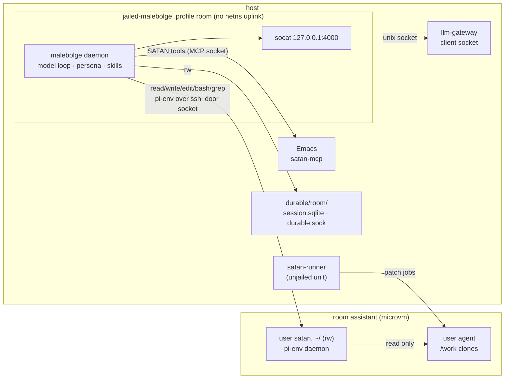
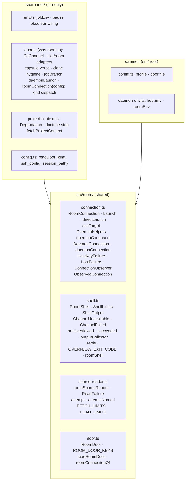
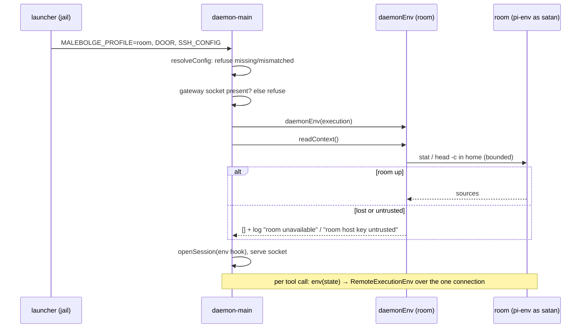

<!-- doctrine:section sec-1 -->
# 1. Design Problem

Malebolge (`~/dev/malebolge`) runs two pi-durable agents with opposite reach.
The **interactive daemon** (`src/daemon-main.ts`, launched by
`jailed-malebolge` from `~/dev/satan/flake.nix`) runs its coding tools — `read`,
`write`, `edit`, `bash`, `grep` — on the host, in a bwrap jail with the launch
directory (`~/notes`) bound read-write and the host network on. The **patch
runner**'s jobs run their tools inside oubliette's room `assistant` (a microvm)
over pi-env, with no uplink. The agent with freedom acts on the host; the agent
in SATAN's own machine is the constrained one. CHR-020 — the daemon can write
the user's notes — is the live symptom.

This slice gives the daemon **vm mode**: its coding tools execute in room
`assistant`, as a room user of its own, in that user's home. The model loop,
the gateway key and the SATAN MCP tools (fixed mode `interactive`) stay on the
host. The daemon's jail loses the network, the launch directory and every
host write except its own conversation store, its attach socket and its
persisted jail home (§4.6).



Every edge leaving the jail is a named unix socket or an explicit bind; the
gateway is the only network egress, bounded by its key. The dotted edge is the
D3 rule (RFC-019 D3, "vm mode's work reaches the host only as a patch job"):
user `satan` can read `/work` clones and cannot write them, so vm-mode work
reaches the host only through a patch job the user promotes.

**Boundary.** In scope: the shared room module in malebolge (`src/room/`), the
daemon's room profile, the room-profile jail, the grants inventory (RFC-019
OQ-4), the corpus wording, and drafted governance revisions. Out of scope:
building the egress and host profiles (CON-005 — only the seam), per-mode SATAN
tool filtering (RSK-019), merging daemon and runner (RFC-019 OQ-1), the
gateway client socket, the launch-dir switch and the jail's
`workspaceDepsFromEnv` and `persistedHome` settings (flakes:SL-015, a
prerequisite that lands first), and the fleet's room user declaration (in
`/srv/fleet`).

<!-- doctrine:section sec-2 -->
# 2. Current State

**Daemon** (`src/daemon-main.ts`, `src/session.ts`, `src/config.ts`):

- `resolveConfig(process.env, process.cwd())`; `cwd` is the launch directory.
  Store `~/.local/state/satan/durable/session.sqlite`; attach socket
  `$XDG_RUNTIME_DIR/satan/durable.sock` (override `MALEBOLGE_SOCKET`), which
  `src/attach-main.ts` and `emacs/malebolge.el` (via attach-main) also resolve.
- Project context read once at startup with node fs:
  `readSources(cwd, gitRootDirs(cwd), nodeSourceReader)` (SL-026 DEC-072).
- `openSession` hard-codes the environment:
  `env: ({ cwd }) => new NodeExecutionEnv({ cwd: cwd ?? process.cwd() })`.
  pi-durable calls this hook per tool call (`harness/harness.ts:255-261`); the daemon
  re-applies `{ model, cwd }` on every open (`daemon-main.ts`).
- Extensions `[persona, projectContext, skills, cwd, CodingTools, grep, satan]`
  (`src/daemon-extensions.ts`). `persona` is `system/scaffold.txt` +
  `prompts/interactive.txt`, the same files `~/notes` `just
  build-system-prompt` concatenates for pi's `jailed-pi`.
- `grep` maps an exec `spawn_error` to "ripgrep (rg) is not available"
  (`src/grep.ts`), which misreports any connection failure.

**Runner's room code** (`src/runner/`):

- `env.ts`: `LostFailure`, `HostKeyFailure`, `ConnectionObserver`,
  `JobConnection` (an observing `Connection` subclass), `jobEnv`,
  `sshTarget`, `DaemonHelpers`, `daemonCommand`, `DaemonConnection` (keeps the
  host-key trust record pi-env erases), `daemonConnection`.
- `room.ts`: the git channel (`GitChannel`, slot and room adapters, `capsule`
  verbs, clone hygiene) **and** the room session facts (`RoomConnection`,
  `Launch`, `daemonLaunch`, `roomConnection`), the shell types (`RoomShell`,
  `ShellLimits`, `ShellOutput`), `ChannelUnavailable`, `ChannelFailed`,
  `notOverflowed`, `succeeded`.
- `shell.ts`: `outputCollector`, `settle`, `OVERFLOW_EXIT_CODE`,
  `roomShell(connection, jobId, cwd)` built on `jobEnv`.
- `project-context.ts`: a private `roomSourceReader` entangled with job
  admission (`Degradation`, the doctrine step, `PrepareFailed`).
- `config.ts`: `readDoor` parses `[door]`; kind `room` keys `room`, `user`,
  `known_hosts`, `host_key_alias`, `ssh_config`, `identity`, `session_path`.
- `test/runner/room.test.ts` "door knowledge (EX-10)": the door is named only
  in `runner/config.ts`, `runner/env.ts`, `runner/room.ts`; the kind only in
  `runner/config.ts`, `runner/room.ts`.
- Import census (malebolge RFC-001): only `runner-main.ts` imports
  `src/runner/*`.

**Jail** (`~/dev/satan/flake.nix`): `jailed-malebolge` =
`makeJailedAgent { profile = "specDev"; extraPkgs = devToolPkgs ++ goadPkgs; }`
with `malebolgeJailOptions`: rw `/run/user/1000/satan` (MCP and attach
socket, and `goad.sock`), ro malebolge tree, ro `~/satan-corpus`, rw
`~/satan-corpus/goad`, rw `~/.local/state/satan/durable`, ro gateway key and
catalog, `MALEBOLGE_SKILLS` = goad's skill. The jail library binds the launch
directory rw at `/workspace/<basename>` unconditionally
(`~/flakes/agents/jailed-agents.nix`). `jailProbes.malebolge` asserts the key
custody, the goad bind, the skill and `rg` on PATH.

**Room** (EVD-011, research ✓ rows): room `assistant` is reached through the
door socket `/run/capsule-room/assistant/ssh.sock` (ssh `ProxyCommand socat`);
two pi-env clients on one room user are independent; a non-login ssh command
has the room base (`rg`, `git`) on PATH; `microvm@assistant` is not started at
boot (`capsule assistant start`). The runner's room user is `agent`, which owns
the `/work` clones.

<!-- doctrine:section sec-3 -->
# 3. Forces & Constraints

- **CON-005 (execution profiles).** Room profile only; the seam admits egress
  and host later; egress and room never combine, by construction; a profile is
  a host jail (oubliette RFC-001 P3), not a daemon flag; a conversation is
  bound to one profile for life (oubliette RV-021 F-1).
- **ADR-017 §2, §4; SPEC-001 REQ-009..011.** Safe with Emacs absent; fail
  closed; a lost room is a tool error, not a crash; no dual enforcement.
- **ADR-017 §3 ledger, INV-1..3.** An owner or enforcement move edits the
  ledger in the same change, with a transition line (→ DEC-082).
- **ADR-018 D2.** Mode policy is core-owned; the execution profile is launcher
  configuration, not mode policy, so D2 is untouched (DEC-082).
- **POL-001.** The shared module is a cutover: one implementation, no
  parallel copy in the daemon.
- **SPEC-002 NF-004 (REQ-016).** The jail is a declared, test-asserted
  profile: no notes rw, no secrets on argv. **NF-005 (REQ-017):** SATAN never
  writes the notes root. **NF-006 (REQ-018):** named, configurable values, not
  literals in code.
- **SPEC-004 §Execution environment, NF-001 (REQ-033).** The runner's per-job
  env, tools and door values are unchanged by the extraction.
- **SL-026 DEC-072.** Context is read once, in the environment, through one
  renderer; its daemon half is amended by DEC-080.
- **ISS-042.** Sockets are bound as directories, never as files.
- **mem.fact.jail.unix-socket-ro-bind.** `connect` works through a read-only
  bind; `listen` needs a writable one.
- **flakes:SL-015** (prerequisite, handback 2026-10-20): flakes:DEC-075 gateway
  client socket `/run/llm-gateway-client/api.sock` (user, 0600);
  flakes:DEC-076 `jailLib.gatewaySocketOptions` (ro socket-dir bind + in-jail
  `socat` on `127.0.0.1:4000`), added by the jail itself because
  `jailed-malebolge` passes no `gateway`; flakes:DEC-077 bound host sockets are
  channels whose audit is the jail definition's job; flakes:DEC-078
  `mountLaunchDir ? true`, off → start in `$HOME`. Profile `offline` sets
  `SSH_AUTH_SOCK=""`: the room identity must be a file. PHASE-05
  (`03dc0f0a`): `workspaceDepsFromEnv`, `persistedHome` (§4.6).
- **malebolge RFC-001** (advice, DEC-074): adopted — the `src/room/` tier,
  the consumer cut, the invariants in the module header, no pause, profile or
  tool-error policy inside, `runner/door.ts` rename, an explicit import
  allowlist on three sides (runner, room, outside), `parseModel` out of
  `src/config.ts` and `registryOf` out of `src/session.ts` (RFC-001 §3,
  RV-001 F-4), `run.ts` not bundled (RFC-001 §5). Departures: the room-door TOML
  parser is shared in `src/room/` (RFC-001 §3 wanted per-program parsers);
  `daemonLaunch` and `roomConnection(config)` stay in `src/runner/`, with
  client-neutral `directLaunch` and `roomConnectionOf` in `src/room/`;
  `JobConnection` moves, as `ObservedConnection` (§7 R1); `DOCTRINE_LIMITS`
  stays (the daemon runs no doctrine step). Deferred to malebolge IMP-002, as
  the RFC permits: `src/lib/`, the rest of the two-`config.ts` split, the
  `run.ts` re-cut.

Governing decisions: DEC-074 (module), DEC-075 (jail), DEC-076 (grants),
DEC-077 (profile selection, door file), DEC-078 (profile-bound store),
DEC-079 (room down, trust), DEC-080 (context through the env), DEC-081
(direct launch), DEC-082 (authority and spec revisions). Evidence: EVD-011.

<!-- doctrine:section sec-4 -->
# 4. Design

## 4.1 `src/room/`: the room session, shared (DEC-074)

A new tier holds what a room session needs whichever program holds it. The
cut is by consumer: *would the daemon need this to have a room session?* If
yes it moves; if it exists because a job is a reviewable unit of work, it
stays in `src/runner/`.



Arrows are imports. Nothing outside `src/runner/` imports `src/runner/*`, and
`src/runner/` imports no daemon-private module.

**Module header** (`src/room/connection.ts`, referenced from the other three
files), stating the invariants that travel:

1. Built from facts (`RoomConnection`, `Launch`); never knows which client it
   serves, which kind of door it reached, or which profile is running. A
   function that needs to ask "job or daemon?" belongs to neither: split it or
   inject the difference.
2. A host-key failure is a trust failure, never downtime: it is recorded
   (`DaemonConnection.trustFailure`) and surfaced as such; it is never retried
   as a lost room.
3. No pause, profile or tool-error policy inside. Reactions are the caller's,
   passed in as an observer or a function.

**Moves, unchanged in behaviour.** From `runner/env.ts`: `LostFailure`,
`HostKeyFailure`, `ConnectionObserver`, `sshTarget`, `DaemonHelpers`,
`daemonCommand`, `DaemonConnection`, `daemonConnection`, and the
`HostKeyChangedError`/`HostKeyUnknownError` re-exports. From `runner/room.ts`:
`RoomConnection`, `Launch`, `RoomShell`, `ShellLimits`, `ShellOutput`,
`ChannelUnavailable`, `ChannelFailed`, `notOverflowed`, `succeeded`. From
`runner/shell.ts` (the whole file): `outputCollector`, `settle`,
`OVERFLOW_EXIT_CODE`, `roomShell`. From `runner/project-context.ts`:
`roomSourceReader`, `attempt`, `attemptNamed`, the failure classification,
`regularPaths`, `FETCH_LIMITS`, `HEAD_LIMITS`.

**New in `src/room/`:**

```ts
// connection.ts
/** A launch that runs the daemon itself, with no wrapper (a slot; vm mode, DEC-081). */
export const directLaunch: Launch = (daemon) => [daemon];

/**
 * `inner`, observed: a call failing with `isConnectionLost` is reported
 * (trust failure or loss, by `DaemonConnection.trustFailure`) and awaited
 * before the error is rethrown — or, when `reword` is given, a RemoteError
 * with the same code and fields and the client's message.
 */
export class ObservedConnection extends Connection {
  constructor(inner: Connection, observer: ConnectionObserver, reword?: Reword);
}
export type RoomFault = "unavailable" | "untrusted";
export type Reword = (fault: RoomFault, error: RemoteError) => RemoteError;

// shell.ts — the factory takes an env identity, not a job
export function roomShell(connection: Connection, at: { id: string; cwd: string }): RoomShell;

// source-reader.ts — admission split off: failures go to the caller
export type ReadFailure =
  | { reason: "missing" | "timeout" | "overflow" }
  | { reason: "exit" | "error"; code?: number | string; stderr?: string };
export function roomSourceReader(
  shell: RoomShell,
  signal: AbortSignal,
  failed: (source: string, failure: ReadFailure) => void,
): SourceReader;

// door.ts — the room-door table both programs parse (DEC-074, DEC-077)
export interface RoomDoor {
  room: string;
  user: string;
  knownHosts: string;
  hostKeyAlias: string;
  identity: string;
}
export const ROOM_DOOR_KEYS = ["room", "user", "known_hosts", "host_key_alias", "identity"] as const;
/** The room-door keys of `fields`; the caller checks for keys it does not allow (onlyKeys). */
export function readRoomDoor(fields: JsonRecord, home: string): RoomDoor;
export const roomConnectionOf = (door: RoomDoor, sshConfig?: string): RoomConnection;
```

`ObservedConnection` is today's `JobConnection` body, renamed because it no
longer belongs to a job: `roomShell` (moving to `src/room/` by DEC-074) is
built on it, and the daemon's fault wording (§4.4) needs the same seam. The
runner's `jobEnv` builds an `ObservedConnection` with its pause observer and no
`reword`; its behaviour is unchanged. `roomSourceReader` rethrows what the
classification does not answer for (the caller's abort, `ChannelUnavailable`,
`ChannelFailed` `host_key`, non-channel errors), as today. `expandHome` moves
from `runner/config.ts` to `src/fields.ts` with `requireString` and `onlyKeys`.

**Stays in `src/runner/`.** `jobEnv` and the pause wiring (`env.ts`,
`pause.ts`); `GitChannel` and both adapters, the `capsule` verbs, the slot door,
clone hygiene (`checkRoomClone`, `cleanRoomClone`, `CloneDefect`,
`PREPARE_LIMITS`), `jobBranch`, `daemonLaunch` (`session <repo> --`, room
kind; `directLaunch` for a slot) and `roomConnection(config)`, which dispatches
on `[door] kind` and calls `roomConnectionOf` for a room door. The remainder of
`room.ts` is renamed `runner/door.ts`. `Degradation` becomes
`{ source: string } & (ReadFailure | { reason: "boot_not_ignored" | "empty" })`;
the doctrine step and `DOCTRINE_LIMITS` stay (the daemon runs no doctrine).
`readDoor` (kind `room`) is `{ kind, ...readRoomDoor(fields, home),
sshConfig, sessionPath }`.

**Root moves for the runner's contract** (RFC-001 §3, RV-001 F-4). The
runner imports two root modules only for one helper each; both modules are
otherwise daemon-only and this slice grows them. `parseModel`, `ModelRef` and
`DEFAULT_MODEL` move from `src/config.ts` to `src/models.ts`, beside
`GATEWAY_PROVIDER`; `registryOf` moves from `src/session.ts` to a new
`src/registry.ts`. Afterwards `config.ts` and `session.ts` are daemon-only.

**Structural test** (`test/structure.test.ts`, replacing the one-way check),
an allowlist asserted over source text, file by file:

- no module outside `src/runner/` imports `src/runner/*`, except the entry
  point `src/runner-main.ts`;
- a module in `src/runner/` imports only `src/runner/*`, `src/room/*` and the
  root modules `context`, `fields`, `grep`, `json`, `message-of`, `models`,
  `ndjson`, `project-context`, `registry`, `truncate`, `unix-socket` (today's
  edges, less `config` and `session`);
- a module in `src/room/` imports only `src/room/*` and the root modules
  `context`, `fields`, `json`, `project-context` (the `SourceReader` type),
  `truncate` (and packages); never `src/runner/*` or a
  daemon module.

A new root module is outside the runner's allowlist until it is added on
purpose.
EX-10 (`test/runner/room.test.ts`) is revised: the door is named in
`runner/config.ts`, `runner/door.ts`, `room/door.ts`, `room/connection.ts` and
the daemon's `config.ts`; the *kind* (slot vs room door) only in
`runner/config.ts` and `runner/door.ts`. The profile literal `"room"` must not
trip the kind check: the kind regex is narrowed to the door's kind (`kind`
compared with `"slot"`/`"room"`, the kind-only keys, the door types), not any
quoted `room`.

## 4.2 Execution profile and daemon configuration (DEC-077, DEC-078)

The launcher selects the profile; the jail enforces it; the daemon builds only
what its profile names.

| variable | set by | profile | meaning |
|---|---|---|---|
| `MALEBOLGE_PROFILE` | launcher | all | `room` or `host`. Absent or other → startup error |
| `MALEBOLGE_DOOR` | launcher | room | path of the door file (TOML, below). Required for `room`, refused for `host` |
| `MALEBOLGE_SSH_CONFIG` | launcher | room | path of the jail's rendered ssh_config (a store path in the jail's closure). Required for `room` |
| `MALEBOLGE_GATEWAY_SOCKET` | launcher | room | the gateway client socket; checked at startup (§4.4) |

Door file (rendered by home-manager from one attrset beside the runner's
`[door]`, flakes side):

```toml
[door]
room = "assistant"
user = "satan"
known_hosts = "/var/lib/capsule/room/assistant/known_hosts"
host_key_alias = "assistant"
identity = "/home/david/.ssh/malebolge-vm.key"
home = "/home/satan"
```

Keys: `ROOM_DOOR_KEYS` (DEC-077) plus `home`, the room user's home and the
daemon's room cwd (§7 R2). The daemon's parser is
`onlyKeys(door, [...ROOM_DOOR_KEYS, "home"])` then `readRoomDoor`. No
`ssh_config`: the jail renders it (DEC-075).

```ts
// src/config.ts
export type Profile = "room" | "host";
export type Execution =
  | { profile: "host"; cwd: string }
  | { profile: "room"; room: RoomConnection; home: string; gatewaySocket?: string };

export interface Config {
  // … unchanged fields …
  execution: Execution;
  /** <state>/satan/durable/<profile>/session.sqlite */
  storagePath: string;
  /** $MALEBOLGE_SOCKET or <runtime>/satan/durable/<profile>/durable.sock */
  daemonSocket: string;
}
export function resolveConfig(env: Env, cwd: string, readFile: (path: string) => string): Config;
```

`cwd` and `skillDirs` stay; `cwd` becomes `execution.cwd` for `host` and
`execution.home` for `room`.

**Profile-bound store (DEC-078).** The store and attach socket live in
directories named for the profile; each jail binds only its own (§4.6). As a
cheap check against a launcher misconfiguration, `resolveConfig` refuses a
store or socket whose parent directory's name differs from the profile —
reachable today only through `MALEBOLGE_SOCKET`. The existing
`durable/session.sqlite` becomes the host profile's (`durable/host/`, an
operator move); the room profile starts fresh.

**Attach.** `daemonSocket(env)` (shared by daemon and `attach-main.ts`)
resolves `MALEBOLGE_SOCKET`, else `<runtime>/satan/durable/<profile>/durable.sock`
with the profile from `MALEBOLGE_PROFILE`, defaulting to `room` for the
attach client only — the one profile with a launcher (§7 R5). The daemon
never defaults.

## 4.3 The daemon's environment (DEC-081)

`openSession` takes the environment hook instead of building one:

```ts
// src/session.ts
export interface SessionOptions {
  models: Models;
  extensions: readonly Extension[];
  agent: AgentChange;
  /** pi-durable's per-call environment hook. */
  env: (state: { cwd?: string }) => ExecutionEnv;
}

// src/daemon-env.ts — the one place a profile turns into an environment
export interface DaemonEnv {
  env: SessionOptions["env"];
  /** The agent's cwd: the launch dir (host) or the room home (room). */
  cwd: string;
  /** Project context sources, read once at startup (§4.5); [] when unreadable. */
  readContext: () => Promise<ContextSource[]>;
  close: () => void;
}
export function daemonEnv(execution: Execution, log: (text: string) => void): DaemonEnv;
```

- **host**: today's behaviour — `NodeExecutionEnv`, `nodeSourceReader` over
  `gitRootDirs(cwd)`.
- **room**: one `DaemonConnection` for the daemon's life,
  `daemonConnection(room, directLaunch)` — pi-env started directly in the room
  user's home, no `session` (DEC-081; the room base is on PATH, EVD-011). The
  tool path wraps it in an `ObservedConnection` (observer logs; `reword` per
  §4.4); the startup context read (§4.5) passes the bare `DaemonConnection` to
  `roomShell`, which observes it itself. Rule: an `ObservedConnection` always
  wraps a `DaemonConnection` directly, never another `ObservedConnection` —
  its trust check reads `trustFailure()` from its immediate inner connection,
  so a nested wrapper would report a host-key refusal as a loss.
  The hook returns a `RemoteExecutionEnv` over the tool path's wrapper, id `pi-env:daemon-room`,
  cwd `state.cwd ?? home`. The connection is lazy: nothing runs until the
  first call, a failed start fails that call, the next call retries (pi-env).
  `close` closes it at shutdown.



The daemon never starts the room (DEC-079): `capsule assistant start` is the
operator's.

## 4.4 Room faults (DEC-079)

Observed at the connection seam, never conflated, worded once for every tool:

| seen at `ObservedConnection` | tool sees | logged |
|---|---|---|
| lost, no trust failure on record | `room unavailable: <pi-env message>` | yes |
| lost, `trustFailure()` set | `room host key untrusted: <message>` | yes, every time |
| other failure | pi-env's message, unchanged | no |

pi-env copies a `RemoteError`'s message into the `ExecutionError` /
`FileError` it returns (`remote-env.ts`), so rewording at the seam reaches
`read`, `write`, `edit`, `bash` and `grep` alike; the daemon's `reword` is the
injection, and neither pi-durable's tools nor `grep` learn about rooms. `grep`'s
own `spawn_error` text becomes neutral — `rg could not run: <message>` —
which reads correctly for a missing binary and for a reworded room fault
(§7 R3). The session survives either fault; the next call tries again.

**Startup.** A room that cannot be reached means no project context section,
logged, and the daemon starts. A **missing-socket check**: when
`MALEBOLGE_GATEWAY_SOCKET` is absent from the filesystem, startup is refused
with `gateway socket missing: <path> (llm-gateway client listener)`, as an
unreachable satan-mcp is today. It proves presence only: a stale socket or a
listener failing later still reaches the model call as the provider's
connection error, through the in-jail forwarder (§7 R6).

## 4.5 Project context and cwd (DEC-080)

In the room profile the daemon reads project context once at startup through
`roomSourceReader` over `roomShell(daemonConnection, { id: "pi-env:daemon-room-context",
cwd: home })`, from the home only: `readSources(home, [home], reader)` — the
home is not a git repo, so no root walk. Read failures are logged (`failed`
callback), not fatal; `ChannelUnavailable` and `ChannelFailed` `host_key` are
caught in `readContext` and yield `[]`. Every exec carries `FETCH_LIMITS` /
`HEAD_LIMITS`, so a down room costs at most a few bounded timeouts. One
renderer (`renderProjectContext`), unchanged; the host profile keeps the node
reader. The cwd section reads `Current working directory: /home/satan`.

## 4.6 The room-profile jail (DEC-075)

```nix
# ~/dev/satan/flake.nix (sketch; names per flakes:SL-015 as landed)
malebolgeSshConfig = pkgs.writeText "malebolge-room-ssh-config" ''
  Host *
    ProxyCommand ${pkgs.socat}/bin/socat - UNIX-CONNECT:/run/capsule-room/%h/ssh.sock
'';
malebolgeRoomJailOptions = with jailLib.combinators; jailLib.gatewaySocketOptions ++ [
  (try-fwd-env "XDG_RUNTIME_DIR")
  (set-env "MALEBOLGE_PROFILE" "room")
  (set-env "MALEBOLGE_DOOR" malebolgeDoorFile)
  (set-env "MALEBOLGE_SSH_CONFIG" "${malebolgeSshConfig}")
  (set-env "MALEBOLGE_GATEWAY_SOCKET" gatewayClientSocket)
  (readonly "/run/capsule-room/assistant")          # door socket dir (ISS-042)
  (readonly roomKnownHosts)
  (readonly malebolgeRoomIdentity)
  (readonly malebolgeDoorFile)
  (readonly "/run/user/1000/satan/mcp")            # satan-mcp, connect only
  (readonly malebolgeRoot)
  (readonly "/home/david/satan-corpus")
  (readonly malebolgeKeyFile)
  (readonly malebolgeCatalog)
  (readwrite "/run/user/1000/satan/durable/room")  # attach socket: listen needs rw
  (readwrite "/home/david/.local/state/satan/durable/room")
  (set-env "MALEBOLGE_GATEWAY_KEY_FILE" malebolgeKeyFile)
  (set-env "MALEBOLGE_GATEWAY_CATALOG" malebolgeCatalog)
];
jailed-malebolge = jailLib.makeJailedAgent {
  name = "malebolge";
  agent = malebolgeDaemon;
  profile = "offline";          # --unshare-net
  mountLaunchDir = false;       # flakes:DEC-078
  extraPkgs = [ pkgs.nodejs pkgs.openssh pkgs.socat ];
  extraOptions = malebolgeRoomJailOptions;
  apiKeys = []; useOpEnv = false; workspaceDeps = [];
  workspaceDepsFromEnv = false; # flakes:SL-015 PHASE-05 (RV-035 F-1)
  persistedHome = "malebolge";  # flakes:SL-015 PHASE-05 (RV-035 F-6)
};
```

- `%h` in `ProxyCommand` is the ssh host, which `sshTarget` sets to the room
  name, so the ssh_config holds no room literal; the store-path `socat` is in
  the jail's closure (handback: the oubliette host's socat is not).
- The writable directories must exist before bwrap binds them; the launcher
  creates both (`mkdir -p`) before entering the jail.
- `mcp/` alone is bound; `goad.sock` and the rest of `/run/user/1000/satan`
  are not in the jail.
- **Persisted jail home.** Profile `offline` persists a host-backed,
  writable home (`persist-home "agent-offline"`), shared by name with any
  other `offline` consumer (none today). The daemon keeps nothing there
  (store and socket are explicit binds; pi-env's server binary comes from the
  ro malebolge tree, deployed to the room user's `~/.pi/mobile/tools`), but a
  compromised daemon can write it. flakes:SL-015 PHASE-05 adds
  `persistedHome` (a string replaces the profile's home name); satan sets
  `"malebolge"`, so that write reaches nothing another jail reads.
- **Workspace deps.** `makeJailedAgent` merges `JAIL_WORKSPACE_DEPS` (read by
  `builtins.getEnv` under impure evaluation) into rw `/workspace/<name>`
  binds. satan's `.envrc` exports it (including `~/notes`) and evaluates the
  devshell `--impure`, whose packages include `jailPkgs`: the devshell's
  `jailed-malebolge` binds `~/notes` rw today, whatever `mountLaunchDir`
  says. flakes:SL-015 PHASE-05 adds `workspaceDepsFromEnv` (false skips the
  `JAIL_WORKSPACE_DEPS` merge; static `workspaceDeps` still bind); satan sets
  it false for `jailed-malebolge`. Until PHASE-05 lands the room profile does
  not ship. Probe: no `/workspace/` bind at all, checked on the launcher built
  from the impure devshell, not only under pure `nix flake check`.
- The room literal `assistant` appears once in the satan flake (the door
  dir bind), beside the door file path; the door file is the single source of
  the room's facts for the daemon.
- Residual network egress: the gateway, bounded by the key's model list and
  budget. Host reach: the SATAN MCP tool set through Emacs. CON-005 forbids
  egress with the room attached, so an MCP tool that can carry data off the
  host is not an accepted residual: §6's audit gates closure on there being
  none in the `interactive` set (§7 on keeping it so).

## 4.7 Jail grants inventory (DEC-076, RFC-019 OQ-4)

| grant today | disposition | reason |
|---|---|---|
| launch dir rw at `/workspace/<dir>` | removed (`mountLaunchDir = false`) | CHR-020 |
| host network (`specDev`) | removed (`offline`) | CON-005; gateway via socket |
| `devToolPkgs` (incl. `rg`) | removed | no host coding tools; `grep` runs in the room |
| `goadPkgs`, goad skill (`MALEBOLGE_SKILLS`), rw `~/satan-corpus/goad` | removed | goad-backend authoring becomes patch jobs on satan-corpus (IMP-020); goad's host service keeps writing its data |
| rw `/run/user/1000/satan` | narrowed: ro `mcp/` + rw `durable/room/` | no host write but the profile's own socket |
| rw `~/.local/state/satan/durable` | narrowed: rw `durable/room/` | DEC-078 |
| persisted jail home (`agent` under `specDev`) | kept, its own: `persistedHome = "malebolge"` (flakes:SL-015 PHASE-05) | ssh and node need a `HOME`; nothing kept there |
| `JAIL_WORKSPACE_DEPS` rw binds (impure eval) | removed: `workspaceDepsFromEnv = false` (flakes:SL-015 PHASE-05) | the devshell's launcher binds `~/notes` rw today |
| ro `~/satan-corpus` | kept | persona (`system/`, `prompts/`) |
| ro malebolge tree | kept | the daemon runs from it |
| ro gateway key, catalog | kept | model access |

## 4.8 Room user, corpus, fleet, flakes

- **Room user (D3 by permissions).** vm mode runs as its own room user,
  `satan`, with its own key and home `/home/satan`. `/work`
  clones stay owned by `agent`: readable by `satan`, not writable. vm mode
  clones what it needs into its home (`git clone /work/<repo>`); its work
  reaches the host only as a patch job. Today oubliette seeds each clone
  directory `0700` for `agent` alone; read access comes from oubliette
  IMP-023 (prerequisite): `repos.readers`, a readers' group with a declared
  gid, clone directories `0750` to that group, git `safe.directory` for the
  readers. Declared in `/srv/fleet/flake.nix`: `rooms.assistant.users.satan`
  and `repos.readers = ["satan"]`; the key is issued by `~/flakes` with the
  door file. `dirty_clone` stays as the runner's own check.
- **Persona.** `prompts/interactive.txt` is shared with pi's `jailed-pi`
  (`~/notes` `just build-system-prompt`), whose environment differs (host
  jail, `/workspace/notes`). Its "Execution environment" paragraph moves to a
  per-profile file: `prompts/env/room.txt` (room `assistant`, user `satan`,
  cwd the home; `/work` clones are read-only — clone into your home; your
  changes reach the user only as a patch job you propose; web access is not
  available) and `prompts/env/pi.txt` (today's wording, for `jailed-pi`).
  `personaFiles(corpusRoot, profile)` appends `prompts/env/<profile>.txt`;
  `just build-system-prompt` appends `prompts/env/pi.txt` (§7 R4). A missing
  env file is a startup error naming its path, as an absent profile is: this
  slice writes `room.txt` and `pi.txt` only, and the host profile gets
  `host.txt` with its launcher.
- **`~/notes` justfile.** `hello-durable` and `attach-durable` keep working
  unchanged (attach defaults to `room`); `build-system-prompt` gains the pi
  env file.
- **flakes (not ours; lands first).** flakes:SL-015 delivers the gateway
  client socket, `jailLib.gatewaySocketOptions`, `mountLaunchDir`, the door
  file render, the vm-mode identity key, and (PHASE-05) `workspaceDepsFromEnv`
  and `persistedHome`. oubliette IMP-022 (room-client bundle) is backlog only.

## 4.9 Governance revisions (DEC-082; drafted here, applied at reconcile)

- **ADR-017 authority ledger.** Legend gains `satan-flake` — "the satan
  flake's launchers (`~/dev/satan/flake.nix`)". New row:

  | # | Authority item | Owner | Governs | Enforced at | Since |
  |---|---|---|---|---|---|
  | 3b | Malebolge execution profile | `satan-flake` | REQ-002 | `jailed-malebolge` / `malebolgeRoomJailOptions` (`~/dev/satan/flake.nix`), enforced at bwrap; checked by `malebolge-jail-profile` | SL-027 |

  Row 3 is unchanged. Transition line: `3b · (new) → satan-flake · SL-027 · malebolge's
  execution profile is a launcher, not an Emacs profile (DEC-082)`.
- **SPEC-002 REV.** §Containers: the interactive daemon is a room client
  (coding tools in room `assistant` as user `satan`; model loop, persona and
  SATAN MCP on the host). §Transports: daemon → room over pi-env/ssh through
  the door socket; daemon → gateway over the client socket. §Current topology
  and §End-state diagrams likewise. NF-004: the room-profile jail as a
  consumer class with its asserted bind list (§4.6). NF-005: room writes
  (the `satan` room home) are outside the three roots, not host writes.
- **SPEC-004 REV.** §Execution environment: the room session lives in
  `src/room/`, shared with the daemon; the runner's per-job env, tools and
  door values are unchanged. §Concerns "one seat": the daemon is a concurrent
  room client outside the job seat, as its own room user; it never touches
  `/work` clones or the room's lifecycle.
- **malebolge IMP-002 / RV-001 F-4** (cross-repo note, at reconcile): SL-027
  delivered `src/room/`, the structural test, and the `parseModel` and
  `registryOf` moves; IMP-002 keeps `src/lib/`, the rest of the
  two-`config.ts` split, and the `run.ts` re-cut (RFC-001 §5: not bundled
  here).
- **SL-026 DEC-072** noted as amended for the daemon by DEC-080. **IMP-037**
  progress notes become history (DEC-076).

<!-- doctrine:section sec-5 -->
# 5. Code Impact

| path | change |
|---|---|
| `malebolge/src/room/connection.ts` | new: module header (invariants); moved `RoomConnection`, `Launch`, `sshTarget`, `DaemonHelpers`, `daemonCommand`, `DaemonConnection`, `daemonConnection`, `LostFailure`, `HostKeyFailure`, `ConnectionObserver`, host-key error re-exports; new `directLaunch`, `ObservedConnection` (was `JobConnection`), `RoomFault`, `Reword` |
| `malebolge/src/room/shell.ts` | new: moved `RoomShell`, `ShellLimits`, `ShellOutput`, `ChannelUnavailable`, `ChannelFailed`, `notOverflowed`, `succeeded`, `outputCollector`, `settle`, `OVERFLOW_EXIT_CODE`; `roomShell(connection, { id, cwd })` |
| `malebolge/src/room/source-reader.ts` | new: moved `roomSourceReader` (failure callback, `ReadFailure`), `attempt`, `attemptNamed`, classification, `regularPaths`, `FETCH_LIMITS`, `HEAD_LIMITS` |
| `malebolge/src/room/door.ts` | new: `RoomDoor`, `ROOM_DOOR_KEYS`, `readRoomDoor`, `roomConnectionOf` |
| `malebolge/src/fields.ts` | gains `expandHome` (from `runner/config.ts`) |
| `malebolge/src/models.ts` | gains `parseModel`, `ModelRef`, `DEFAULT_MODEL` (from `config.ts`) |
| `malebolge/src/registry.ts` | new: `registryOf` (from `session.ts`) |
| `malebolge/src/runner/model-gate.ts`, `runner/run.ts`, `runner/start.ts`, `test/harness-fixture.ts` | import paths for the two root moves |
| `malebolge/src/runner/run.ts:353`, `runner/collect.ts:177`; `test/runner/room-fixture.ts`, `shell.test.ts`, `prepare.test.ts`, `collect.test.ts` | `roomShell(connection, jobId, cwd)` → `roomShell(connection, { id, cwd })` |
| `malebolge/src/runner/env.ts` | keeps `jobEnv` (builds `ObservedConnection`); imports from `src/room/` |
| `malebolge/src/runner/room.ts` → `runner/door.ts` | renamed; loses the moved symbols; `daemonLaunch` uses `directLaunch` for a slot; `roomConnection(config)` calls `roomConnectionOf` |
| `malebolge/src/runner/shell.ts` | deleted (moved) |
| `malebolge/src/runner/project-context.ts` | keeps doctrine step, `DOCTRINE_LIMITS`, `Degradation`, `fetchProjectContext`; uses the shared reader |
| `malebolge/src/runner/config.ts` | `readDoor` (room) composes `readRoomDoor` |
| `malebolge/src/runner/*` (other importers of `room.ts`, `shell.ts`, `env.ts`) | import paths only |
| `malebolge/src/config.ts` | `Profile`, `Execution`, door-file parse, profile-derived store and socket, mismatch refusal, `daemonSocket` profile default |
| `malebolge/src/daemon-env.ts` | new: `daemonEnv` (host, room), reword, `readContext` |
| `malebolge/src/session.ts` | `SessionOptions.env`; `NodeExecutionEnv` import leaves |
| `malebolge/src/daemon-main.ts` | gateway-socket check; `daemonEnv`; context via `readContext`; cwd from `DaemonEnv`; close on stop; log line names the profile |
| `malebolge/src/persona.ts` | `personaFiles(corpusRoot, profile)` appends `prompts/env/<profile>.txt`; missing env file → startup error naming the path |
| `malebolge/src/grep.ts` | neutral `spawn_error` text |
| `malebolge/test/structure.test.ts` | new: three-sided import allowlist (§4.1) |
| `malebolge/test/runner/room.test.ts` | EX-10 owners and kind regex revised; tests of moved code move with it (`test/room/…`) |
| `malebolge/test/…` | per §6 |
| `malebolge/docs/internals.md`, `README.md` | room tier, profiles, door file, socket path |
| `satan/flake.nix` | `jailed-malebolge` → room profile (§4.6); `malebolgeJailOptions` replaced; goad bindings removed; `jailProbes.malebolge` rewritten; `devToolPkgs` `ripgrep` comment no longer names the daemon |
| `satan-corpus/prompts/interactive.txt`, `prompts/env/room.txt`, `prompts/env/pi.txt` | §4.8 |
| `notes/justfile` | `build-system-prompt` appends `prompts/env/pi.txt` |
| `satan/.doctrine/adr/017/authority-ledger.md`, `spec/tech/002`, `spec/tech/004` | at reconcile (§4.9) |

Cross-repo, not this slice's to write: `~/flakes` (flakes:SL-015: gateway
client socket, `gatewaySocketOptions`, `mountLaunchDir`, door file, identity
key, `workspaceDepsFromEnv`, `persistedHome`), `~/dev/oubliette` (IMP-023:
`repos.readers`, the readers' group that makes `/work` clones readable) and
`/srv/fleet/flake.nix` (`rooms.assistant.users` gains `satan`;
`repos.readers = ["satan"]`).

<!-- doctrine:section sec-6 -->
# 6. Verification

**VT** (malebolge, `just check`: lint, format, typecheck, tests):

- **Runner unchanged.** The runner suite passes with only import-path edits
  and the `roomShell(connection, { id, cwd })` call shape; moved tests
  (`env`, `shell`, `project-context`) pass in their new homes with their
  assertions unchanged (SPEC-004 NF-001).
- **Structure** (`test/structure.test.ts`): the three rules of §4.1 hold
  over `src/`; a probe import outside an allowlist (a fixture source string)
  fails it. EX-10 revised as §4.1.
- **Door parser** (`test/room/door.test.ts`): the five keys read, `~`
  expanded in path keys; a missing key names it; `readRoomDoor` ignores keys
  it does not own, so the runner's (`ssh_config`, `session_path`) and the
  daemon's (`home`) `onlyKeys` decide; the runner's `[door]` fixtures parse
  to the same `RoomDoorConfig` as before.
- **Profile config** (`test/config.test.ts`): absent / unknown
  `MALEBOLGE_PROFILE` → error; `room` without `MALEBOLGE_DOOR` or
  `MALEBOLGE_SSH_CONFIG` → error; `host` with `MALEBOLGE_DOOR` → error; door
  file with an unknown key → error; store and socket paths derived under
  `durable/<profile>/`; `MALEBOLGE_SOCKET` in another profile's directory →
  refused; `daemonSocket` for attach defaults to `room`.
- **Daemon env** (`test/daemon-env.test.ts`, fake connection / local pi-env):
  host builds `NodeExecutionEnv` at the launch dir; room builds a
  `RemoteExecutionEnv` with cwd = home over one connection reused across
  calls, launched with `directLaunch` (argv asserted: no `session`).
- **Fault wording** (`ObservedConnection` with `reword`): a lost connection →
  tool result `room unavailable: …`; a start that fails host-key checking →
  `room host key untrusted: …`, never `unavailable`; another failure →
  pi-env's message; without `reword` the error is rethrown unchanged (the
  runner's case). One `bash` and one `grep` call through a lost connection
  each return a tool error and the session takes the next call.
- **Startup context** (fake `RoomShell`): sources read from the home only;
  `ChannelUnavailable` and `host_key` → `[]` and a log line, daemon
  continues; every exec carries `FETCH_LIMITS` / `HEAD_LIMITS`. Through a
  real `DaemonConnection` whose start fails host-key checking (fake
  `DaemonHelpers`), `readContext` logs `room host key untrusted`, never
  `room unavailable`.
- **Gateway check**: missing socket path → startup refused with the
  `gateway socket missing` message.
- **Persona**: `personaFiles(root, "room")` ends with `prompts/env/room.txt`;
  a profile whose env file is absent refuses startup, naming the path.

**Flake checks** (`~/dev/satan`, `nix flake check`; probes written
literally, never derived):

- `malebolge-jail-profile` present: `MALEBOLGE_PROFILE room`,
  `MALEBOLGE_DOOR`, `MALEBOLGE_SSH_CONFIG`, `MALEBOLGE_GATEWAY_SOCKET`, ro
  binds of the door dir, known hosts, identity, door file, the gateway
  client socket dir, `/run/user/1000/satan/mcp`, malebolge tree, corpus,
  key, catalog; the persisted home named `malebolge`; rw binds of `durable/room` (state and runtime);
  `openssh` and `socat` on PATH; the netns flag the `offline` profile renders.
- Absent: `/workspace/` in any bind (CHR-020; launch dir and workspace deps), `--bind
  /run/user/1000/satan ` (whole dir rw), `satan-corpus/goad`,
  `MALEBOLGE_SKILLS`, goad packages, `durable/host`, `op run`,
  `LLM_GATEWAY_KEY`, `agent-offline` (the shared persisted home).
- `runner-socket-unjailed` still passes.
- The same absences hold for the `jailed-malebolge` the impure devshell
  puts on PATH, with `JAIL_WORKSPACE_DEPS` set (a `just` recipe over the
  built launcher; `nix flake check` is pure and cannot see it).

**VA** (by agent, live):

- Negative probe inside the jail: no route out (`curl` to an external host
  fails "Network is unreachable"); `~/notes` and the launch dir absent;
  `durable/host/` and another profile's socket dir absent; `goad.sock`
  absent; writing `/run/capsule-room/assistant/` fails (EROFS).
- A daemon session concurrent with a running patch job: both complete;
  the job's clone is untouched by `satan`; as `satan`, `git clone
  /work/<repo>` succeeds and writing `/work/<repo>` fails with permission
  denied — checked again after the job completes, since a job may leave
  restrictive modes behind (RV-035 F-2).
- In the room: `rg` and `git` resolvable for `satan` (DEC-081).
- **SATAN MCP egress audit** (flakes:DEC-077, DEC-075 residual): list the
  `interactive` mode's tool set and classify each tool for whether it can
  carry data off the host (Emacs has the network): notification, web or
  HTTP fetch, mail, external sync, anything that shells out. Record the result
  in `notes.md`. Closure gate: no tool in the set can carry data off the
  host. A tool that can blocks closure until it leaves the room profile's
  tool set or the user amends CON-005; it is not recorded as an accepted
  residual.

**VH** (by human, live, with the room started): an interactive session where
`bash pwd` reports `/home/satan`; a file written lands in the room (seen from
`capsule assistant` shell), not on the host; `~/notes` is unchanged
(`git status`); SATAN MCP tools still answer (`satan_boot_context`); with the
room stopped, a tool call answers `room unavailable` and the session goes on.

Entry for VA/VH: flakes:SL-015 and oubliette IMP-023 deployed; fleet `satan`
user, reader entry and key deployed.

<!-- doctrine:section sec-7 -->
# 7. Risks & Open Edges

**Drafting refinements** (accepted by the user 2026-10-20; DEC-074, DEC-075,
DEC-077 and DEC-079 amended to match). Drafting met gaps the original
decisions did not settle; each is drafted above.

- **R1 `ObservedConnection` moves to `src/room/`** (DEC-074 originally kept
  `JobConnection` in `src/runner/`). DEC-074 also moves the shell
  factory, which is built on that class, and DEC-079 needs the same seam for
  the daemon; keeping it runner-only forces a second copy (POL-001). The
  class asks nothing of its client; `jobEnv` and the pause stay.
- **R2 Door file gains `home`** (DEC-077 originally listed five keys). The daemon needs
  its room cwd before the room is reachable (cwd section, agent cwd), so
  pi-env's `info().home` is not available at a down-room startup; deriving
  `/home/<user>` would be a literal (SPEC-002 NF-006).
- **R3 Fault wording at the seam, grep made neutral** (DEC-079 says grep's
  mapping is injected). The injection is the daemon's `reword` at the
  connection seam, which covers all five tools; grep's own text only stops
  naming a cause it cannot know.
- **R4 Persona split** (scope objective 4 says the D3 rule is stated in
  `interactive.txt`). That file is shared with `jailed-pi`, whose environment
  differs; a per-profile env file keeps each harness's facts true. Touches
  `~/notes` `justfile` (one line).
- **R5 Attach defaults to `room`** while the daemon has no default (DEC-077).
- **R6 Gateway missing-socket check refuses startup** rather than degrading,
  as an unreachable satan-mcp does; it proves presence, not reachability.
- **R7 `MALEBOLGE_SSH_CONFIG`, `MALEBOLGE_GATEWAY_SOCKET`** are new variable
  names; the room user is `satan`.

**Accepted residuals** (user, 2026-10-20):

- **MCP set kept egress-free by care, not enforcement.** §6 gates closure on
  today's `interactive` tool set having no off-host tool; nothing stops a
  later tool from adding one. An enforced room-profile allowlist is per-mode
  filtering, out of scope (RSK-019); new SATAN tools should not open an
  off-host channel.

**Tensions not covered by a decision** (research T3, T4; T4 accepted by the
user 2026-10-20):

- **T3 Audit of room actions** (SPEC-001 REQ-003, ledger row 4a). Row 4a's
  audit (`satan-audit-record`) covers calls through MCP dispatch only; the
  daemon's coding tools are pi-durable extensions and reach no append-only
  audit, on the host today and in the room after this slice. The pi-durable
  transcript records them but is not shown to be append-only or owned under
  the ledger. This is a pre-existing gap the slice moves but neither creates
  nor closes; it is not claimed as satisfied. Deferred to ISS-050.
- **T4 Three roots vs room writes** (SPEC-002 NF-005). Room writes are not
  host writes; the room home is none of notes, corpus or state. NF-005 is
  unaffected; the SPEC-002 REV names the room as outside the roots (§4.9).

**Risks.**

- **flakes:SL-015 slips** → the room profile cannot ship (no gateway path).
  The malebolge half (§4.1–§4.5) is testable without it. satan's flake takes
  `agents` from GitHub (`github:davidlee/nix-config?dir=flakes/agents`), not
  the local checkout: the jail work needs `~/flakes` pushed (PHASE-05
  `03dc0f0a` is committed, unpushed; SL-015 PHASE-04 and audit open) and
  `nix flake lock --update-input agents` in `~/dev/satan` before
  `workspaceDepsFromEnv` and `persistedHome` exist to set. The plan
  sequences this before the jail phase.
- **Interactive latency over pi-env** is unmeasured (scope A1); one
  connection reused for the daemon's life keeps start cost (~0.2–0.3 s,
  EVD-011) to the first call after a loss.
- **pi-env daemon-side locking under load** untested (EVD-011); the VA
  concurrent-session check covers the realistic case.
- **An HM-rendered door file is a symlink into the store.** A bwrap bind of it
  resolves the link; the VA probe confirms the daemon reads it inside the jail.
- **Room down is routine** (not started at boot): every interactive session
  then runs without coding tools until `capsule assistant start`; the tool
  text says so.
- **The existing conversation does not follow** into the room profile
  (DEC-078); it stays readable under `durable/host/` once a host launcher
  exists.
- **pi-durable API churn** (pinned, experimental): `RemoteError` construction
  for `reword` and the `env` hook shape are the surfaces used.

