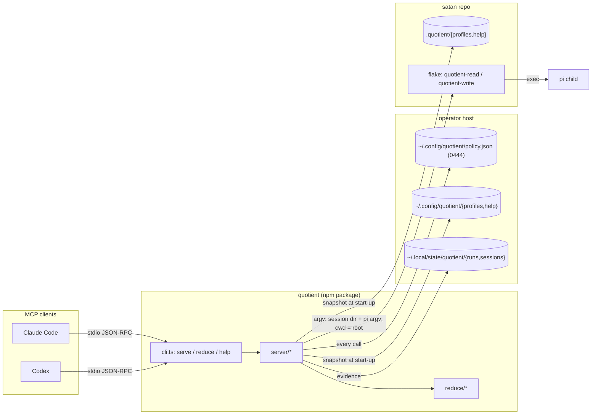
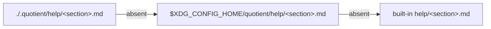
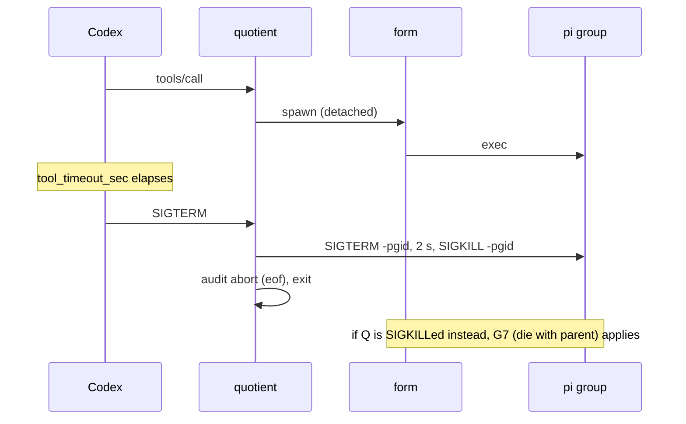
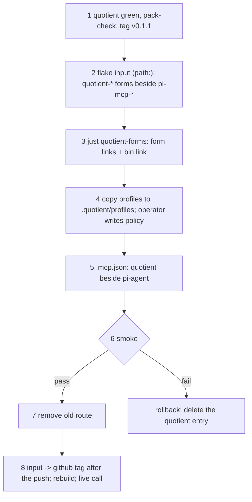

<!-- doctrine:section sec-1 -->
# Overview and repo layout

pi-mcp is two things in satan today: an MCP stdio server exposing one tool,
`pi_agent`, which admits a call against an operator policy and runs one
confined `pi` child; and the reducer, which turns the child's event stream into
a bounded, cited result. Both move to `~/dev/quotient` (remote
`github.com/davidlee/quotient`), published to npm as `@davlee/quotient` with
one bin, `quotient`.

What moves is **mechanism**. What stays in satan is **this host's confinement
and values**: satan keeps building the bwrap forms (renamed `quotient-<cap>`),
keeps its profiles as a project-local `.quotient/profiles/`, and the operator
keeps writing the policy. quotient defines the contract a form must meet
(`form-1`, sec-4) and ships no form.

The server's behaviour is SL-029's, unchanged, except for:

- the entry point and built-in help (sec-2);
- configuration discovery and the policy schema (sec-3);
- the form contract and the unconfined form (sec-3, sec-4);
- child cleanup when the server is signalled (sec-4).



Two edges are easy to misread. The server reads `.quotient/` from **its own
launch directory** (the client's cwd), never from a call's `cwd`. And it finds a
form only through the policy, by absolute path, never through `PATH`.

## Layout (DEC-110)

```
quotient/
  package.json  package-lock.json  tsconfig.json  flake.nix  README.md  LICENSE
  src/cli.ts              entry point: serve | reduce | help | --version (sec-2)
  src/root.ts             packageRoot: package.json and help/ from import.meta.url
  src/config.ts           location resolution, pure over env + launch dir (sec-3)
  src/help/               section loader, overlay, renderers, digest (sec-2)
  src/server/*.ts         <- satan pi/mcp/*.ts (tests colocated; test-rig.ts)
  src/reduce/*.ts         <- satan pi/reduce/*.ts
  help/*.md               built-in prose sections
  docs/contract/          pi-agent-result-1.md  quotient-policy-1.md  form-1.md
  docs/design.md          standalone rationale, no doctrine ids
  examples/               policy.json, profiles/{read,research,write}.md
  scripts/hostile-audit   <- satan bin/pi-mcp-hostile-audit, generalised (sec-4)
  scripts/pack-check      the publish gate (sec-5)
```

## History

- `git filter-repo` keeps only `pi/mcp`, `pi/reduce`, `bin/pi-mcp`,
  `bin/pi-run-reduce` and `bin/pi-mcp-hostile-audit`, renamed to the layout
  above, with `--prune-empty`.
- The rewritten history is reviewed (`git log --stat`) and secret-scanned
  before any push.
- Old commit messages cite satan's doctrine ids; that is accepted as history.

## What does not move

- satan's forms and their flake check (sec-7).
- `pi/mcp/forms.test.ts`. It reads `../../flake.nix` and asserts satan's form
  definitions, not the server's behaviour, so it stays in satan (sec-7).
- satan's profiles, which become `satan/.quotient/profiles/`.
- The operator policy.
- The doctrine records (SL-029, DEC-089 to DEC-103), which stay as satan's
  history; quotient restates their substance without ids (sec-6).

<!-- doctrine:section sec-2 -->
# Entry point and built-in help

## `src/cli.ts` (DEC-111)

The file starts with `#!/usr/bin/env node` and is the only module with side
effects at import. It dispatches on its first argument:

| argv | action | exit |
|---|---|---|
| (none) | `serve(stdin, stdout, env, stderr, { launchDir: cwd })`. If stdin is a TTY, it first prints one stderr line saying the server speaks MCP on stdio. It installs the SIGTERM/SIGINT handlers of sec-4. | 0 after shutdown |
| `reduce …` | `reduce/cli.ts` `main(argv.slice(1))` with today's `pi-run-reduce` arguments | 0 completed, 1 failed or incomplete, 2 usage |
| `help [section]` | prints one section, or the list of sections | 0; 2 for an unknown section; 1 when the help layer is unreadable |
| `--version` | the version from `package.json` | 0 |
| anything else | usage on stderr | 2 |

- The reducer's self-execution guard (`import.meta.main ?? argv[1].endsWith('cli.ts')`,
  `pi/reduce/cli.ts`) is deleted. `reduce/cli.ts` exports
  `main(argv: string[]): number`; its usage text says `quotient reduce`.
- `reduce.ts` stays internal: `package.json` publishes no `exports` entry.
- `serverInfo` becomes `{ name: 'quotient', version: <package.json> }` (today
  `'pi-mcp'`/`'0'`). The tool's name stays `pi_agent`.
- The stderr log prefix `pi-mcp:` becomes `quotient:`.
- `serve` keeps its injectable streams and environment; the test rig depends
  on that seam.

## `src/root.ts`

`packageRoot` is computed once from `import.meta.url` as the parent of the
module's directory, which is the same path from `src/root.ts` and from
`dist/root.js`. `package.json` and `help/` resolve from it. It is tested from
both trees.

## Help sections (DEC-115)

One sectioned source serves the model and the human.

| section | source | consumer | overridable in v1 |
|---|---|---|---|
| `agent` | `help/agent.md` + a rendered profile table | MCP `initialize.instructions` | yes |
| `tool` | `help/tool.md` | the `pi_agent` tool description | yes |
| `result` (alias `refusals`) | `docs/contract/pi-agent-result-1.md`, verbatim | `quotient help result` | **no** |
| `policy` | `docs/contract/quotient-policy-1.md`, verbatim | `quotient help policy` | **no** |
| `form` | `docs/contract/form-1.md`, verbatim | `quotient help form` | **no** |
| `profiles` | `help/profiles.md` (document grammar, layering, capability pin) | `quotient help profiles` | yes |
| `setup` | `help/setup.md` (install, first policy, choosing a form, what the unconfined form gives up) | `quotient help setup` | yes |
| `clients` | rendered: Claude Code and Codex snippets (sec-5) | `quotient help clients` | yes |
| `reduce` | the reducer's usage text | `quotient help reduce` | yes |

- **Contract sections are not overridable in v1.** They are the normative
  text; an override would let `quotient help policy` misstate the schema and
  would void the drift tests (sec-6). Allowing it later is a separate change.
- **What `agent` says:** when to delegate; trust `result` only when `final` is
  true, otherwise read `state`, `causes` and `transcript`; `refused` means
  nothing ran; pass `session` back to continue. This is the text satan's
  `CLAUDE.md` carries today, so a client needs no installed skill.
- **The rendered profile table** lists each snapshot profile — name, model,
  thinking, tools, source path — with the capability the policy pins, **as
  read at `initialize`**. The text says the pin is re-checked on every call. If
  the policy is unreadable at `initialize`, the column reads
  `unknown (policy unavailable)` and the server still starts.

## Overrides and snapshot



- Per section, first hit wins; contract sections skip the first two layers.
- Only an absent file falls through. The rule matches profiles (sec-3): a
  missing layer directory is an empty layer, while an unreadable layer or an
  unreadable section file, shadowed or not, refuses start-up. Every call then
  refuses `profile-invalid`, with the help path in `detail`. Help files have no
  grammar, so no help document is "invalid".
- Read once at start-up into a snapshot, like profiles; an edit takes effect
  at restart.
- `help_digest` = sha256 over `section \0 source-path \0 bytes \0` in section
  order, written on every `spawn` audit record. Audit-only, never compared.
- Both help layers are protected stores (sec-3), so no write delegate can
  rewrite the text the orchestrator reads.

<!-- doctrine:section sec-3 -->
# Configuration and policy

## Resolution (DEC-112)

Today every path comes from `PI_MCP_*` env with no defaults
(`pi/mcp/policy.ts`). quotient adds discovery, split by authority: the policy,
which is authority, is never looked up in the project tree; profiles and help
are layered local-first; state defaults to XDG.

One pure module owns it, so profiles and help do not depend on the policy
module to find XDG:

```ts
// src/config.ts
export type Locations = {
  policyPath: Resolved;      // read on every call
  runDir: Resolved;          // every call
  sessionHome: Resolved;     // every call
  profileLayers: string[];   // [<launch>/.quotient/profiles, <xdgConfig>/quotient/profiles]
  helpLayers: string[];      // [<launch>/.quotient/help, <xdgConfig>/quotient/help]
};
export type Resolved = { ok: true; path: string } | { ok: false; detail: string };
export function resolveLocations(env: Env, launchDir: string): Locations;
```

| item | lookup | read | unusable |
|---|---|---|---|
| policy | `QUOTIENT_POLICY`, else `<xdgConfig>/quotient/policy.json`; never the launch dir | every call and every gate tick | `policy-unavailable` |
| run evidence | `QUOTIENT_RUN_DIR`, else `<xdgState>/quotient/runs` | every call | `policy-unavailable` |
| session home | `QUOTIENT_SESSION_HOME`, else `<xdgState>/quotient/sessions` | every call | `policy-unavailable` |
| profiles | per name: launch-dir layer over XDG layer | start-up snapshot | see below |
| help | per section, sec-2 | start-up snapshot | absent falls through; unreadable refuses start-up |

- `<xdgConfig>` is `$XDG_CONFIG_HOME` if absolute, else `$HOME/.config`;
  `<xdgState>` likewise with `.local/state`. A relative `XDG_*` is ignored, per
  the XDG spec. Neither usable: `policy-unavailable`.
- **Only an unset `QUOTIENT_*` variable falls through.** A set but empty or
  relative value refuses `policy-unavailable`, as today, so a typo never
  silently moves the policy.
- State directories are created on first use (`writeAttemptProbe` already
  `mkdir -p`s the run dir). The new roots are disjoint from pi-mcp's.
- **Request-boundary refusals use the same run dir.** Today they record through
  `knownRunDir(env)`, which reads only the env var (`policy.ts`), so with the
  XDG default an early refusal (`profile-invalid`, `request-invalid`) would go
  unrecorded. `knownRunDir` is replaced by `resolveLocations(…).runDir`;
  admission and the early refusals share it.
- Env renames, in lockstep:

  | today | after |
  |---|---|
  | `PI_MCP_POLICY` | `QUOTIENT_POLICY` |
  | `PI_MCP_RUN_DIR` | `QUOTIENT_RUN_DIR` |
  | `PI_MCP_SESSION_HOME` | `QUOTIENT_SESSION_HOME` |
  | child-env scrub prefix `PI_MCP_` (`spawn.ts`) | `QUOTIENT_` |
  | satan form's `PI_MCP_ACTIVE_SESSION_DIR` | `QUOTIENT_ACTIVE_SESSION_DIR` (form-internal, not part of form-1) |

## Profile snapshot

- `loadProfiles(layers: string[])` reads every layer once. A missing layer
  directory is an empty layer. An unreadable layer, or an invalid document in
  **either** layer (shadowed or not), refuses start-up: every call then
  refuses `profile-invalid`.
- Per name, the launch-dir document wins. Each `Profile` gains `source` (its
  path).
- Digest: sha256 over `name \0 source \0 bytes \0` in name order. Written on the
  `spawn` record as `profile_digest`, with `profile_source`. Audit-only.
- The header marker `<!-- pi-mcp-profile` becomes `<!-- quotient-profile`, with
  no alias.
- `DEFAULT_PROFILES_DIR` (the module-relative directory) is removed. There is
  no built-in profile layer; `examples/profiles/` are copies to start from.

## Policy schema `quotient-policy/1` (DEC-113)

```json
{ "schema": "quotient-policy/1", "mode": "per-call", "enabled": true,
  "roots": ["/home/u/dev/satan", "/home/u/dev/malebolge"],
  "maxima": { "requests": 6, "tokens": 200000, "cost_usd": 1, "wall_clock_s": 300 },
  "profiles": { "read": "read", "research": "read", "write": "write" },
  "forms": { "read": "/home/u/.local/state/quotient/forms/read/bin/quotient-read",
             "write": "/home/u/.local/state/quotient/forms/write/bin/quotient-write" },
  "exposure": ["/home/u/.local/share/jail.nix/home/agent"],
  "transcript_budget_bytes": 4096 }
```

- **Carried from DEC-097 unchanged:** fail-closed reading, unknown keys
  refused, all four maxima required, `enabled` re-read at every gate tick,
  `mode` limited to `per-call`, the digest in the audit.
- **`schema`** is required and checked first; missing or unknown is
  `policy-invalid`.
- **`profiles`** maps a name (`PROFILE_NAME` grammar) to `read` | `write`.
  Validation step 3 becomes: grammar → snapshot (`profile-unknown`) → map key
  (`profile-not-allowed`) → **document `filesystem` ≠ pinned capability →
  `profile-capability-mismatch`** (new token). A local profile can change
  model, thinking, tools and prose, never capability. This closes the
  elevation path of DEC-092 / RV-046 F-5 under local-first lookup.
- **`forms`** maps a capability to an absolute form path, to
  `{ "path", "extensions"? }` (unchanged), or to
  `{ "unconfined": "<absolute pi path>" }`. `path` and `unconfined` together is
  `policy-invalid`; `read` unconfined is `policy-invalid` (DEC-114). No `PATH`
  lookup, ever.
- **`exposure`** (was `child_binds`): the writable host paths a form shares
  with the child beyond the root, the session directory and its private temp.
  It is the operator's, fixed for every call, and an input to step 8.
- **One root per call.** `roots` is an allowlist; each call names one of them
  (or a path inside one) as its `cwd`. Multi-root calls are IDE-016.

```ts
type Form =
  | { kind: 'confined'; path: string; extensions: string[] }
  | { kind: 'unconfined'; pi: string };
```

## Protected stores (validation step 8)

| store | tolerance | today / new |
|---|---|---|
| run evidence dir | unreachable | today |
| attempts ledger | unreachable | today |
| session home, except this call's session dir | unreachable | today |
| policy file | never writable | today |
| launch-dir profile layer | never writable | new |
| XDG profile layer | never writable | new |
| launch-dir help layer | never writable | new |
| XDG help layer | never writable | new |

- The new stores are protected **whether or not they exist**
  (`canonicalPath` already handles absent paths), so a write delegate cannot
  create `.quotient/` under the launch dir and plant a profile or help text
  for the next restart.
- A write call whose root or an `exposure` path is, or contains, one of them
  refuses `view-overlaps-protected`. Read calls are admitted.
- Consequence: a write delegate cannot be rooted at the server's launch dir or
  a parent of it. Rooted at another repo (`~/dev/malebolge`) or a worktree not
  enclosing the launch dir's `.quotient/`, it can.
- `ChildViewInput` gains `profileLayers` and `helpLayers`; the member role
  `child_bind` becomes `exposure`.

<!-- doctrine:section sec-4 -->
# Form contract and process lifecycle

## `form-1` (DEC-116)

A form is an executable that confines one pi run. quotient states what a form
must guarantee and leaves the mechanism (bwrap, macOS seatbelt, Landlock, …)
to the implementation.

**Invocation.** `<form> <session-dir> <pi argv…>`, with the working directory
set to the call's canonical root, and the child env of sec-3 (the server's env
minus `QUOTIENT_*` and any value naming the run's evidence). The form execs pi
with that argv. The root is conveyed by the working directory, so later
versions can add roots as new arguments without changing these.

**Guarantees.**

| # | guarantee |
|---|---|
| G1 | The root is readable at its own absolute path. |
| G2 | The root is not writable under `read`, and writable under `write`. |
| G3 | The session directory is writable at its own absolute path. |
| G4 | The child has a private, writable temp, not shared with the host. |
| G5 | The child can write nothing except the root (under `write`), the session directory, its private temp and the policy's `exposure`. Anything else it can see is read-only. |
| G6 | The run evidence dir and the session home (except this call's session directory) are neither readable nor writable. The policy file and the profile and help layers are not writable. |
| G7 | The confined process dies with its parent (e.g. bwrap `--die-with-parent`). |
| G8 | A missing, relative or non-directory session directory exits 64 before running anything. |

What the child may *read* beyond G6 is the mechanism's choice: a bwrap form
shows a small view, a seatbelt form may allow wide reads. form-1 does not
promise that other host secrets are unreadable; an operator who needs that
chooses a form that documents the stronger property.

G5 and G6 are what make step 8 meaningful: the server checks that root,
session directory and `exposure` do not overlap the protected stores, which is
only sound if the form adds nothing writable and hides the unreachable stores.

```
              readable?              writable?
root          yes                    write capability only
session dir   yes                    yes
private tmp   yes                    yes
exposure      yes                    yes
run/session   NO                     NO        <- G6
policy, profile & help layers  allowed  NO     <- G6
everything else  form's choice       NO        <- G5
```

## Write-denial probe: `scripts/hostile-audit`

Today's `bin/pi-mcp-hostile-audit` is bound to this host: it checks
`/run/llm-gateway` and a gateway key, hard-codes the jail.nix home as
`child_binds`, infers the capability from the form's file name, relies on the
server's module-relative profile directory (removed in sec-3), and execs
`bin/pi-mcp`. Generalised:

```
scripts/hostile-audit --form <path> --capability read|write --model <id>
                      [--exposure <path>]... <root> <session-home> <run-dir>
```

- It writes a temporary policy (`schema`, `profiles: { probe: <cap> }`, the
  form, `exposure`) and a temporary launch dir holding
  `.quotient/profiles/probe.md`, and runs the server from `packageRoot`.
- The delegate is asked to append to its own run's `audit.jsonl`. PASS (0) when
  the write is refused and the evidence is intact; FAIL (1) on damaged evidence
  or a clean success with no attempt in the stream; SKIP (77) on a missing
  prerequisite. Ambient `QUOTIENT_*` variables refuse (SKIP), as today.
- Host prerequisites (gateway socket and key) move to satan's wrapper recipe.
- **The probe samples one G6 case: a write to the run's own `audit.jsonl`.**
  It does not cover G6's other stores, and a form passing it is not thereby
  form-1 conformant. The other guarantees need the form
  implementer's own evidence; `form-1.md` says so, and lists each guarantee
  as unverified by quotient. A probe per guarantee is follow-up work.

satan's evidence for its own forms, after step 2 (sec-7):

| guarantee | evidence |
|---|---|
| G1, G2 | forms test: root bound at `$PWD`, `--ro-bind` for read, `--bind` for write |
| G3 | forms test: the session directory is bound from the run-time variable |
| G4 | forms test: `--tmpfs /tmp` |
| G5 | the `quotient-forms` flake check: the built launcher's bind set equals the generator baseline plus root and session dir |
| G6 write | G5's bind-set check, plus step 8's disjointness of root, session dir and `exposure` from the protected stores; `just quotient-hostile-audit` samples the run's `audit.jsonl` on both forms |
| G6 read | forms test: no bind names the session home or run dir; the G5 check admits no other bind |
| G7 | forms test: `--die-with-parent` (new assertion) |
| G8 | forms test: the three `exit 64` guards (new assertion) |

The G5 and G6-read rows trust the generator's own binds. Static assertions over
`flake.nix` show the intent, not runtime behaviour.

## The unconfined form (DEC-114)

`spawn` branches once:

`buildArgv` (`spawn.ts`) today returns the form's argv, session directory
first. It becomes pi's argv only, and the session positional moves to the
branch:

```ts
const piArgv = buildArgv(plan);   // --mode json … --session-dir <dir> --no-extensions
const [command, args] = plan.form.kind === 'confined'
  ? [plan.form.path, [plan.sessionDir, ...piArgv]]
  : [plan.form.pi, piArgv];   // no session positional; pi already gets --session-dir
```

Everything else is identical: detached process group, termination ladder,
child env, audit. The `spawn` record carries `form_kind`.

It is **not a form-1 form**: none of G1–G8 hold, hostile-audit does not apply,
and step 8 still runs but nothing enforces it. `quotient help setup`, the
README and the `quotient-policy-1` contract say so: no read-only guarantee, no
reach limit beyond pi's working directory. `read` cannot be unconfined.

## Process lifecycle (DEC-118 amendment)

Today the child is spawned `detached`, as its own process-group leader, and
the server runs the one termination ladder (SIGTERM to the group, `graceMs` =
2 s, SIGKILL to the group, reap, audit) on cancellation, on the gate's
triggers, and on stdin EOF (`serve`'s post-loop sweep, cause `eof`). The gap is
the server itself being signalled: nothing then reaches the child group.

**New:** `cli.ts` installs SIGTERM and SIGINT handlers that call the same
shutdown path stdin EOF takes — stop admitting, abort every in-flight call with
cause `eof` ("client gone"), await their ladders and audit, exit. `serve`
exposes it in-process (an `AbortSignal` option) so tests drive it without
signals. No new termination token: no result is written down a closed
channel, so `pi-agent-result/1` is unchanged.



| server ends by | covered by |
|---|---|
| stdin EOF | the ladder, cause `eof` (today) |
| SIGTERM / SIGINT (e.g. Codex `tool_timeout_sec`) | the ladder, cause `eof` (new) |
| SIGKILL, confined form | G7 |
| SIGKILL, unconfined form | **not covered**; documented |

Every other part of lifecycle and accounting is SL-029's, unchanged: gate
ticks, `wall_clock_s` as the backstop, sessions bound to (root, capability),
`session-busy`, and the `audit.jsonl` / `attempts.jsonl` split.

<!-- doctrine:section sec-5 -->
# Build, packaging and clients

## tsc (DEC-117)

Node refuses to strip types under `node_modules`, so the published package
ships `.js`. In the repo, dev and tests keep running the `.ts` directly
(`node --test 'src/**/*.test.ts'`), which needs a Node with type stripping.

- `tsconfig.json`:
  - `module`/`moduleResolution: nodenext`, `strict`;
  - `rewriteRelativeImportExtensions` (TypeScript ≥ 5.7; every relative import
    ends in `.ts`);
  - `erasableSyntaxOnly`, `verbatimModuleSyntax`;
  - `rootDir: src`, `outDir: dist`;
  - excludes `**/*.test.ts` and `src/server/test-rig.ts` from the emit.
- The built `.js` needs Node ≥ 22; `engines` says so.

## package.json

```json
{ "name": "@davlee/quotient", "version": "0.1.1", "type": "module",
  "bin": { "quotient": "dist/cli.js" },
  "files": ["dist", "help", "docs", "examples"],
  "scripts": { "build": "tsc", "prepack": "tsc", "test": "node --test 'src/**/*.test.ts'" },
  "engines": { "node": ">=22" },
  "devDependencies": { "typescript": "^5.7", "@types/node": "^22" } }
```

- No runtime dependencies. `@types/node` is needed because the sources use
  `node:` modules, `Buffer` and `NodeJS.Signals`; nothing type-checks them
  today, since Node only strips types. `package-lock.json` is committed (`buildNpmPackage`
  needs it).
- pi is a documented prerequisite (README, `quotient help setup`), not a
  dependency.

## Pack verification: `scripts/pack-check` (the publish gate)

From a clean checkout: `npm ci`, `npm pack` (whose `prepack` runs `tsc`), install
the tarball into an empty temp directory, then:

1. `quotient --version` and `quotient help agent`;
2. `quotient reduce <fixture>` exits 0;
3. an MCP `initialize` over stdio returns `serverInfo.name = quotient` and
   `instructions`;
4. one `pi_agent` call under a temp policy through the rig's stub form (a
   shell form exec'ing a fake pi that emits a canned stream) returns
   `final: true`.

`npm publish --access public` runs only on the operator's explicit go-ahead,
after `npm whoami` confirms the `@davidlee` scope.

## nix

- quotient's `flake.nix` exports `packages.default` (`buildNpmPackage` with
  `npmDepsHash`; the wrapper carries node) and a devShell with node and
  typescript. It exports no forms (DEC-116).
- satan consumes it as a flake input, `path:/home/david/dev/quotient` until the
  GitHub push, then `github:davidlee/quotient/v0.1.1` (sec-7).

## Clients (DEC-118)

Calls stay blocking in v1. `quotient help clients` prints both snippets with
the absolute path the bin was run as, symlinks kept; under the nix wrapper,
`QUOTIENT_LAUNCHER` (its own `$0`, made absolute; a relative or empty value is
ignored):

```json
{ "mcpServers": { "quotient": { "command": "/abs/bin/quotient" } } }
```

```toml
[mcp_servers.quotient]
command = "/abs/bin/quotient"
cwd = "/abs/project"       # the launch dir: where ./.quotient is found
tool_timeout_sec = 360     # policy maxima.wall_clock_s + 60
```

- Codex's default `tool_timeout_sec` is 60 s, which a delegate run exceeds;
  the snippet is therefore part of the contract. The 60 s margin covers spawn,
  the 2 s ladder, reduction and evidence writes.
- If no policy is readable, the snippet carries a placeholder timeout and says
  why.
- A client that kills the server on timeout is covered by sec-4.
- Both clients are smoke-tested live (Codex through `codex exec`).

<!-- doctrine:section sec-6 -->
# Documentation and drift tests

## Normative contracts (DEC-119), `docs/contract/`

| doc | content | source today |
|---|---|---|
| `pi-agent-result-1.md` | the tool-result document: every field, its nesting, JSON type and nullability, as a table the drift test parses; the `state` × `termination` × `causes` table; `final`; the refusal tokens, each with the validation step that produces it; the rule that a refusal is a successful MCP call that ran nothing, never a JSON-RPC error | `result.ts`, SL-029 design sec-5, DEC-093, DEC-103 |
| `quotient-policy-1.md` | the sec-3 schema: every field, its validation and the refusals it causes; resolution and env vars; the protected stores; what the unconfined form voids | `policy.ts`, `childview.ts`, DEC-095, DEC-097, today's `pi/mcp/README.md` |
| `form-1.md` | sec-4's invocation, G1–G8, the read-scope disclaimer, and what the write-denial probe does and does not prove | `flake.nix` comments, `spawn.ts`, DEC-098, DEC-100 |

- Each contract carries its version in its name. A breaking change mints `-2`
  and keeps `-1` alongside.
- Help prints these files verbatim (sec-2), and they are not overridable in
  v1, so there is no second copy to drift.

## `docs/design.md`

Rationale, not normative. It restates, without ids:

- one process per call, one root per call;
- the operator's posture, declared and never downgraded;
- retrospective accounting, and what the ceilings do *not* guarantee;
- the roots allowlist, compared by path component;
- profiles as live authority, frozen at start-up, with the capability taken
  from the document and pinned by the policy;
- the termination ladder;
- sessions;
- the audit split;
- the validation order (fail closed, first failure wins).

It ends with one origin pointer, with no id: "extracted from
github.com/davidlee/satan".

## README

- Install (npm, nix) and the pi prerequisite.
- A five-minute setup: write `policy.json` from `examples/`; copy the profiles;
  pick a form, or declare unconfined and read what it gives up; add a client
  snippet from `quotient help clients`.
- Links to the contracts and to `quotient help`.

Today's `pi/mcp/README.md` is split between the README and
`quotient-policy-1.md`.

## Drift tests

| test | asserts | replaces |
|---|---|---|
| refusal tokens | the refusal unions in the sources (read from their `export type …Refusal… =` declarations), as a set, equal the token list in `pi-agent-result-1.md`, both ways | `pi/mcp/readme.test.ts` |
| result keys and types | for a rig-produced result in each `state`, the key set equals the contract's at every nesting level, both ways. Each value's JSON type matches the contract's field table; `null` appears only in a field marked nullable, and each nullable field is `null` in at least one fixture | — |
| result semantics | the contract's termination → state table, parsed, equals `CAUSE_STATE` (`result.ts`) both ways; its `state` and `termination` vocabularies equal `RESULT_STATES` and `TERMINATIONS` | — |
| policy | the keys `validatePolicy` accepts and the env vars `config.ts` reads all appear in `quotient-policy-1.md`; every fenced `json` block there is admitted | `pi/mcp/readme.test.ts` |
| no doctrine ids | nothing under `docs/` matches `\b(SL|DEC|RV|ADR|REQ|POL)-\d{3}\b` | — |

`pi-agent-result-1.md` therefore carries a field table (path, JSON type,
nullable) that the test parses. Types are checked on the values the fixtures
produce, so a branch no fixture reaches goes unchecked; the nullable rule forces
a fixture for each nullable field.

<!-- doctrine:section sec-7 -->
# Cutover and host migration (satan)

The cutover is additive until the smoke tests pass (DEC-120). Both servers can
run side by side because their tools resolve to different names:
`mcp__pi-agent__pi_agent` and `mcp__quotient__pi_agent`.



| step | where | change | rollback |
|---|---|---|---|
| 1 | quotient | Suites green; `scripts/pack-check` passes; tagged `v0.1.1`. The GitHub push needs the operator's go-ahead. | — |
| 2 | satan `flake.nix` | Add the `quotient` input (`path:`) and package. Add forms `quotient-read` / `quotient-write` **alongside** `pi-mcp-*`, reading `QUOTIENT_ACTIVE_SESSION_DIR` and adding `--die-with-parent`. Add the `quotient-forms` check and the `quotient` jail-probe entry. | revert the commit |
| 3 | satan `justfile` | Add `quotient-forms`: GC-rooted links at `~/.local/state/quotient/forms/<cap>/bin/quotient-<cap>`, and `~/.local/state/quotient/bin/quotient` (the nix-built bin, node wrapped). Keep `pi-mcp-forms`. Add a `quotient-hostile-audit` recipe that checks the gateway prerequisites and runs `scripts/hostile-audit` from the input. | — |
| 4 | satan + host | **Copy** `pi/mcp/profiles/*.md` to `.quotient/profiles/`, marker renamed `quotient-profile`; the originals stay until step 7 because the old server reads them. The operator writes `~/.config/quotient/policy.json` (`quotient-policy/1`, a profiles map, `exposure`, mode 0444), with a scratch git repo in `roots` for step 6's write smoke. | delete the new files |
| 5 | satan `.mcp.json` | Add a `quotient` entry, `command: "${HOME}/.local/state/quotient/bin/quotient"`, no env (XDG defaults), **beside** `pi-agent`. Restart the session. | delete the entry |
| 6 | smoke | Through `mcp__quotient__pi_agent`: `read` and `research` return `final: true`. A `write` call rooted at a scratch git repo listed in `roots` (outside satan) creates one named file: `final: true`, the file exists, and the `spawn` record says `form_kind: confined`. hostile-audit passes against both forms. A Codex `codex exec` call with the printed snippet returns `final: true`. A write call rooted at satan's launch dir refuses `view-overlaps-protected`. | — |
| 7 | satan | Remove the `pi-agent` entry, `pi/`, `bin/pi-mcp`, `bin/pi-run-reduce`, `bin/pi-mcp-hostile-audit`, `piMcpJail`, `piMcpBaseline`, `piMcpForms`, the `pi-mcp-forms` check and jail-probe entry, and the `pi-mcp-forms` recipe. Move `pi/mcp/forms.test.ts` to a satan-owned path, retargeted to the `quotient*` forms, and point the `pi-suites` recipe at it (renamed `forms-suite`). Retarget `scripts/lib/pi-report.sh`, `CLAUDE.md` and `docs/INDEX.md`. `just check` is green. Restart the Claude Code session and repeat one `read` call through the final `.mcp.json`, and one `codex exec` call; both return `final: true`. Only then delete the old form links. The operator reissues the policy without the scratch root, and a write call rooted there refuses `root-not-allowlisted`. | revert; `just pi-mcp-forms` at the reverted commit rebuilds the old links |
| 8 | satan | After the push, switch the input to the tag, `github:davidlee/quotient/v0.1.1`, and relock. Rebuild with `just quotient-forms`, confirm `quotient --version` reads `0.1.1`, and repeat one live `read` call; it returns `final: true`. | switch back to the `path:` input, relock, rerun `just quotient-forms`, and repeat the live call |

`v0.1.0` (`6c31180`) was tagged and pushed but never published. The `@davidlee`
npm scope is held by another account, so the first publish is
`@davlee/quotient` 0.1.1 (`v0.1.1`, `3395eab`); RV-059 F-1.

## `scripts/lib/pi-report.sh`

It is the reducer's other consumer: `pi-scout` and `pi-research` call it, and
it defaults to `<repo>/bin/pi-run-reduce`, which step 7 deletes. `PI_REDUCE`
becomes a command rather than a path, defaulting to
`$HOME/.local/state/quotient/bin/quotient reduce`. Today the script tests the
whole value with `[ -x "$reduce" ]`, which a command fails. So the value is
word-split into an array; the first word must be executable, and the array is
run as is:

```bash
local -a reduce
read -ra reduce <<< "${PI_REDUCE:-$HOME/.local/state/quotient/bin/quotient reduce}"
if [ -x "${reduce[0]}" ] && …; then "${reduce[@]}" -v --out … ; fi
```

Paths with spaces are not supported, which the usage comment says.
`pi-report-test.sh` keeps its fallback case and adds a reducer case: a stub
executable given as `PI_REDUCE="<stub> reduce"` receives `reduce` as its first
argument and its output is printed.

## Notes

- **State roots are disjoint from step 1.** The new server writes under
  `~/.local/state/quotient/`. Old run history stays at
  `~/.local/state/pi-mcp/runs`; nothing is moved.
- **The bin link removes the direnv dependency.** `.mcp.json` no longer needs a
  devshell `node`; the nix-built bin carries its own. A home-manager install
  in `~/flakes` is a later option.
- **Each step after 1 is its own satan commit.** Steps 2 to 6 leave the old
  route working.
- **Governance follow-through is `/reconcile`'s work** (inq-12). By REV:
  DEC-092, DEC-093, DEC-094, DEC-097, DEC-099, DEC-100; the ADR-017 ledger's
  "Enforced at" anchors for rows 1b, 2b, 4c, 5c and 6c, and row 3c's anchor
  names (owner stays `satan-flake`); POL-001's candidate list; and the
  memories that cite `pi/mcp` paths.

<!-- doctrine:section sec-8 -->
# Code impact and verification

## satan

| path | change |
|---|---|
| `pi/**` | removed (step 7); profiles copied to `.quotient/profiles/`; `forms.test.ts` moved to a satan-owned path, gaining `--die-with-parent` and `exit 64` assertions |
| `bin/pi-mcp`, `bin/pi-run-reduce`, `bin/pi-mcp-hostile-audit` | removed |
| `flake.nix`, `flake.lock` | quotient input and package; `quotient-*` forms with `--die-with-parent`; `quotient-forms` check and jail probe; `piMcp*` removed |
| `justfile` | `quotient-forms` (form and bin links), `quotient-hostile-audit`; `pi-mcp-forms` removed; `pi-suites` → the forms test only |
| `.mcp.json` | the `quotient` entry replaces `pi-agent` |
| `.quotient/profiles/*.md` | new: this host's profiles |
| `scripts/lib/pi-report.sh`, `scripts/lib/pi-report-test.sh` | reducer default → `quotient reduce`; `PI_REDUCE` is a command |
| `CLAUDE.md`, `docs/INDEX.md` | retargeted |

## quotient (outside this repo)

| path | change from the moved code |
|---|---|
| `src/cli.ts`, `src/root.ts`, `src/config.ts`, `src/help/` | new (sec-2, sec-3) |
| `src/server/policy.ts` | reads locations from `config.ts`; `knownRunDir` removed; schema v1; profiles map; `exposure`; `Form` union; `read`-unconfined refusal |
| `src/server/profiles.ts` | layered `loadProfiles`; `source`; digest over source paths; capability pin in step 3; marker rename |
| `src/server/childview.ts` | four new protected stores; `exposure` role |
| `src/server/spawn.ts` | scrub prefix `QUOTIENT_`; `buildArgv` returns pi's argv only; unconfined branch; `form_kind`, `profile_source`, `help_digest` on `spawn` |
| `src/server/server.ts` | `serverInfo`; `instructions`; request-boundary refusals record to `resolveLocations(…).runDir`; tool description from help; layers from the launch dir; `DEFAULT_PROFILES_DIR` removed; shutdown signal option |
| `src/server/evidence.ts` | log prefix |
| `src/server/main.ts` | removed (`cli.ts` replaces it) |
| `src/server/readme.test.ts` | replaced by the drift tests (sec-6) |
| `src/reduce/cli.ts` | exports `main(argv)`; guard deleted; usage text |
| `help/`, `docs/`, `examples/`, `scripts/`, `package.json`, `tsconfig.json`, `flake.nix` | new or moved |

## Verification

TDD in quotient (red, green, refactor), on the existing `test-rig.ts`. The
suites that move with the code stay green (262 tests under `just pi-suites`
today). New tests, by behaviour:

- **cli:** dispatch; `reduce` exits 0/1/2 as before; unknown verb and unknown
  help section exit 2; `--version`.
- **config:** env beats XDG; unset falls through, set-but-relative refuses; the
  policy is never read from the launch dir even when `.quotient/policy.json`
  exists; relative `XDG_*` ignored; no usable HOME/XDG → `policy-unavailable`;
  with every `QUOTIENT_*` unset, a malformed request and an invalid policy are
  each recorded in the XDG run dir's `attempts.jsonl`.
- **profiles:** launch-dir beats XDG per name; missing layer is empty; an
  invalid shadowed document refuses start-up; the digest changes with the
  source path; `profile-capability-mismatch`; an unmapped name →
  `profile-not-allowed`.
- **policy v1:** missing or unknown `schema`; `child_binds` now an unknown
  field; `path` with `unconfined`; `read` unconfined → `policy-invalid`.
- **step 8:** a write root containing the launch-dir `.quotient/`, existing or
  not, refuses `view-overlaps-protected`; a read root containing it is
  admitted; a sibling-repo write root is admitted.
- **spawn argv:** a stub records the exact argv each path receives: the
  confined form gets the session dir then pi's argv; unconfined pi gets pi's
  argv with no session positional; `form_kind` audited.
- **shutdown:** with a call in flight through a stub form whose pi sleeps, the
  shutdown signal kills the group, audits `abort` with cause `eof`, and leaves
  no process behind; EOF behaviour unchanged.
- **help:** `instructions` equals the assembled `agent`; the tool description
  equals `tool`; a file override wins for `agent`; contract sections ignore
  overrides; `help_digest` is on the `spawn` record; `packageRoot` resolves
  from `dist/`; an absent override falls through, while an unreadable layer or
  section file, shadowed or not, refuses start-up.
- **drift:** the five tests of sec-6.
- **pack:** `scripts/pack-check` (sec-5).

In satan:

- `just check` green after step 7, with no `pi/` sources and the forms test
  passing; `nix build .#checks.x86_64-linux.quotient-forms` green.
- Cutover smoke (sec-7 step 6), including Codex, the scratch-root write and the
  refused write call; the post-removal live calls of step 7, and the scratch
  root refusing `root-not-allowlisted` once the policy is reissued; step 8's
  rebuild and live call from the tagged GitHub input.
- `pi-report-test.sh`: the fallback case and the `PI_REDUCE` command case.
- `grep -rIn 'pi-mcp\|PI_MCP\|pi/mcp\|pi-run-reduce' --exclude-dir=.doctrine`
  returns only intentional history.

