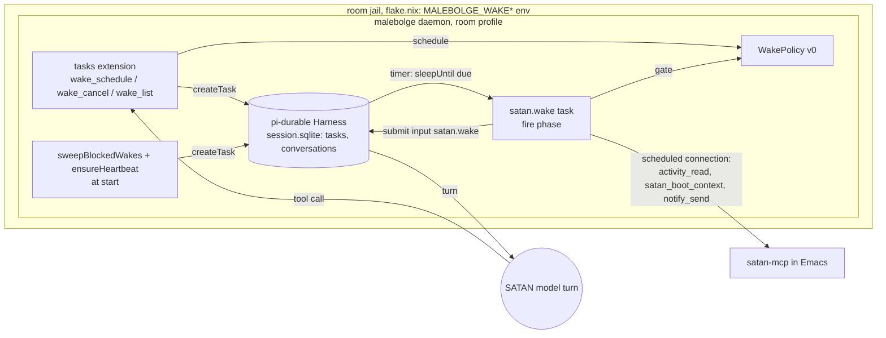
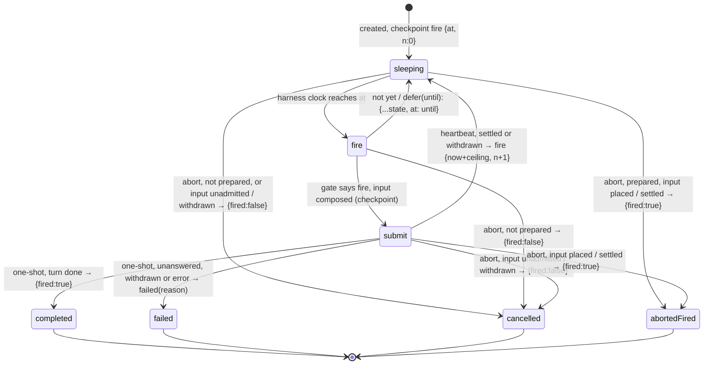
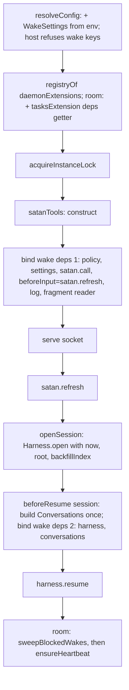

<!-- doctrine:section sec-1 -->
## What changes

Today SATAN acts in the room daemon only when the user sends a turn. After this
slice SATAN can ask to be woken: a tool call schedules a turn in a conversation
at a later time, and the daemon starts that turn on its own, with a fresh
percept, while the user is away. A heartbeat keeps one wake always pending, so
SATAN has a recurring chance to act even if it schedules nothing.

Wakes exist only in the **room** profile; the host profile stays
interactive-only (CON-005).

All code lands in the malebolge daemon (`~/dev/malebolge`). The scheduling store
and the timer are pi-durable's own: a wake is a sleeping pi-durable task in the
daemon's `session.sqlite`. No host table, no host timer, no satan-side
(Emacs) code. This repo changes only `flake.nix` (the room jail passes the
wake settings) and governance text.

The system boundary: the host (the user, through the jail and its env) sets the
policy's bounds and the off switch; SATAN chooses only *what* to wake for and
*roughly when*, inside those bounds. The model never edits the policy.

Purpose of the diagram: who owns what at run time.



Non-obvious edges: the harness, not malebolge, arms the timer (no `onWake`);
the task talks to satan-mcp over a `scheduled` connection, which is audit
attribution only (DEC-138); a wake's model turn is an ordinary turn in its
target conversation, so its in-turn tool calls go through the same `satan`
extension as any interactive turn.

Decisions: DEC-127 … DEC-139.

<!-- doctrine:section sec-10 -->
## Invariants

- **W1 One turn per occurrence.** A wake occurrence submits at most one input,
  however often its fire phase re-runs (crash, restart, defer). Mechanism: the
  input's `requestId` is `wake:<taskId>:<n>`, where `n` is the occurrence
  counter in the task's checkpoint; pi-durable dedupes a `requestId` within a
  conversation before any write.
- **W2 Host-owned bounds.** Floor, ceiling and quiet window come from the jail
  env; jitter, retry step, presence weight and percept deadline are code
  constants. No tool argument or model output changes them. `wake_schedule`'s
  `after_minutes` is clamped into `[floor, ceiling]`.
- **W3 Fail closed.** Wakes fire only when `MALEBOLGE_WAKES` is exactly `on`
  at daemon start. Off defers; it never drops a wake. The switch and the
  quiet window are checked again on every entry to `submit`, so a restart
  between preparing and admitting an input cannot bypass them.
- **W4 The switch gates admission.** Off stops new wake inputs. A wake input
  admitted before a restart still runs (pi-durable resumes admitted work),
  unless the bounded wait withdraws it while still queued; the
  hard stop for SATAN's tools remains `satan-mcp-enabled` (ledger row 6a).
- **W5 Exactly one viable heartbeat** after every daemon start: created under
  the instance lock, after `resume()`; a blocked or parked heartbeat is
  replaced, and an abort-marked one no longer counts, so a restart between
  abort and replacement still ends with one.
- **W9 A cancelled answer means no turn.** `wake_cancel` answers `cancelled`
  only when the task settled `{fired:false}`, which the abort handler returns
  only from a `fire` phase without `prepared`, or after finding the
  occurrence's input never admitted or withdrawing it while still queued. It
  may answer "already fired" for a wake whose input never ran; never the
  reverse. An aborted wake never leaves a queued input unwatched.
- **W10 Room only.** The `tasks` extension and the heartbeat exist only in the
  room profile; host start refuses wake config keys.
- **W6 Gate decides admission, not start.** The quiet window and presence are
  checked when the fire phase runs. A `followUp` input queued behind a busy
  turn starts when that turn ends, possibly inside the quiet window (accepted:
  a busy conversation means someone is awake).
- **W7 Every gate decision and terminal outcome leaves a journal line**
  (stderr, `malebolge: wake …`); together with the transcript's tool calls and
  `satan.wake` entries this is the wake lifecycle audit (ledger row 4d).
- **W8 Targets are fixed at schedule time.** A wake goes to the conversation
  resolved when it was scheduled; nothing re-resolves a topic at fire time.

<!-- doctrine:section sec-11 -->
## The wake task

`satan.wake` v1 is a pi-durable task definition (`defineTask`), registered by
the `tasks` extension. One definition serves one-shot wakes and the heartbeat.

```ts
// src/wake/task.ts
export type EpisodeClass = "attend" | "seclude";

export interface WakeInput {
  conversationId: ConversationId; // target, fixed at schedule (W8)
  intent: string;                 // SATAN's own words: why it wants to wake
  payload?: JsonValue;            // optional structured notes for the wake turn
  episodeClass: EpisodeClass;
  at: number;                     // decided by WakePolicy.schedule (ms, harness clock)
  requestedAt?: number;           // what SATAN asked for, kept for audit
  scheduledBy: ConversationId;    // the scheduling tool's api.conversationId
  recurring?: true;               // the heartbeat only
}

export type WakeState =
  // `prepared`: an earlier `submit` of this occurrence may have admitted its input.
  | { phase: "fire"; at: number; n: number; prepared?: true }
  | { phase: "submit"; at: number; n: number; firedAt: number; content: string };
export type WakeResult = { fired: boolean };

export const wakeTask = (deps: () => WakeDeps) =>
  defineTask<WakeInput, WakeState, WakeResult>({
    name: "satan.wake",
    version: 1,
    initial: (input) => ({ phase: "fire", at: input.at, n: 0 }),
    phases: {
      fire: (task, runtime, ctx) => fire(deps(), task, runtime, ctx),     // gate, compose
      submit: (task, runtime, ctx) => submit(deps(), task, runtime, ctx), // host gate, submit, wait, next
    },
    // An occurrence that may be admitted withdraws its own input if still queued;
    // it reports fired only when a turn ran or is running (W9).
    abort: async (task, runtime, ctx) => {
      const state = task.state.checkpoint;
      const mayBeAdmitted = state.phase === "submit" || state.prepared === true;
      const fired = mayBeAdmitted && (await withdraw(deps(), task, runtime, ctx)) === "fired";
      return runtime.commit(() => terminal({ fired }), ctx);
    },
  });
```

**The abort handler owns the occurrence's input.** Aborting a task ends the
`submit` invocation that holds the bounded wait (*Fire composition*), so the
handler takes over its one remaining duty. `withdraw` looks up the
occurrence's submission (`tx.submissionByRequest(input.conversationId,
"wake:<id>:<n>")`) and, if found, calls
`harness.abortSubmission(id, ctx, input.conversationId)`:

| Lookup / `abortSubmission` | Meaning | `withdraw` → result |
|---|---|---|
| no submission, or `not_found` | never admitted | `unadmitted` → `{fired:false}` |
| `aborted` | was queued; withdrawn, never runs | `withdrawn` → `{fired:false}` |
| `already_placed` / `settled` | its turn ran or is running | `fired` → `{fired:true}` |
| lookup or abort throws | unknown | `fired` → `{fired:true}`, journal the error |

"Never admitted" is reliable: `abortTask` signals and joins the task's
active invocation before the abort invocation runs, so no admission of this
occurrence is in flight. `wake_cancel` aborts only sleeping tasks, whose
definition is loaded, so its aborts always run the handler. A **blocked**
task is different: pi-durable cannot run the abort handler of a task whose
definition is missing or cannot take it (`missing_task`, `task_too_old`,
`migration_failed`) and settles it `orphaned` (pi-durable `docs/spec.md`
§ blocked tasks). Blocked wakes are therefore aborted only by the start sweep
(*Heartbeat*), which withdraws their queued inputs itself. Between the two, no
aborted wake leaves a queued input unwatched. A `settled` input may have been
withdrawn by the bound just before the abort; reporting it fired is the
harmless overstatement W9 permits.

The composed input text is saved in the `submit` checkpoint, so a re-run of
`submit` resubmits byte-identical content under the same `requestId` and
never re-fetches the percept.

**`submit` re-checks the host gate on every entry.** A crash between the
`submit` checkpoint and pi-durable's admission of the input leaves a prepared
but unadmitted occurrence, and the daemon may restart with wakes off or inside
the quiet window. So `submit` first runs the policy's host checks — the
switch and the quiet window, not presence — and on a defer goes back to
`fire`: `sleepUntil(until, {phase:"fire", at: until, n, prepared: true})`. The
occurrence keeps its `n`, so when it later fires, a submission that was in
fact admitted before the crash dedupes (W1), and pi-durable runs an admitted
input regardless of the task (W4). `prepared` makes the abort handler look up
the occurrence's input before answering (W9); it clears when `n` advances.

Episode classes (named here; DEC-130 left the names to drafting): `attend` —
observation or intervention, wants the user present; `seclude` — self-work,
wants the user away. The heartbeat is `seclude`.

Ownership: `{ ownership: { kind: "conversation" }, conversationId: target,
background: true }`, so the task survives restarts with its target and never
holds the target busy.

Purpose of the diagram: the task's lifecycle, including where `n` changes.



Either phase re-runs from its last checkpoint after a crash. Because `n`
changes only when the heartbeat leaves `submit`, a re-run of `submit`
resubmits the same `requestId` and pi-durable returns the existing submission
(W1). Every defer from `fire` is `sleepUntil(until, {...state, at: until})`:
only `at` changes, so `n` and `prepared` survive any number of defers. A defer
commits a new `at` but the same `n`, so a crash-then-defer-then-
fire still dedupes. The heartbeat's `n+1` is committed in the same
`sleepUntil` checkpoint as its next `at` (verified by probe against pi-durable 1.4.0: one commit).

"Not yet" exists because `fire` can run early: `resume()` re-runs the phase of
a task cut off mid-run regardless of `at`. The phase first checks
`now() < state.at` and re-sleeps if so.

<!-- doctrine:section sec-12 -->
## WakePolicy

A seam, not a pure function, so later factors (token budget, recent wakes)
extend `env` without touching the fire phase (DEC-128).

```ts
// src/wake/policy.ts
export type Presence = "present" | "away" | "unknown";

export interface WakeEnv {
  now(): number;
  random(): number;                       // [0,1)
  presence(): Promise<Presence>;          // only called when needed
}

export type Gate = { kind: "fire" } | { kind: "defer"; until: number; reason: DeferReason };
export type DeferReason = "disabled" | "quiet" | "presence";

export interface WakePolicy {
  /** The decided fire time for a request; `requested` absent means one ceiling on. */
  schedule(requested: number | undefined, env: WakeEnv): number;
  /** At fire: fire now, or defer until a later time. */
  gate(wake: { episodeClass: EpisodeClass }, env: WakeEnv): Promise<Gate>;
}

export interface WakeSettings {
  enabled: boolean;        // MALEBOLGE_WAKES === "on"
  floorMs: number;         // MALEBOLGE_WAKE_FLOOR_MS, default 300000
  ceilingMs: number;       // MALEBOLGE_WAKE_CEILING_MS, default 7200000
  quiet: QuietWindow;      // MALEBOLGE_WAKE_QUIET, default 23:20-07:00
  topic: string;           // MALEBOLGE_WAKE_TOPIC, default room
}

export const v0Policy = (settings: WakeSettings): WakePolicy => …;
```

`schedule` (sync; it needs no I/O):

1. `want = requested ?? now + ceiling`.
2. `at = clamp(want, now + floor, now + ceiling)`.
3. Jitter: `at = now + (at − now) × (1 + u)`, `u` uniform in ±10%
   (`JITTER = 0.1`); re-clamp to `[now + floor, now + ceiling]`.

`gate`, in order — cheapest check first, presence last because it costs a
satan-mcp call:

1. `!enabled` → `defer(now + step(), "disabled")`.
2. `now` inside the quiet window → `defer(windowEnd + random() × floor, "quiet")`.
3. `p = await presence()`. `unknown` → fire. Favoured (`attend` and `present`,
   or `seclude` and `away`) → fire. Otherwise fire with probability
   `PRESENCE_WEIGHT = 0.4`, else `defer(now + step(), "presence")`.

`step() = floor × (1 + u)`, the jittered retry step. The quiet window is a
local wall-clock range `HH:MM-HH:MM` that may wrap midnight; `windowEnd` is its
next end after `now`. Local time is the daemon process's zone (see *Verification*'s
time-zone item).

`env.presence()` (DEC-129): calls `activity_read{scope:"current"}` over the
wake's `scheduled` satan-mcp connection. satan-mcp returns a tool's result as
one text item holding the Lisp plist printed by `prin1-to-string`
(`satan-mcp.el:381`), for example:

```
(:scope "current" :status "ok" :window (…) :presence (:status "ok" :window_minutes 10 :key_seconds 41 :pointer_seconds 12 :presence "typing"))
```

The adapter (`presenceOf(result): Presence`) reads the first
`:presence "<word>"` — the inner key, the only `:presence` followed by a
quoted string — with `/:presence "(typing|reading|mixed|idle)"/`.
`typing | reading | mixed` → `present`; `idle` → `away`; no match,
`isError`, a thrown call (satan-mcp off, Emacs absent, deadline passed) →
`unknown`. No general plist reader: the regex is the whole contract, and its
tests use real result text.

Tests drive the policy with a fake `WakeEnv`: fixed clock, seeded `random`,
scripted presence.

<!-- doctrine:section sec-13 -->
## Tools

The `tasks` extension registers three native tools. They run in-process and
work with Emacs absent.

| Tool | Arguments | Result |
|---|---|---|
| `wake_schedule` | `intent` (string), `episode_class` (`attend`\|`seclude`), `after_minutes?` (number), `topic?` (string), `payload?` (object) | `{id, at, conversation, enabled}` |
| `wake_cancel` | `id` (number) | `{id, cancelled: true}` or `{id, cancelled: false, reason: "already fired"}` |
| `wake_list` | — | `{enabled, wakes: [{id, at, topic, conversation, intent, episode_class}]}` |

`wake_schedule`:

1. Target: `topic` absent → `api.conversationId`. `topic` present → read the
   index; unknown topic → error result (the tool creates no topics); else its
   latest conversation now (W8).
2. `requestedAt = after_minutes === undefined ? undefined : api.now() + after_minutes × 60000`.
3. `at = policy.schedule(requestedAt, env)`.
4. `api.commit(tx => tx.createTask(wakeDefinition, input, {ownership:{kind:"conversation"}, conversationId: target, background: true}))`.
5. Result carries the decided `at` as ISO-8601 local time and `enabled`, so
   SATAN learns wakes are off rather than silently waiting.

`wake_cancel{id}`: refused unless `id` is a live `satan.wake` that is not the
heartbeat (`input.recurring`). Then, from `inspect()`:

- not `sleeping` → `cancelled: false, reason: "already fired"`; the task is
  left alone.
- `sleeping` → `harness.abortTask(id)`, then `api.waitForTask(id)`; answer
  from the settled result: `{fired:false}` → `cancelled: true`;
  `{fired:true}` → `cancelled: false, reason: "already fired"`.

This closes the race between `inspect()` and the timer (W9). If the abort
wins inside a `fire` phase without `prepared`, nothing was submitted and the
answer is `cancelled`. If the timer wins and the task reaches `submit`, or the
occurrence is `prepared` (deferred back from `submit`), the abort handler
withdraws the input if it is still queued (*The wake task*): withdrawn or
never admitted → `cancelled`; placed or settled → "already fired". Either
way no admitted input is left without an owner. The task's outcome and its
journal line agree with the answer.

`wake_list`: sleeping `satan.wake` tasks from `harness.inspect()`, heartbeat
included and marked (`recurring: true`); topic derived via `contextOf` at list
time.

Tools need the Harness (`inspect`, `abortTask`), which the tool API does not
expose, so they read it from the late-bound deps (*Daemon wiring and configuration*).

<!-- doctrine:section sec-2 -->
## Fire composition

Purpose of the diagram: one occurrence, across the boundaries it crosses.

```mermaid
sequenceDiagram
  participant H as Harness timer
  participant F as fire phase
  participant U as submit phase
  participant P as WakePolicy
  participant S as satan-mcp (scheduled conn)
  participant C as target conversation
  H->>F: due (or resume after crash)
  F->>F: now < at? → sleepUntil(at, same state)
  F->>P: gate(episodeClass, env)
  P->>S: activity_read{scope:current} (only at step 3)
  P-->>F: defer(until, reason) → journal, sleepUntil(until, {...state, at:until})
  P-->>F: fire
  F->>F: beforeInput() (satan.refresh: SATAN tool list)
  F->>S: satan_boot_context{refresh:true}, 10 s deadline
  S-->>F: percept, or "percept unavailable: <reason>"
  F->>F: read ~/satan-corpus/prompts/wake.md (missing → fail)
  F->>U: commit checkpoint submit {at, n, firedAt, content}
  U->>P: host checks (switch, quiet window)
  P-->>U: defer → sleepUntil(until, fire {at:until, n, prepared})
  U->>C: submit input, requestId wake:<id>:<n>, whenBusy followUp
  C-->>U: submission.wait(): done | unanswered(reason)
  U->>C: one ceiling, unsettled → submission.abort(): aborted | already_placed (wait on) | settled
  U->>U: journal outcome; one-shot → terminal; heartbeat → fire {now+ceiling, n+1}
```

**Bounded wait.** Every wake races `submission.wait()` against one ceiling.
When the ceiling passes first, `submit` calls `submission.abort()`, which in
one pi-durable commit withdraws the input only if it is still queued
(`harness/submissions.ts:130-143`):

- `aborted` — the input was still queued, typically behind a failed run that
  `afterFailedRun: keep` leaves in place. It is withdrawn (settled
  `unanswered`, reason `aborted`) and never reaches the model; the occurrence
  takes the failure path below with reason
  `not answered within <ceiling>; withdrawn`.
- `already_placed` — its turn is running: wait on, unbounded. A placed input
  always settles; a failed run settles its placed inputs `unanswered`, and the
  model stream deadline (*Daemon wiring and configuration*) fails a run whose
  model stream stalls.
- `settled` — it settled during the race: read `wait()` as usual.

The check and the withdrawal are one commit, so a turn that starts just
before the bound is neither withdrawn nor reported. Without the bound, nothing
would release a one-shot queued in a conversation that gets no further input.
The bound is an in-memory race; after a restart `submit` resubmits the same
`requestId`, gets the existing submission back, and the race starts again.

The submitted input:

```ts
{
  type: "input",
  whenBusy: "followUp",
  requestId: `wake:${taskId}:${n}`,
  entry: { kind: "satan.wake", data: { taskId, n, at, firedAt, intent, payload, episodeClass, scheduledBy } },
  content: `<wake fired_at="…" late_by="…" class="seclude" scheduled_by="7">
${fragment}
<intent>${intent}</intent>
<payload>${JSON.stringify(payload)}</payload>
<percept>${percept}</percept>
</wake>`,
}
```

`late_by` is `firedAt − input.at` in minutes (how far defers pushed it).
`wake.md` is read per fire, as `persona.ts` reads persona files per request; it
is corpus text SATAN can edit. A missing file fails the fire visibly rather
than running on framing SATAN did not write (SL-015's preference).

Percept and presence share one new export on `SatanTools`:

```ts
// src/satan-tools.ts
export interface SatanTools {
  refresh(): Promise<void>;
  close(): Promise<void>;
  /** One satan-mcp tool call over `key`'s pooled connection, bounded by `deadlineMs`. */
  call(key: PoolKey, tool: string, args: Record<string, unknown>, deadlineMs: number): Promise<CallToolResult>;
}
```

It reuses the private `withConnection` and the existing `within` deadline
helper; the only new thing is the export and the `scheduled` key. In-turn tool
calls of the wake's model turn stay `interactive`-attributed in v0 (IMP-058).

Failure (DEC-134). Any of: `wake.md` missing, target unreachable
(`runtime.conversation` returns `undefined`), `submit` throws, the
submission settles `unanswered` (including `model_error`, e.g. a gateway spend
cap — pi-durable settles those inputs `unanswered`, `generation.ts:376`), or
the bounded wait withdraws it:

1. journal `malebolge: wake <id> (<topic>) failed: <reason>`;
2. best-effort `notify_send{title:"SATAN wake failed", body}` via `call` over
   `scheduled` (desktop notification; lands in satan-tank's RECENT EVENTS);
3. one-shot → task fails with the reason; heartbeat → stays alive, sleeps one
   ceiling, `n+1`.

<!-- doctrine:section sec-3 -->
## Heartbeat

Exactly one recurring `satan.wake` (DEC-131), so SATAN gets a turn at least
about every ceiling even when it schedules nothing.

- Input: `recurring: true`, `episodeClass: "seclude"`, target the latest
  conversation of topic `MALEBOLGE_WAKE_TOPIC` (`room`), `scheduledBy` the
  same conversation, `intent` a fixed host string ("heartbeat: nothing else
  is scheduled"), `at = now + ceiling`.
- **Sweep** at daemon start (`src/wake/sweep.ts`, `sweepBlockedWakes`), room
  profile only, after `openSession` and therefore after `resume()`, under the
  instance lock the daemon already holds, before *Ensure*. For every live
  `satan.wake` whose inspection state is `blocked` (`restart_limit`,
  `missing_task`, `task_too_old`, `migration_failed`), heartbeat or one-shot:
  1. journal `malebolge: wake <id> blocked (<reason>); aborting`;
  2. withdraw its still-queued inputs: every submission in
     `inspect().submissions` whose `requestId` starts `wake:<id>:` and whose
     status is `queued` → `harness.abortSubmission(sub.id, ctx,
     sub.conversationId)`; placed ones are left to run. The `wake:` request-id
     namespace is the wake's own (W1) and does not depend on the task's
     checkpoint version, so no unsupported checkpoint is read;
  3. a one-shot also takes the failure report of *Fire composition* (reason
     `blocked (<reason>)`); a heartbeat is replaced by *Ensure*;
  4. `abortTask` it.

  The abort comes last because it can end the task's visibility: a
  definition-blocked task with nothing live is settled `orphaned` in the
  abort's own commit (`harness/scheduler.ts:558-574`), and `inspect()` lists
  live tasks only, so no later sweep would find it or its queued input. A
  crash before step 4 leaves the task live and blocked, and the next start's
  sweep repeats the steps; a one-shot's failure report may then be sent
  twice, never lost. When the abort handler runs (`restart_limit`) it finds
  the input already withdrawn; `abortSubmission` is one commit, so the
  second attempt gets `settled`.
- **Ensure** (`src/wake/heartbeat.ts`, `ensureHeartbeat`), right after the
  sweep:
  1. `conversations.setTopic({ name: topic })` — create the topic record or
     leave it;
  2. `inspect()`; candidates are live `satan.wake` tasks with
     `input.recurring`, not `record.abortRequested` and not `blocked`;
  3. none → `conversations.open({ kind: "topic", name: topic })` (latest or
     first) and create the heartbeat there; journal its id.

  The sweep's abort and ensure's create are separate commits. A restart
  between them is safe: the aborted task is `abortRequested` or terminal, so
  the next start's candidates exclude it and ensure creates the
  replacement. `abortTask` returns before
  the abort handler settles; nothing waits for it.
- **When due:** if any *other* `satan.wake` is sleeping → sleep one ceiling, no
  fire, `n` unchanged, journal `suppressed`. Otherwise run the gate and the
  fire composition (*Fire composition*).
- **Bounded wait** (*Fire composition*). When the bound withdraws its input,
  the heartbeat journals and notifies
  `heartbeat unanswered (queued behind a failed run?)` instead of failing.
  Settled or withdrawn, it then sleeps one ceiling with `n+1`. Its next input
  is new (`wake:<id>:<n+1>`), and under `afterFailedRun: keep` it starts a run
  that carries any other inputs still queued behind the failed one, so a
  heartbeat stuck behind a failed run recovers itself. Start-time detection
  cannot see this case: a phase awaiting `wait()` is an active invocation,
  which `inspect()` reports as `running`.
- It never goes terminal.
- "Pending" counts **sleeping** wakes only. A wake that has fired and awaits its
  turn, or one stuck behind a failed run, does not suppress the heartbeat.
- `wake_cancel` refuses it. The off switch defers it like any wake.
- Gap bound: about 2 × ceiling between heartbeat opportunities when SATAN's
  own chain stops just after a heartbeat check; about 3 × ceiling when the
  heartbeat's own input is stuck behind a failed run. That input is withdrawn
  after one ceiling and the next one is admitted one ceiling later, so other
  inputs queued behind the failed run run about 2 × ceiling after the stuck
  input's admission, absent gate defers, restarts or other input to the
  conversation.

<!-- doctrine:section sec-4 -->
## Off switch, failure visibility, audit

**Off switch** (DEC-132). `MALEBOLGE_WAKES` read once by `resolveConfig`; only
the exact value `on` enables. Off:

- the gate's first check defers by one retry step, reason `disabled`, without
  a presence call; nothing is dropped;
- `wake_schedule` still creates wakes and reports `enabled: false`;
  `wake_list` works; the heartbeat is still ensured and defers;
- a wake input already admitted (before the restart that turned wakes off)
  still runs (W4). The hard stop for SATAN tools is `satan-mcp-enabled`.

Flipping it is a change to `flake.nix` (the room jail's `set-env`), a deploy,
and a daemon restart. On turning on, overdue wakes fire at their next check,
spread by the retry-step jitter.

**Journal lines** (stderr, `malebolge: ` prefix, journald collects), the audit
record for ledger row 4d together with the transcript:

| Event | Line |
|---|---|
| scheduled | the `wake_schedule` tool call in the transcript (no journal line) |
| gate: fire | `wake <id> n=<n> (<topic>) fire` |
| gate: defer | `wake <id> n=<n> (<topic>) defer <reason> until <iso>` |
| heartbeat suppressed | `wake <id> heartbeat suppressed: <k> pending` |
| terminal | `wake <id> n=<n> (<topic>) done` / `failed: <reason>` / `cancelled` |
| heartbeat unanswered | `wake <id> n=<n> heartbeat unanswered after <ceiling>; withdrawn` (also notified) |
| cancel | `wake <id> cancelled` / `wake <id> cancel: already fired` |
| start sweep | `wake <id> blocked (<reason>); aborting` and `wake <id> withdrew <k> queued input(s)` |
| heartbeat ensure | `wake heartbeat <id> created in <topic>` |

No new table and no transcript writes: task rows are mutable, so they are not
cited as audit.

<!-- doctrine:section sec-5 -->
## Daemon wiring and configuration

Purpose of the diagram: where wake wiring enters `startDaemon`'s existing
order, which does not change.



- **Room only** (W10). `daemonExtensions` takes the profile;
  `tasksExtension`, `sweepBlockedWakes` and `ensureHeartbeat` are wired only for `room`.
  `resolveConfig` refuses any `MALEBOLGE_WAKE*` key under the host profile,
  as it already refuses `MALEBOLGE_DOOR` (`src/config.ts:136`). No wake task
  is ever created on host, so host needs no registered definition for
  recovery.
- **Late-bound deps.** The registry is built before `satanTools` and before the
  session exists, but the extension's task and tools need both. The `tasks`
  extension takes a getter `() => WakeDeps`; `startDaemon` fills it in two
  steps (E, I). `openSession` gains a synchronous
  `beforeResume?: (session: Session) => void`, called with the complete
  `{harness, root}` after the backfill and before `harness.resume()`.
  `startDaemon` builds the one `Conversations` instance there, binds it and
  the harness into the deps, and resolves the socket path's
  `conversationsReady` with the same instance. Scheduling stays paused until
  `resume()` (verified by probe against pi-durable 1.4.0: no phase runs
  through open, root, configure and commits), so no task or tool can run against unbound deps.
- **Model stream deadline.** `gatewayProvider` (`src/models.ts`) wraps the
  gateway API in `withStreamDeadline(api, MODEL_STREAM_DEADLINE_MS)` (2 h, a
  code constant), for both profiles. The deadline runs from request start
  across headers and the whole response body. On expiry the wrapper aborts
  the inner request and ends the stream as an error
  (`model stream exceeded 2h`). It is not retried: pi-durable retries only an
  `error` whose message pi-ai classifies as transient (`generation.ts:561-566`,
  pi-ai `utils/retry.ts`), and this wording is deliberately not one. The run
  fails with `model_error` on the first expiry, settling its inputs
  `unanswered` (`generation.ts:376`), which the wake reports through the
  failure path of *Fire composition*. So a stalled model stream fails its
  turn — and releases a wake waiting on its placed input — within about 2 h
  of that request starting; a turn's healthy requests are each bounded the
  same way, so the turn as a whole has no fixed length. The
  test pins the request count, so a wording change that made the expiry
  retryable fails it. The wrapper is malebolge's, not a pi
  option: pi-ai's `timeoutMs` stops at response headers on this path (the
  OpenAI SDK clears its timer when `fetch` returns), and pi's internals may
  change. It does not bound a tool call inside the turn (*Risks and
  follow-ups*).
- **Clock.** `SessionOptions` gains optional `now`, passed to `Harness.open`,
  and the same function is `WakeEnv.now`, so tests drive both with one fake
  clock (`test/harness-fixture.ts`). No `onWake`: the harness arms its own timer.
- **Stop** is unchanged and cancels nothing durable. An interrupted fire re-runs
  on restart and dedupes by W1.
- **`SatanKind`** becomes `"interactive" | "scheduled"`; the pool already keys
  by `(conversation, kind)`.

```ts
// src/wake/extension.ts
export interface WakeDeps {
  settings: WakeSettings;
  policy: WakePolicy;
  now(): number;
  random(): number;
  satan: Pick<SatanTools, "call" | "refresh">;
  fragment(): string;                                  // reads wake.md; throws when missing
  log: Log;
  harness: Pick<Harness, "inspect" | "abortTask" | "abortSubmission">;
  conversations: Pick<Conversations, "setTopic" | "open">;
}
export const tasksExtension = (deps: () => WakeDeps): Extension =>
  defineExtension({ name: "tasks", tasks: [wakeTask(deps)], tools: [wakeSchedule(deps), wakeCancel(deps), wakeList(deps)] });
```

**Config** (`src/config.ts`): `Config.wakes: WakeSettings`, parsed with the
existing helpers (`idleMsOf`'s digit-only rule for `*_MS`; a new small parser
for `HH:MM-HH:MM`). A malformed value fails daemon start, like every other
`MALEBOLGE_*` key.

| Key | Default | Meaning |
|---|---|---|
| `MALEBOLGE_WAKES` | off | `on` enables firing |
| `MALEBOLGE_WAKE_FLOOR_MS` | 300000 | earliest a wake may be scheduled; retry step |
| `MALEBOLGE_WAKE_CEILING_MS` | 7200000 | latest; heartbeat period |
| `MALEBOLGE_WAKE_QUIET` | `23:20-07:00` | local window in which nothing fires |
| `MALEBOLGE_WAKE_TOPIC` | `room` | the heartbeat's topic |

**Jail** (this repo's `flake.nix`, ledger row 3b, owner `satan-flake`). The
launcher sets the jail's env explicitly, so a unit's env never reaches the
daemon. The room jail options gain `set-env` for the keys the host wants set
(at least `MALEBOLGE_WAKES "on"` when wakes are enabled), beside
`MALEBOLGE_PROFILE`; `jailProbes.malebolge.present` gains the matching
`--setenv … ` strings, so dropping one fails the launcher check. No `~/flakes`
change. Rollout follows the runtime jail's deploy path (the GitHub flake
input).

<!-- doctrine:section sec-6 -->
## Governance writes

Landing with the implementing phase (DEC-136):

- Authority ledger (`.doctrine/adr/017/authority-ledger.md`): legend token
  `room-daemon` (malebolge interactive daemon, room profile, unit
  `malebolge-room`). Rows: **7b** arrival policy → malebolge wakes (WakePolicy,
  bounds from the room jail env); **6d** kill switch → `MALEBOLGE_WAKES`, read at
  start, fail closed, defers, stops new admissions only; **4d** append-only
  audit → wake lifecycle (transcript tool calls and `satan.wake` entries, the
  journal lines of *Off switch, failure visibility, audit*). Row **3b** evidence gains the wake env keys and
  probes. No row 5d (no limits in v0, DEC-137). Rows cite ADR-017 directly
  (QUE-001 open).
- `docs/architecture.md:50-54`, `docs/governance.md:54`: one sentence each —
  malebolge wakes are a user-installed mechanism (host clamp, heartbeat,
  fail-closed switch), which is what those passages already permit.
- SPEC-002: the interactive daemon's Owns gains wake scheduling; the satan-mcp
  transport names `scheduled`. Via a REV at reconcile.

Governance applied: ADR-017 §3 (one owner per duty: new rows + token, same
change), §4 (fail closed: W3); ADR-018 D2/D3 (policy read from host env, not
copied; control plane in-process); REQ-013 (one schema owner: pi-durable's
tables only); CON-005 (room stays offline: the jail gains env, no network);
POL-001 (disable switch per mechanism); DEC-121/125 (`scheduled` kind, pool
per conversation × kind); DEC-083/085 (service stop is not the kill switch).

<!-- doctrine:section sec-7 -->
## Code impact (design targets)

malebolge (`~/dev/malebolge`):

| Path | Change |
|---|---|
| `src/wake/task.ts` (new) | `satan.wake` definition, `WakeInput`/`WakeState`, fire phase, composition, failure report |
| `src/wake/policy.ts` (new) | `WakePolicy`, `WakeEnv`, `v0Policy`, quiet-window parse and arithmetic, constants |
| `src/wake/tools.ts` (new) | `wake_schedule`, `wake_cancel`, `wake_list` |
| `src/wake/sweep.ts` (new) | `sweepBlockedWakes` |
| `src/wake/heartbeat.ts` (new) | `ensureHeartbeat` |
| `src/wake/extension.ts` (new) | `WakeDeps`, `tasksExtension` |
| `src/wake/presence.ts` (new) | `presenceOf(result)`: the Lisp-text adapter |
| `src/daemon-extensions.ts` | room profile: append `tasksExtension(deps)` |
| `src/daemon-start.ts` | build deps; bind in two steps; one `Conversations`; room: `sweepBlockedWakes`, `ensureHeartbeat` |
| `src/session.ts` | `SessionOptions.now?`, `beforeResume?(session)` |
| `src/models.ts` | `withStreamDeadline`, `MODEL_STREAM_DEADLINE_MS`; `gatewayProvider` wraps its API |
| `src/satan-tools.ts` | export `call(key, tool, args, deadlineMs)` |
| `src/conversation-context.ts` | `SatanKind` gains `scheduled` |
| `src/config.ts` | `WakeSettings` from the five keys; host refuses them |
| `test/harness-fixture.ts` | clock injection through `openSession` |
| `test/wake-*.test.ts` (new) | *Verification* |

satan (this repo):

| Path | Change |
|---|---|
| `flake.nix` | room jail `set-env` for wake keys; `jailProbes.malebolge.present` |
| `.doctrine/adr/017/authority-ledger.md` | token `room-daemon`; rows 7b, 6d, 4d; row 3b evidence |
| `docs/architecture.md`, `docs/governance.md` | one sentence each |

satan-corpus: `prompts/wake.md` (new; SATAN-facing framing for a wake turn).

<!-- doctrine:section sec-8 -->
## Verification

Tests (vitest, faux model, injected clock, `MemoryStorage` with reopen):

- **Policy** (pure, fake env): clamp below floor / above ceiling; jitter stays
  within ±10% and within bounds for many seeds; quiet window defers to its end,
  including a window that wraps midnight and a `now` exactly at either edge;
  disabled defers with no presence call; presence: favoured fires, unfavoured
  fires at weight 0.4 under a seeded sequence, unknown fires.
- **Presence adapter:** real satan-mcp result text for `typing`, `reading`,
  `mixed`, `idle`, `:status "missing"`, an `isError` result, and a thrown
  call → the mapped `Presence`.
- **Schedule → fire:** `wake_schedule` returns the decided `at`; nothing before
  `at`; one turn after; the model sees the `<wake>` block with fragment, intent,
  payload and percept; entry `satan.wake` carries `n`.
- **W1, crash after admission:** interrupt right after submit (close harness),
  reopen with the clock moved into the quiet window → exactly one turn, no
  second input. Same with a defer between the crash and the re-run.
- **Crash between the `submit` checkpoint and admission:** reopen with wakes
  off → no input, the wake defers back to `fire` with `prepared`; same with the
  clock in the quiet window; turned on later → one turn. A presence or quiet
  defer from `fire` (a second defer) → `prepared` survives. Cancelled while
  `prepared`, after any number of defers → `cancelled` (input never admitted)
  and no turn.
- **Restart with overdue wakes:** each fires once.
- **Heartbeat:** exactly one after N restarts; a parked heartbeat
  (`restartLimit` reached) is replaced at start; restart between the abort of
  a blocked heartbeat and its replacement → one new heartbeat, and it fires;
  suppressed while another wake sleeps; not suppressed by a fired-awaiting
  wake; `n` increments per fire and each heartbeat fire is a distinct turn.
- **Start sweep:** a heartbeat blocked by an incompatible definition
  (`task_too_old`: reopen with the kind registered at a lower version) whose
  occurrence is queued behind a failed run → journalled, settled `orphaned`
  with no handler call, its queued input withdrawn (`unanswered`, `aborted`),
  and a replacement created — including when the replacement targets a newer
  conversation in the topic, across a restart between abort and create, and
  across a restart after the withdrawal and before the abort (the next start
  finishes the abort; the input stays withdrawn).
  Same for a blocked one-shot, which also gets the failure report. A
  `restart_limit` heartbeat (handler runs) → its input withdrawn once, no
  error from the second attempt. A placed input of a blocked wake is left to
  run. Negative controls: a sweep that only aborts leaves the orphaned
  heartbeat's input queued, and a sweep that aborts before withdrawing,
  stopped between the two, leaves it queued too; each makes this test fail.
- **Heartbeat behind a failed run:** fail the run ahead of the heartbeat's
  input (faux `stopReason: error`), with a second input queued behind it;
  after one ceiling the heartbeat's input is withdrawn (journal and notify
  `unanswered`), it sleeps, and its next input runs with the other queued
  input; the withdrawn input never reaches the model. Also across a
  close/reopen while stuck.
- **One-shot behind a failed run,** in a conversation other than the
  heartbeat's: after one ceiling its input is withdrawn and the task fails
  with `not answered within <ceiling>; withdrawn`, with a journal line and a
  `notify_send`; no turn ever runs it. Also across a close/reopen while stuck.
  Negative control: a `submit` without the bound leaves the task `running`
  and the input queued, and this test fails.
- **Placed at the bound:** a wake whose input is placed just before one
  ceiling elapses (faux model holds the turn past the bound) is neither
  withdrawn nor reported, and completes when the turn ends.
- **Cancel:** sleeping → cancelled, no turn; after fire with its turn placed
  → "already fired"; abort first → `cancelled`, no input; heartbeat refused;
  unknown id refused. Never `cancelled` with a turn that ran.
- **Cancel owns the input:** timer first, the input queued behind a foreground
  run → cancel withdraws it and answers `cancelled`; then fail the foreground
  run and advance past one ceiling → the submission is settled `unanswered`
  (`aborted`), no turn runs it, no failure report. Same for a `prepared`
  sleeping occurrence whose input was admitted before the crash, and for one
  whose input never was (answer `cancelled`, no submission). Timer first with
  the turn already placed → "already fired" and the turn completes. Negative
  control: an abort handler that only reports leaves the input queued after
  the foreground failure, and this test fails.
- **Model stream deadline,** through the real pi-ai `openai-completions`
  adapter with an injected transport and a shortened deadline: headers, one
  chunk, then a body that never ends → the stream ends as an error, the run
  fails with `model_error` after exactly one model request (no retry), and a
  placed wake input settles `unanswered`; the inner request's signal is
  aborted. Positive control: a stream that
  finishes inside the deadline is unaffected. Option propagation on a faux
  model does not count.
- **Startup binding:** an overdue wake and a resumed tool call at
  `openSession` find every deps member bound at first invocation.
- **Host profile:** `MALEBOLGE_PROFILE=host` with a wake key set → start
  fails; host registry has no `tasks` extension and no heartbeat.
- **Degraded:** satan-mcp unreachable → wake fires with `percept unavailable`,
  presence `unknown`; `wake.md` missing → one-shot fails, journal line,
  heartbeat survives.
- **Off:** `MALEBOLGE_WAKES` unset → nothing fires, wakes kept, `enabled:false`
  reported; turned on (restart) → overdue wakes fire.
- **Config:** each key parsed; malformed values fail start.
- **Launcher check** (`nix flake check` in this repo): the room jail's argv
  carries the wake `--setenv` strings.

By agent at audit: journal lines appear for each event in *Off switch, failure visibility, audit*'s table in a
live run; ledger rows and docs sentences landed.

Open item to verify in implementation (not a design question): the room jail's
local time zone. The quiet window is local wall-clock time; if the jail lacks
`/etc/localtime` and `TZ`, Node falls back to UTC and the window is shifted.
Check in the running jail; if needed, add `TZ` to the jail's `set-env` and
probes (same row 3b change).

<!-- doctrine:section sec-9 -->
## Risks and follow-ups

- **Unattended spend** with no owned ceiling (DEC-137); the gateway key cap is
  the backstop. Limits plug into `WakeEnv` (IMP-053).
- **Presence needs Emacs**; with Emacs absent the presence rule is inert
  (`unknown` fires) and failures reach only the journal.
- **Topic-targeted wakes** miss a newer conversation started in that topic
  after scheduling; the heartbeat stays with its creation conversation (W8).
- **Percept size:** a full boot capsule per wake (OQ-4); a delta capsule is a
  follow-up (IMP-010).
- **A wake stuck behind a failed run** is withdrawn after one ceiling and
  reported: a one-shot fails, the heartbeat lengthens one gap to about 3 ×
  ceiling (*Heartbeat*). A wake still queued behind a healthy queue longer
  than one ceiling is withdrawn too — reported, not silent. `afterFailedRun`
  stays `keep` (user choice).
- **A hung tool call inside a turn** holds the turn, and a wake waiting on
  its placed input, until it returns or the daemon restarts. The model stream
  deadline (*Daemon wiring and configuration*) bounds model streams only.
  Implementation check: confirm each room tool has its own deadline
  (satan-mcp calls, bash, …); any that lacks one goes to the backlog.
- **Presence adapter is a regex over printed Lisp.** A change to
  `activity_read`'s printed shape degrades presence to `unknown` (wakes fire),
  never to a wrong `present`/`away` unless the inner key's meaning changes.
- Follow-ups: IMP-056 pre-compaction; IMP-057 tank recent-wakes section;
  IMP-058 `scheduled` attribution of in-turn calls; a live off switch; `fresh`
  and `patch` task kinds; socket `schedule` op (RSK-018). Close IDE-014 and
  IDE-017 as absorbed when this lands.

