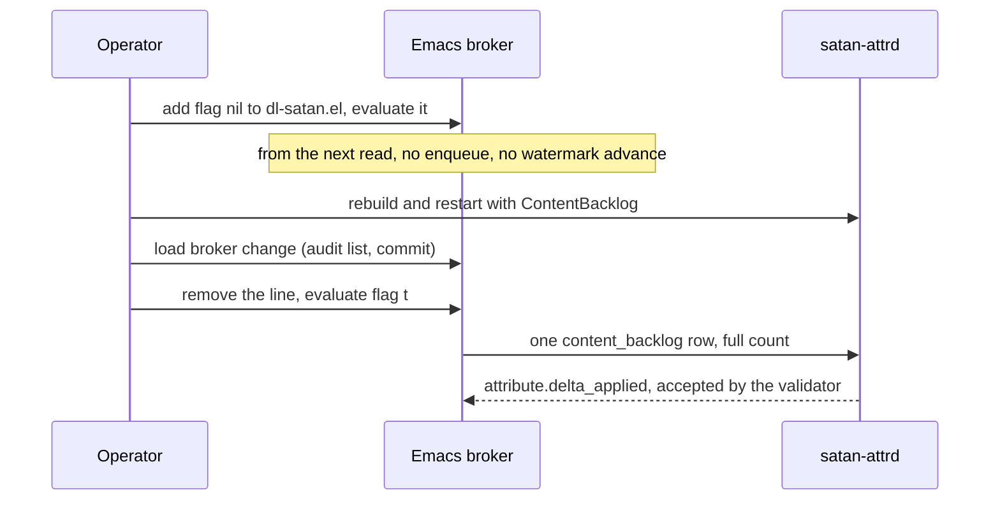

<!-- doctrine:section sec-1 -->
## What changes

SATAN's content probe reports uninspected panopticon page captures with the sensor reason `content_backlog`. The attribute daemon, `satan-attrd`, has no such reason, so it deletes each row. The broker then advances the probe's watermark anyway, so the evidence is consumed as well as discarded (`ISS-011`, `RFC-021` F1).

This design adds the reason to the daemon and the contract, so the signal lands. It keeps the existing backlog by turning the probe off until the daemon is deployed, using the flag that already exists. It also fixes the one remaining way this probe consumes evidence it failed to deliver: a failed insert.

| | Today | Target |
|---|---|---|
| Daemon on `content_backlog` | Parse fails, row deleted | Parsed, Curiosity +0.025, event row written |
| Broker audit validator | Rejects the reason | Accepts the reason |
| Watermark after a failed insert | Advances; evidence lost | Stays; next probe retries |
| Contract §6S | Omits the reason and its evidence values | Declares them |

The boundary is narrow. There is no broker-side hold and no vocabulary list shared between broker and daemon (`DEC-148`). Protection against the next reason skew belongs to `RFC-021` O1.

<!-- doctrine:section sec-2 -->
## Invariants

- **The watermark marks delivered evidence.** The content probe advances it only after the insert succeeded. Delivery here means the row reached the inbox; the daemon's verdict is not visible to the broker. Delivery is at least once: if the insert succeeds and the watermark write then fails, the next probe reports the same captures again.
- **The watermark compares `captured_at` with `captured_at`.** It stores the highest `captured_at` string seen, never the broker's clock, so comparisons stay within one format. This rule is `DR-005` DEC-5 in the frozen `.emacs.d` corpus; it is restated here because that record is not reachable from this repo.
- **`probe-read` stays free of side effects.** All writes remain in `probe-commit`, which runs only for a child that reached `ready`.
- **The delta does not scale.** `metric_value` is evidence only, as for every sensor reason (`DEC-149`).
- **The row stays non-zero.** The dispatcher skips attributes with a zero base delta, so an all-zero row would write no event and lose the signal again.

<!-- doctrine:section sec-3 -->
## Broker

### Content probe commit

`satan-sensor-content-probe-commit` ignores the result of `satan-attribute-enqueue`, which returns `(ok . ID)` or `(error . MSG)` rather than signalling. It becomes:

```elisp
(defun satan-sensor-content-probe-commit (snapshot)
  "..."
  (condition-case err
      (when (plist-get snapshot :emit)
        (require 'satan-attribute)
        (pcase (satan-attribute-enqueue (plist-get snapshot :payload))
          (`(ok . ,_)
           (satan-sensor-content-mark-inspected (plist-get snapshot :high-water))
           t)
          (result
           (message "[satan-sensor-content] enqueue failed, watermark kept: %S" result)
           nil)))
    (error
     (message "[satan-sensor-content] probe-commit soft-failed: %S" err)
     nil)))
```

The second arm matches anything that is not `ok`, so an unexpected result keeps the watermark. The function still returns non-nil only when a signal was emitted, and it stays soft-failing, so `satan-broker--commit-frontiers` is unchanged. The next probe recounts the same captures, so a failed insert costs timeliness only.

The curiosity and wpm probes have the same flaw and do not change here.

### Audit validator

`satan-audit-attribute-sensor-reasons` in `satan/satan-audit.el` gains `"content_backlog"`. Without it the listener rejects the daemon's `attribute.delta_applied` event for the new reason. The delta and the event row are already in Postgres by then, so the rejection costs the transcript line, and only the daemon logs it, as `broker rejected attribute.delta_applied`. This is a hand edit, as SL-016 made for the ask reasons. `satan-audit--validate-attribute-sensor-evidence` checks field types only, so it needs no change.

<!-- doctrine:section sec-4 -->
## Daemon and contract

### `satan-attrd`

`parse_sensor_payload` validates the reason against `SensorReason` and takes `sensor_type` and `metric_unit` as free strings. It also requires `run_id`, `ts`, a numeric `metric_value` and a boolean `enabled`; `satan-attribute-build-sensor-payload` supplies all of them, and the other sensors use the same builder. The reason is therefore the only blocker. The live rejection cannot confirm this, because the reason is parsed before the later fields, so a test does.

- `src/types.rs`: `SensorReason::ContentBacklog`, `as_str` → `"content_backlog"`, the `FromStr` arm, and the variant added to the round-trip test's literal array. That test lists variants by hand, so it stays green if this is forgotten.
- `src/tuning.rs`: `SensorReason::ContentBacklog => [TINY, 0.0, 0.0, 0.0, 0.0, 0.0, 0.0, 0.0]`. The match is exhaustive, so the compiler forces this row.
- `src/dispatcher.rs` tests: one row-shape test, one `dispatch_sensor_content_backlog_affects_only_curiosity` test following the existing pattern, and one test that starts Curiosity at exactly 1.0 and still gets an event carrying `RangeClamp`.
- `src/run_loop.rs` tests: `parse_sensor_payload` accepts a payload with the probe's real field values. The function is private, so the test goes in that file's `mod tests`.

No migration: `reason` is `TEXT NOT NULL` with no CHECK.

### `docs/attributes/design-contract.md`

- **§6S.1:** add `content_backlog`, triggered when panopticon page captures exist that SATAN has not inspected.
- **§6S.2 table:** add the row with Δ curiosity +0.025, all others 0.
- **§6S.2 preamble:** state that `content_backlog` fires once per tick that finds captures newer than the watermark, and that `metric_value` never scales it. The watermark advance suppresses repeats, so it does not fire every tick while old captures sit unread. This is more exact than `DEC-149`'s "per-event while the backlog persists".
- **§6S.5:** add `panopticon_content_backlog` to `sensor_type` and `uninspected_captures` to `metric_unit`.
- **§16:** add a dated entry recording the reason, the delta, the measured Curiosity saturation, and that attrd deploys before the flag is re-enabled.

<!-- doctrine:section sec-5 -->
## Release sequence

This diagram shows the order that preserves the backlog across the two repos. The order is an operator procedure; nothing in code enforces it.

The flag defaults to `t` and a live `setq` does not survive a restart, so the interim setting lives in the Emacs config: `(satan-sensor-content-enabled nil)` under `:custom` in `apps/dl-satan.el`, with a live `setq` as well, and not saved through Customize. Removing that line and evaluating `(setq satan-sensor-content-enabled t)` is the re-enable step. The flag takes effect at the next `probe-read`: a tick already past its read still commits, once.



The broker change must be loaded before the flag returns, or the validator rejects the daemon's event. Because the flag is off until then, the daemon and broker changes can land in either order. The elisp runs from the live tree, so loading it means evaluating the changed files or restarting Emacs; a restart is safe because the config holds the flag. `satan-attrd` is a local `path:` flake input.

The flag is off only for the interim. The final state has it on.

<!-- doctrine:section sec-6 -->
## Code impact (design targets)

| Path | Change |
|---|---|
| `satan/satan-sensor-content.el` | `probe-commit` advances only on `(ok . ID)`; docstring updated |
| `satan/satan-audit.el` | `content_backlog` added to the sensor reason list |
| `satan/test/satan-sensor-content-test.el` | New failure tests; every advancing test stubs enqueue to return `(ok . 1)`, including the three that call the real enqueue today |
| `satan/test/satan-audit-attribute-test.el` | New reason added to the accepted-reasons loop |
| `docs/attributes/design-contract.md` | §6S.1, §6S.2, §6S.5, §16 |
| `satan-attrd/src/{types,tuning,dispatcher,run_loop}.rs` | External repo: reason, delta row, tests (`run_loop.rs` tests only) |
| `apps/dl-satan.el` in the Emacs config | Operator act, not a commit of this slice: the interim flag line, added then removed |

`satan/satan-attribute.el` and `satan/satan-attribute-render.el` do not change.

<!-- doctrine:section sec-7 -->
## Verification

Automated, broker (`just check`):

- `satan-sensor-content/commit-enqueue-error-keeps-watermark`: an `(error . "db down")` result leaves the watermark unchanged and `probe-commit` returns nil.
- `satan-sensor-content/commit-then-reprobe-after-error-recounts`: after a failed commit, the next `probe-read` reports the same count and high-water.
- Every test that expects the watermark to advance stubs enqueue to return `(ok . 1)`, so none depends on a reachable inbox.
- The accepted-reasons loop in `satan-audit-attribute-test.el` covers `content_backlog`.

Automated, daemon (`just` targets in the devshell):

- The round-trip test includes the new variant.
- `content_backlog` parses from a payload with the probe's real field values.
- Dispatch produces exactly one Curiosity event with base +0.025 and changes no other attribute.
- With Curiosity at exactly 1.0, dispatch still produces that event, carrying `RangeClamp`.

Host checks, recorded on `ISS-011`:

- With the flag nil, and allowing one in-flight tick, the watermark stops moving and rejections stop in the journal. It stays nil after an Emacs restart.
- After re-enabling, `satan_attribute_events` has a `content_backlog` row whose `evidence_json` carries the accumulated count, the watermark advances, and the parse-failure line for this reason stops. Use `rg` with a positive control for the journal search.
- The broker accepted the event: that run's `transcript.jsonl` has an `attribute.delta_applied` line with reason `content_backlog`, and the `satan-attrd` journal has no `broker rejected attribute.delta_applied` line in that window. The reason must be matched, because other sensors write the same event to the same file. The line exists only in the daemon's journal; the broker logs nothing on a rejection. `satan_audit_replies` is not evidence, because the daemon deletes those rows after logging them.

The event row proves the daemon half only; it exists whether or not the broker's list was widened. Neither half is a movement in Curiosity, which may be clamped at its ceiling.

<!-- doctrine:section sec-8 -->
## Risks and follow-ups

- **Skew can recur.** Until O1 ships, a reason emitted before the daemon accepts it is deleted, and the watermark moves on. Deploying the daemon first stays a manual rule.
- **The daemon's verdict remains invisible.** The new check proves the row reached the inbox, not that it was accepted.
- **Curiosity is saturated.** It reached 1.000 on each of the 15 days to 2026-11-07, so this row is effectively telemetry and adds about 0.2/day of nominal pressure (`DEC-149`, `ISS-066`).
- **Sibling probes.** Curiosity and wpm still advance after a failed insert. O1 owns the general fix.
- **Duplicate report.** A watermark write that fails after a good insert repeats one row on the next tick. The order of those two steps is unchanged, and the cost is one extra evidence row, so no dedupe key is added.
- **§6S.2's "state-transition-based" claim** also misdescribes `segment_backlog`, which fires about 23 times a day. This slice corrects only its own reason.
- **`docs/attributes/wiring-status.md`** duplicates the reason list and is not normative. It stays out of scope (`RFC-021` O7a).
- **Timestamp comment.** The probe says `captured_at` is UTC-millis-Z, but rows since June carry an offset. Lexical order can slip after a daylight-saving fall-back, for an hour, or after a timezone change, for the size of the shift; a capture in that window may go uncounted once.

